# Notes Chat App — Django Course

An educational project: from HTTP to a production-ready Django application with a WebSocket chat.

---

## Course architecture

```mermaid
graph LR
    A["01 Web Foundations"] --> B["02 Django Core"]
    B --> C["03 DB & ORM"]
    C --> D["04 Forms"]
    D --> E["05 Frontend"]
    E --> F["06 Architecture"]
    F --> G["07 Auth & Security"]
    G --> H["08 Testing"]
    H --> I["09 Async & Realtime"]
    I --> J["10 Linux & DevOps"]
    J --> K["11 Deployment"]
    K --> L["12 Final Project"]

    classDef step     fill:#eceff1,stroke:#546e7a,stroke-width:1px;
    classDef success  fill:#e8f5e9,stroke:#2e7d32,stroke-width:2px;

    class A,B,C,D,E,F,G,H,I,J,K step;
    class L success;
```

---

## Where to start?

| Type | Path |
|-----|---------|
| Beginner | [00. Getting started](00_getting_started/README.md) → Book (01–11) → [Project](12_final_project/README.md) |
| I want practice | [Tutorials](tutorials/README.md) or [Labs](labs/README.md) |
| I need a reference | [Reference](reference/README.md) · [Glossary](GLOSSARY.md) · [Troubleshooting](TROUBLESHOOTING.md) |

---

## What you will learn to build

Notes Chat App is a full-featured Django application with:

- **Notes** — CRUD, tags, priorities, reminders
- **Group chat** — WebSocket via Django Channels + Uvicorn (ASGI)
- **Authentication** — registration, login, sessions, permissions
- **Tests** — unit, integration, consumer (WebSocket), Selenium E2E
- **CI/CD** — GitHub Actions, Docker Compose, PostgreSQL

---

## Course structure

| Section | Topics |
|--------|------|
| [Book](00_getting_started/README.md) | 12 sequential modules, from Web basics to deployment |
| [Notes Chat App](12_final_project/README.md) | Architecture, models, tests, and deployment of the final project |
| [Practice](tutorials/README.md) | Tutorials and labs with hands-on exercises |
| [Reference](reference/README.md) | Cheatsheets, glossary, troubleshooting |
| [For teachers](TEACHING_GUIDE.md) | Teaching paths, learning path |
