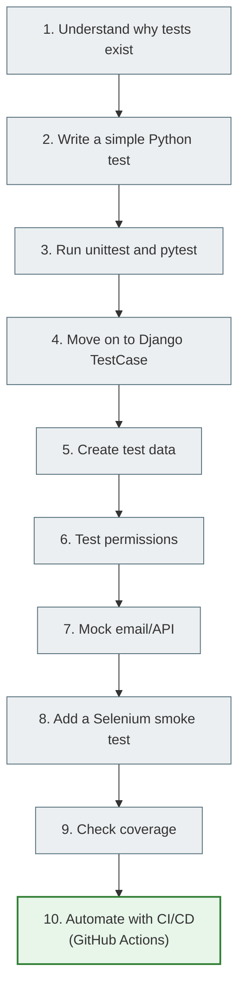

# Testing in Python and Django: a beginner's guide

> After this file you will understand how to go through the lesson, which files to read first, what exactly you need to be able to do by hand, and how tests relate to a real Django project.

---

## 1. Why you need this

Imagine an ordinary situation: you added an `is_archived` field to the note model. Seems like a small thing. But after that, the following may break:

- the note list;
- the creation form;
- the edit page;
- the "active notes" filter;
- access permissions;
- a template that expected a different set of fields.

Without tests you check this by hand. You open the browser, log in, create a note, edit it, delete it, look at the admin. Once is fine. Ten times a day is already tiring. In a week you will forget to check something.

Tests are needed so that the program performs some of the checks by itself.

An important thought:

> Tests do not prove that a program is perfect. They give you enough confidence to change code without being afraid of every line.

This lesson is for a student who already knows a bit of Python/Django and wants to move from "I just run the site and look at it with my eyes" to "I write checks that can be run many times".

---

## 2. Mental model

Tests are not "yet another Python syntax". They are a way of thinking.

Imagine a house with an alarm system:

- the alarm does not build walls;
- it does not make the doors stronger;
- it does not catch every possible problem;
- but when something important is breached, it gives a signal quickly.

It is the same with code. A test does not make your function correct automatically. But it pins down the expected behavior:

```text
I expect that:
if the user is not logged in,
then the note creation page will redirect them to login.
```

After that, the test can be run after every change. If the behavior breaks, the test fails.

---

## 3. What the student should be able to do after the lesson

After going through the whole lesson, you should be able to:

| Skill | What it means in practice |
|---|---|
| Write a simple unit test | Test the function `add()`, `calculate_total()`, `slugify_title()` |
| Run tests | `python -m unittest`, `pytest`, `python manage.py test` |
| Read a test failure | Understand what was expected and what was received |
| Test a Django model | Check `__str__`, custom methods, ownership |
| Test a Django form | Check valid/invalid data, `form.errors`, `cleaned_data` |
| Test a Django view | Check the status code, redirect, template, context |
| Test permissions | Check that User A cannot edit User B's data |
| Create test data | With an object in the test, `setUp()`, `setUpTestData()`, fixtures |
| Use mock | Don't send a real email and don't call an external API |
| Write a Selenium E2E smoke test | Login -> create note -> note appears in browser |
| Run coverage | See which parts of the code were executed during the tests |

---

## 4. A 2-minute basic example

Create the file `math_utils.py`:

```python
def add(a, b):
    return a + b
```

Create the file `test_math_utils.py`:

```python
from math_utils import add


def test_add_two_numbers():
    result = add(2, 3)

    assert result == 5
```

Run:

```bash
pytest
```

What happened here:

| Part | What it does |
|---|---|
| `add(2, 3)` | Calls the code under test |
| `result` | Stores the actual result |
| `assert result == 5` | Compares reality with the expectation |
| `pytest` | Finds the test and runs it |

If you change the function to an incorrect one:

```python
def add(a, b):
    return a - b
```

the test will fail. And that's good. The test shows: "the behavior is no longer what we expected".

---

## 5. How to read this lesson

Don't read it all like a dry book. Every file has to be worked through by hand.

The recommended way:

1. Read the "Why you need this" section.
2. Retype the code by hand.
3. Run the command.
4. Deliberately break the code.
5. See how the test fails.
6. Fix the code.
7. Answer the self-check questions.

If you only read and don't run anything, the topic will seem abstract.

---

## 6. Testing levels

| Level | What it checks | Speed | Example |
|---|---|---|---|
| Unit test | A single function or method | Very fast | `calculate_total(10, 2) == 20` |
| Integration test | The interaction of several parts | Medium | A Form saves a Model to the test database |
| Functional test | Behavior from the point of view of a scenario | Medium/slow | Login -> create note |
| E2E / Selenium | A real browser and the whole user journey | Slow | Firefox opens the site, enters data, clicks |
| Regression test | An old bug has not come back | Depends on the level | A test for an already fixed bug |

The mental pyramid:

```text
        E2E / Selenium
      integration tests
    unit tests
```

Why it is like this:

- unit tests should be the foundation: there are many of them, they are cheap and fast;
- integration tests check that the parts work together;
- E2E tests give high confidence, but they are slow and fragile, so there should be few of them.

---

## 7. Three levels of understanding

| Level | Name | What the student should understand |
|---:|---|---|
| 1 | What it is and how to use it | How to write a simple test and run it |
| 2 | How it works inside | How the test runner finds tests, creates the test database, executes assertions |
| 3 | Architectural consequences | Why code with pure functions, services, and explicit dependencies is easier to test |

An example of an architectural conclusion:

Bad for testing:

```python
def create_note(request):
    # here HTTP, the form, email, the database, and business logic are all together
    ...
```

Better:

```python
def create_note_for_user(user, title, content):
    note = Note.objects.create(owner=user, title=title, content=content)
    send_note_created_email(user.email)
    return note
```

The second option is easier to test: you can test the service separately, the view separately, and the email separately via a mock.

---

## 8. Lesson file map

| File | Level | What's inside | What to do by hand |
|---|---:|---|---|
| [TESTING_FOUNDATIONS.md](../../08_testing_and_quality/testing_foundations_full.md) | 1 | Philosophy, bug, regression, assertion, the pyramid | Write your first simple test case |
| [UNITTEST_BASICS.md](../../08_testing_and_quality/unittest_basics_full.md) | 2 | `unittest`, `TestCase`, assert methods, `setUp()` | Run `python -m unittest` |
| [PYTEST_BASICS.md](../../08_testing_and_quality/pytest_basics_full.md) | 2 | `pytest`, fixtures, parametrization, `pytest-django` | Run `pytest`, write a fixture |
| [DJANGO_TESTING.md](../../08_testing_and_quality/django_testing_full.md) | 3 | `TestCase`, test database, Client, templates, permissions | Test a model/form/view |
| [TEST_DATA_AND_FIXTURES.md](../../08_testing_and_quality/test_data_and_fixtures_full.md) | 3 | Test data, `setUp`, `setUpTestData`, factories | Remove duplication of test data |
| [MOCKING_AND_PATCHING.md](../../08_testing_and_quality/mocking_and_patching_full.md) | 4 | `mock`, `patch`, email/API/payment | Mock the email service |
| [TESTING_PRACTICE_PROJECT.md](../../08_testing_and_quality/testing_practice_project_full.md) | 4 | A full notes project, Selenium, Docker, coverage | Assemble a full test suite |
| [SELENIUM.md](../../08_testing_and_quality/selenium_full.md) | 3 | WebDriver, By strategies, waits, StaticLiveServerTestCase, session cookie trick | Run your first Selenium script |
| [CI_CD.md](../../08_testing_and_quality/ci_cd_full.md) | 4 | CI/CD, GitHub Actions, `django-tests.yml` line by line | Review a workflow run in GitHub Actions |

---

## 9. Mermaid diagram of the student's path



---

## 10. Quick start

If you are short on time, take the minimal route:

1. [TESTING_FOUNDATIONS.md](../../08_testing_and_quality/testing_foundations_full.md) up to the section on AAA.
2. [PYTEST_BASICS.md](../../08_testing_and_quality/pytest_basics_full.md) up to the first fixture.
3. [DJANGO_TESTING.md](../../08_testing_and_quality/django_testing_full.md) up to the model/form/view tests.
4. [TESTING_PRACTICE_PROJECT.md](../../08_testing_and_quality/testing_practice_project_full.md) sections 1-5.
5. [SELENIUM.md](../../08_testing_and_quality/selenium_full.md) up to the section on the session cookie trick.

The full route:

1. all files in order;
2. retype every example by hand;
3. deliberately break every test once;
4. [SELENIUM.md](../../08_testing_and_quality/selenium_full.md) — work through WebDriver, By strategies, waits, the session cookie trick;
5. at the end, add tests to your own Django project;
6. [CI_CD.md](../../08_testing_and_quality/ci_cd_full.md) — automate running the tests with GitHub Actions.

---

## 11. Common beginner mistakes

| Mistake | Why it happens | How to fix it |
| ------- | ------------ | ------------ |
| Reading tests as theory | It seems everything is clear without running it | Run every example |
| Writing only the happy path | A beginner wants to prove that the code works | Add invalid data, permissions, edge cases |
| Using Selenium for everything | A browser test looks "the most real" | Selenium only for critical paths |
| Mocking everything in sight | You want to isolate the code completely | Mock the external boundaries: email, API, payment |
| Chasing 100% coverage | The number looks like quality | Check the substance of the assertions |

---

## 12. Practice

1. Create a `testing_playground` folder.
2. Write a function `calculate_total(price, quantity)`.
3. Write a test for the normal case.
4. Write a test for `quantity = 0`.
5. Deliberately break the function and see what a test failure looks like.
6. Explain in your own words: what exactly this test proved and what it did not prove.

---

## 13. Self-check questions

1. Why do tests increase confidence but not prove that a program is perfect?
2. Why should unit tests be fast?
3. Why shouldn't you write E2E tests for every small button?
4. What is a regression test?
5. Why does code that is easy to test often have a better architecture?
