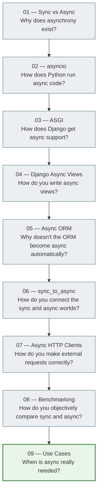

# Asynchronous Django: from the basics to production

> A series of learning documents for students of the Python/Django course.
> Topic: asynchronous programming — from Python asyncio to real Django projects.

---

## Who this lesson is for

This lesson is for you if:

- you already know basic Python (functions, classes, loops);
- you have started learning Django and understand what a view, the ORM, and request/response are;
- you have heard the word "async" but don't yet fully understand why it exists and how it works.

After this lesson you will understand not just the syntax, but **why** async exists and **when** it is really worth using.

---

## Lesson map

---

## File table

| No. | File | Topic | What the student will understand |
|---|------|------|---------------------|
| 1 | [01_sync_vs_async.md](../../09_async_and_realtime/async_01_sync_vs_async_full.md) | Synchronous vs asynchronous execution | Why async exists and what blocking is |
| 2 | [02_asyncio.md](../../09_async_and_realtime/async_02_asyncio_full.md) | Python asyncio | How a coroutine, await, and the event loop work together |
| 3 | [03_asgi.md](../../09_async_and_realtime/async_03_asgi_full.md) | WSGI and ASGI | Why Django needs ASGI for real async |
| 4 | [04_django_async_views.md](../../09_async_and_realtime/async_04_django_async_views_full.md) | Django Async Views | How to write an async def view and when it is useful |
| 5 | [05_async_orm.md](../../09_async_and_realtime/async_05_async_orm_full.md) | Async ORM | Why an async view does not make the ORM asynchronous automatically |
| 6 | [06_sync_to_async.md](../../09_async_and_realtime/async_06_sync_to_async_full.md) | sync_to_async | How to safely connect sync and async code in Django |
| 7 | [07_async_http_clients.md](../../09_async_and_realtime/async_07_async_http_clients_full.md) | Async HTTP Clients | Why `requests` blocks and how to use `httpx` |
| 8 | [08_benchmarking.md](../../09_async_and_realtime/async_08_benchmarking_full.md) | Benchmarking | How to correctly measure sync vs async performance |
| 9 | [09_async_use_cases.md](../../09_async_and_realtime/async_09_async_use_cases_full.md) | Real-world Use Cases | When async is really needed and when it is not |

---

## Recommended reading order

**Read in order** — from `01` to `09`. Each next document builds on the previous one.

If you only want the Django practice, skip the deep asyncio part and read:
`01` → `03` → `04` → `05` → `06` → `09`

---

## What you need to know before you start

- [ ] Basic Python syntax: functions, classes, loops, dictionaries
- [ ] What a Django view is (at least minimally)
- [ ] What an HTTP request / response is
- [ ] What a database and an ORM are (at the level of `User.objects.get(id=1)`)

---

## What you will be able to do afterwards

- [ ] Explain the difference between sync and async execution
- [ ] Write an async def view in Django
- [ ] Make async ORM queries correctly (`aget`, `async for`)
- [ ] Wrap sync code with `sync_to_async`
- [ ] Make several external API requests in parallel with `httpx` and `gather`
- [ ] Understand when async is really needed and when it is overengineering

---

## Important warning

> **Async ≠ "always faster".**
>
> Asynchrony is a tool for specific tasks. If you add `async def` everywhere without understanding it, you are not improving the code — you are adding complexity.
>
> This lesson will explain **when** this tool is really needed.
