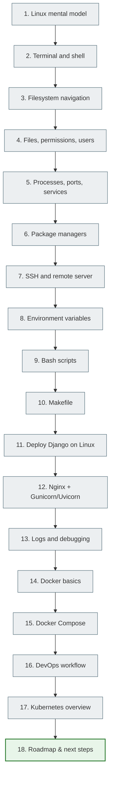

# Linux and DevOps basics for a Python/Django developer

> This module is for students who already know basic Python and want to understand how their code lives on a real server. You will learn to find your way around the Linux terminal, deploy Django projects, understand Docker, and read the basic DevOps map.

---

## Who this lesson is for

This lesson is for you if:

- you know basic Python and Django;
- you have already written simple web applications, but still run them only locally;
- the Linux terminal scares you or seems mysterious;
- you want to understand how code gets from a laptop to a real server;
- you have heard the words "Docker", "Nginx", "SSH", "CI/CD" and want to finally figure out what they are.

---

## What you need to know before you start

| What you need | Why |
|---|---|
| Basic Python (functions, classes, modules) | The examples will be in Python |
| What a Django project is | The `settings.py` file, `manage.py`, apps |
| A basic understanding of HTTP (request/response) | To understand Nginx and deployment |
| WSL installed or access to Ubuntu | To practice the commands |

---

## Table of all files

| No. | File | Topic | What the student will understand |
|---|------|------|---------------------|
| 1 | [`01_linux_mental_model.md`](../../10_linux_and_devops/linux_01_mental_model_full.md) | The Linux mental model | Why a web developer needs Linux, what a server is |
| 2 | [`02_terminal_and_shell.md`](../../10_linux_and_devops/linux_02_terminal_and_shell_full.md) | Terminal and shell | How to read commands, stdin/stdout, exit codes |
| 3 | [`03_filesystem_navigation.md`](../../10_linux_and_devops/linux_03_filesystem_navigation_full.md) | The file system | Directory structure, navigation, basic operations |
| 4 | [`04_files_permissions_users.md`](../../10_linux_and_devops/linux_04_files_permissions_users_full.md) | Permissions and users | chmod, chown, sudo, reading `ls -l` |
| 5 | [`05_processes_ports_services.md`](../../10_linux_and_devops/linux_05_processes_ports_services_full.md) | Processes, ports, services | ps, systemd, ss, kill, foreground/background |
| 6 | [`06_package_managers_and_software.md`](../../10_linux_and_devops/linux_06_package_managers_and_software_full.md) | Package managers | apt vs pip, venv, installing software |
| 7 | [`07_ssh_and_remote_server.md`](../../10_linux_and_devops/linux_07_ssh_and_remote_server_full.md) | SSH and connecting to a server | Keys, connecting, scp, rsync |
| 8 | [`08_environment_variables_and_secrets.md`](../../10_linux_and_devops/linux_08_environment_variables_and_secrets_full.md) | Environment variables and secrets | .env, SECRET_KEY, what must not be committed |
| 9 | [`09_bash_scripts.md`](../../10_linux_and_devops/linux_09_bash_scripts_full.md) | Bash scripts | Automating commands, shebang, variables |
| 10 | [`10_makefile_basics.md`](../../10_linux_and_devops/linux_10_makefile_basics_full.md) | Makefile | Command shortcuts, target/recipe |
| 11 | [`11_deploy_django_on_linux.md`](../../11_deployment/deploy_11_django_on_linux_full.md) | Deploying Django on Linux | Step-by-step deployment from git clone to launch |
| 12 | [`12_nginx_gunicorn_uvicorn.md`](../../11_deployment/deploy_12_nginx_gunicorn_uvicorn_full.md) | Nginx, Gunicorn, Uvicorn | Reverse proxy, WSGI vs ASGI |
| 13 | [`13_logs_monitoring_debugging.md`](../../11_deployment/deploy_13_logs_monitoring_debugging_full.md) | Logs and debugging | journalctl, tail, the "site won't open" checklist |
| 14 | [`14_docker_basics.md`](../../11_deployment/deploy_14_docker_basics_full.md) | Docker basics | Image, container, Dockerfile, port mapping |
| 15 | [`15_docker_compose.md`](../../11_deployment/deploy_15_docker_compose_full.md) | Docker Compose | Running Django + PostgreSQL with a single command |
| 16 | [`16_devops_workflow.md`](../../11_deployment/deploy_16_devops_workflow_full.md) | DevOps workflow | CI/CD, pipeline, staging, production |
| 17 | [`17_kubernetes_overview.md`](../../11_deployment/deploy_17_kubernetes_overview_full.md) | Kubernetes overview | Cluster, pod, deployment — an overview without going deep |
| 18 | [`18_roadmap_next_steps.md`](../../11_deployment/deploy_18_roadmap_next_steps_full.md) | Roadmap and next steps | Where to go next after this lesson |

---

## Mermaid map of the lesson

---

## How to go through the lesson

**Recommended order:** read the files by number — from 01 to 18. The structure goes from simple to complex. Each file builds on the previous one.

**How to read each file:**

1. Read the "Why you need this" section.
2. Type the commands in the terminal — don't just read, do.
3. Deliberately try to make a mistake and see what happens.
4. Answer the self-check questions in your own words.

**Minimal route** (if you are short on time):

1. `01_linux_mental_model.md`
2. `02_terminal_and_shell.md`
3. `03_filesystem_navigation.md`
4. `07_ssh_and_remote_server.md`
5. `11_deploy_django_on_linux.md`
6. `14_docker_basics.md`
7. `15_docker_compose.md`

**Full route:** all 18 files, with practical exercises in each.

---

## What the student will be able to do afterwards

After this module you will be able to:

- connect to a Linux server via SSH;
- find your way around the file system and not be afraid of the terminal;
- run a Django project on a real server;
- read logs and understand what went wrong;
- write a simple Bash script for automation;
- write a Makefile with commands for the project;
- run Django + PostgreSQL with Docker Compose;
- explain what Nginx is and why it sits between the user and Django;
- understand the basic DevOps map (CI/CD, pipeline, staging, production);
- know why Kubernetes exists and when it is needed.

---

> The main idea: Linux is the environment where most backend applications live. After this lesson you will stop being afraid of it and understand how your Python code lives on a real server.
