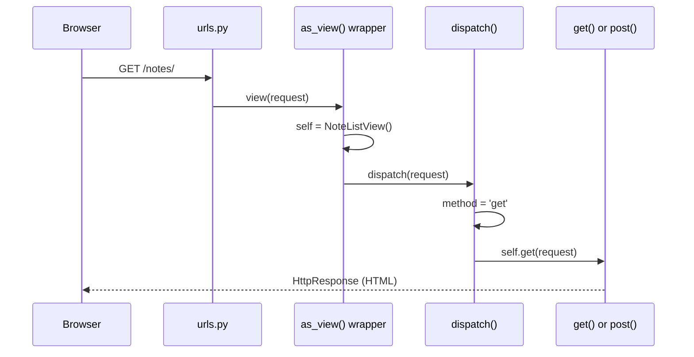
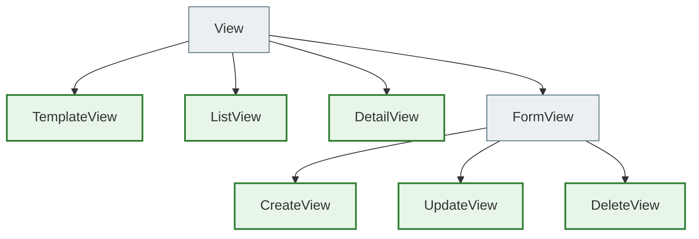
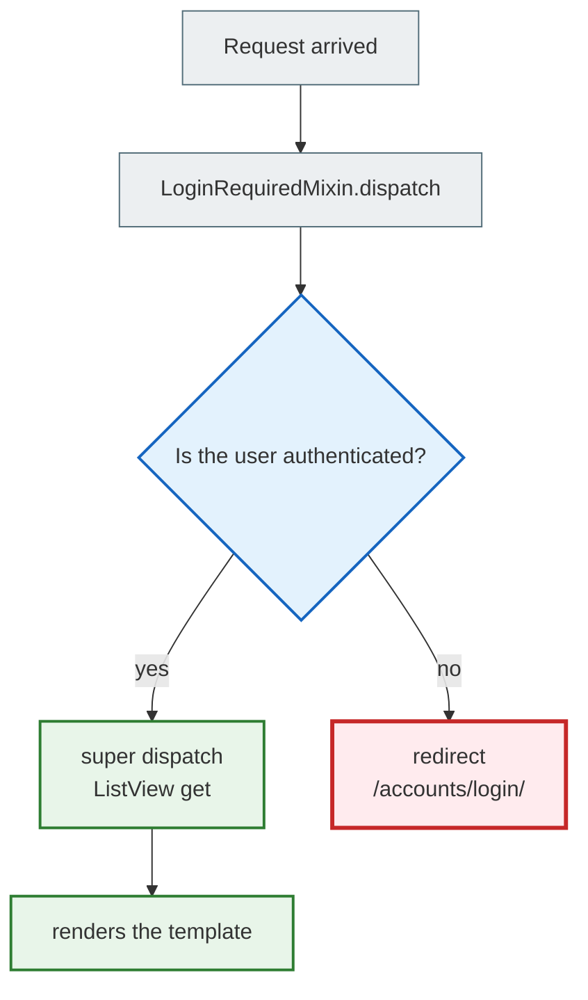

# Class-Based Views (CBV)

> **Chapter structure:** first, complete working FBVs (function-based views) for note CRUD.
> Then — how duplication appears when Notebook views are added.
> Then — CBV as an upgrade: the same result, less code.
>
> **What changes in the transition:** only `views.py` and `urls.py`.
> models, forms, selectors, services, templates — no changes at all.

---

## Part 1 — Complete FBV code (working code)

Here is the real working views code for notes. Read it as the "starting point" — everything works here.

```python
# notes_app/views.py — Function-Based Views for notes
from django.shortcuts import render, redirect, get_object_or_404
from django.contrib.auth.decorators import login_required
from django.contrib import messages
from django.http import Http404
from django.db.models import Q

from . import forms, services, selectors
from .models import Note, Notebook, Tag


@login_required
def note_list(request):
    # Parse GET parameters for filtering
    search = request.GET.get('q', '').strip()
    tag_id = request.GET.get('tag')
    notebook_id = request.GET.get('notebook')

    # Validate the ids — check access rights
    tag = None
    if tag_id:
        try:
            tag = Tag.objects.get(id=int(tag_id), user=request.user)  # user=! reject other users' tags
        except (Tag.DoesNotExist, ValueError):
            pass

    notebook = None
    if notebook_id:
        try:
            notebook = Notebook.objects.get(id=int(notebook_id), user=request.user)
        except (Notebook.DoesNotExist, ValueError):
            pass

    # Delegate reading to a selector
    notes = selectors.get_user_notes(request.user, search=search or None, tag=tag, notebook=notebook)
    notebooks = selectors.get_user_notebooks(request.user)
    tags = selectors.get_user_tags(request.user)

    return render(request, 'notes_app/note_list.html', {
        'notes': notes,
        'notebooks': notebooks,
        'tags': tags,
        'search': search,
        'active_tag': tag,
        'active_notebook': notebook,
    })


@login_required
def note_detail(request, pk):
    try:
        note = selectors.get_note_detail(request.user, pk)
    except Note.DoesNotExist:
        raise Http404("Нотатку не знайдено")

    return render(request, 'notes_app/note_detail.html', {'note': note})


@login_required
def note_create(request):
    if request.method == 'POST':
        form = forms.NoteForm(request.POST, user=request.user)
        if form.is_valid():
            tags = form.cleaned_data.get('tags')
            tag_ids = [t.id for t in tags] if tags else None
            note = services.create_note(
                user=request.user,
                title=form.cleaned_data['title'],
                content=form.cleaned_data.get('content', ''),
                priority=form.cleaned_data.get('priority', 1),
                notebook=form.cleaned_data.get('notebook'),
                tag_ids=tag_ids,
            )
            messages.success(request, f'Нотатку "{note.title}" створено!')
            return redirect('notes_app:note_detail', pk=note.pk)
    else:
        form = forms.NoteForm(user=request.user)

    return render(request, 'notes_app/note_form.html', {
        'form': form,
        'title': 'Нова нотатка',
        'action': 'Створити',
    })


@login_required
def note_edit(request, pk):
    # get_object_or_404 — get the note or 404 (Alice cannot see Bob's notes)
    note = get_object_or_404(Note, pk=pk, user=request.user)

    if request.method == 'POST':
        form = forms.NoteForm(request.POST, instance=note, user=request.user)
        if form.is_valid():
            tags = form.cleaned_data.get('tags')
            tag_ids = [t.id for t in tags] if tags else []
            services.update_note(
                note,
                title=form.cleaned_data['title'],
                content=form.cleaned_data.get('content', ''),
                priority=form.cleaned_data.get('priority', note.priority),
                notebook=form.cleaned_data.get('notebook'),
                is_pinned=form.cleaned_data.get('is_pinned', note.is_pinned),
                tag_ids=tag_ids,
            )
            messages.success(request, f'Нотатку "{note.title}" оновлено!')
            return redirect('notes_app:note_detail', pk=note.pk)
    else:
        form = forms.NoteForm(instance=note, user=request.user)

    return render(request, 'notes_app/note_form.html', {
        'form': form,
        'note': note,
        'title': f'Редагувати: {note.title}',
        'action': 'Зберегти зміни',
    })


@login_required
def note_delete(request, pk):
    note = get_object_or_404(Note, pk=pk, user=request.user)

    if request.method == 'POST':
        title = note.title
        services.delete_note(note)
        messages.warning(request, f'Нотатку "{title}" видалено.')
        return redirect('notes_app:note_list')

    return render(request, 'notes_app/note_confirm_delete.html', {'note': note})
```

```python
# notes_app/urls.py — FBV url config
from django.urls import path
from . import views

app_name = 'notes_app'

urlpatterns = [
    path('notes/', views.note_list, name='note_list'),
    path('notes/new/', views.note_create, name='note_create'),
    path('notes/<int:pk>/', views.note_detail, name='note_detail'),
    path('notes/<int:pk>/edit/', views.note_edit, name='note_edit'),
    path('notes/<int:pk>/delete/', views.note_delete, name='note_delete'),
]
```

**This code works completely.** For many projects it is enough. So when does the need for CBV arise?

---

## Part 2 — The problem: duplication when adding Notebook views

Let's add CRUD for notebooks. Compare the code:

```python
# Notebook views — the same pattern, again and again:

@login_required
def notebook_list(request):
    notebooks = selectors.get_user_notebooks(request.user)
    return render(request, 'notes_app/notebook_list.html', {'notebooks': notebooks})


@login_required
def notebook_create(request):
    if request.method == 'POST':          # ← the same if POST/else
        form = NotebookForm(request.POST)
        if form.is_valid():               # ← the same is_valid() check
            notebook = services.create_notebook(
                user=request.user,
                title=form.cleaned_data['title'],
                color=form.cleaned_data.get('color', '#4A90E2'),
            )
            messages.success(request, f'Записник "{notebook.title}" створено!')
            return redirect('notes_app:notebook_list')
    else:
        form = NotebookForm()

    return render(request, 'notes_app/notebook_form.html', {'form': form})


@login_required
def notebook_edit(request, pk):
    notebook = get_object_or_404(Notebook, pk=pk, user=request.user)  # ← the same auth check!
    if request.method == 'POST':
        form = NotebookForm(request.POST, instance=notebook)
        if form.is_valid():
            services.update_notebook(notebook, **form.cleaned_data)
            messages.success(request, f'Записник "{notebook.title}" оновлено!')
            return redirect('notes_app:notebook_list')
    else:
        form = NotebookForm(instance=notebook)
    return render(request, 'notes_app/notebook_form.html', {'form': form, 'notebook': notebook})


@login_required
def notebook_delete(request, pk):
    notebook = get_object_or_404(Notebook, pk=pk, user=request.user)  # ← the same thing again!
    if request.method == 'POST':
        services.delete_notebook(notebook)
        messages.warning(request, f'Записник "{notebook.title}" видалено.')
        return redirect('notes_app:notebook_list')
    return render(request, 'notes_app/notebook_confirm_delete.html', {'notebook': notebook})
```

**Repetition table:**

```
Note views        Notebook views    Tag views
─────────────     ──────────────    ─────────
@login_required   @login_required   @login_required   ← 3 times
if method POST    if method POST    if method POST    ← 3 times
is_valid()        is_valid()        is_valid()        ← 3 times
get_object_or_404 get_object_or_404 (forgotten!)      ← a security hole

If you forget get_object_or_404(Notebook, user=request.user) in one place →
  Alice sees/edits Bob's notebooks.
```

> **The problem is not the number of lines, it is security.** The `get_object_or_404(Model, pk=pk, user=request.user)` pattern is an access-rights check. If you repeat it by hand 12 times (5 Note + 5 Notebook + Tag + ...), there is a risk of forgetting it in one place.

**The solution: CBV with `UserQuerySetMixin`** — the access check is described once.

---

## Part 3 — CBV as an upgrade: less code, the same result

### What CBVs are and why

**FBV (Function-Based Views)** — a view as a function:

```python
def note_list(request):
    notes = Note.objects.filter(user=request.user)
    return render(request, 'note_list.html', {'notes': notes})
```

**CBV (Class-Based Views)** — a view as a class:

```python
class NoteListView(LoginRequiredMixin, ListView):
    model = Note
    template_name = 'hello_app/note_list.html'
    context_object_name = 'notes'
```

### Why CBV?

| Problem with FBV | Solution with CBV |
|----------------|---------------|
| `@login_required` has to be put on _every_ function | `LoginRequiredMixin` once in the class |
| `Note.objects.filter(user=request.user)` is repeated in 5 places | `UserQuerySetMixin.get_queryset()` — once |
| `if request.method == 'POST': form = ...; if form.is_valid(): ...` — boilerplate code | `CreateView`/`UpdateView` do this automatically |
| No standard way to extend the logic | We override hooks: `get_queryset()`, `form_valid()`, `get_context_data()` |

> **Important:** CBVs do not replace the architecture. Selectors/Services stay where they were — only the calls moved from functions into class methods.

---

## Step 1 — The CBV contract: `as_view()` and `dispatch()`

### Why you cannot put a class directly into `urls.py`

The Django router expects a **callable** (a function):

```python
# ❌ DOES NOT WORK — NoteListView is a class, not a callable
path('notes/', views.NoteListView, name='note_list')

# ✅ CORRECT — .as_view() returns a callable wrapper function
path('notes/', views.NoteListView.as_view(), name='note_list')
```

### What `as_view()` does

`as_view()` is a **classmethod** that Django calls once when the server starts. It returns an ordinary wrapper function `view`. On every HTTP request this function:

1. Creates a **new instance** of the class (a new one every time — thread-safe!)
2. Copies `request`, `args`, `kwargs` onto the instance
3. Calls `instance.dispatch(request, *args, **kwargs)`

```python
# Simplified pseudocode of what as_view() does inside Django:
@classmethod
def as_view(cls, **initkwargs):
    def view(request, *args, **kwargs):
        self = cls(**initkwargs)          # 1. a new instance
        self.request = request            # 2. copy the request
        self.args = args
        self.kwargs = kwargs
        return self.dispatch(request, *args, **kwargs)  # 3. dispatch
    return view
```

### What `dispatch()` does

`dispatch()` is the **main router** of a CBV. It looks at the HTTP method of the request and delegates the call to the corresponding method of the class:

```python
# Pseudocode of dispatch() from the base View:
def dispatch(self, request, *args, **kwargs):
    method = request.method.lower()          # 'get', 'post', 'put', ...
    handler = getattr(self, method, None)    # self.get, self.post, ...
    if handler:
        return handler(request, *args, **kwargs)
    return HttpResponseNotAllowed(...)       # 405 Method Not Allowed
```

### Sequence diagram: from the browser request to the method



---

## Step 2 — Generic Views: the hierarchy

Django ships ready-made CBVs for typical CRUD operations — **Generic Views**.

### Class hierarchy



### What each Generic View does automatically

| Generic View | GET | POST | Key attributes |
|---|---|---|---|
| `TemplateView` | renders the template | — | `template_name` |
| `ListView` | gets the list via `get_queryset()`, renders | — | `model`, `template_name`, `context_object_name` |
| `DetailView` | gets one object via `get_object()`, renders | — | `model`, `template_name`, `context_object_name` |
| `CreateView` | renders an empty form | validates → `form_valid()` or `form_invalid()` | `model`, `form_class`, `template_name` |
| `UpdateView` | renders the form with `instance=object` | validates → `form_valid()` or `form_invalid()` | the same + loads `get_object()` |
| `DeleteView` | renders the confirmation | deletes → `success_url` | `model`, `template_name`, `success_url` |

### Class attributes instead of arguments

In FBVs, parameters were passed into the function or hardcoded inside it. In CBVs we declare them as **class attributes**:

```python
class NoteListView(LoginRequiredMixin, ListView):
    model = Note                              # ← which model to use
    template_name = 'hello_app/note_list.html'  # ← which template to render
    context_object_name = 'notes'            # ← what to call the list in the template
                                             #   (instead of the default 'object_list')
```

---

## Step 3 — `LoginRequiredMixin` and the MRO

### FBV: the `@login_required` decorator

```python
from django.contrib.auth.decorators import login_required

@login_required
def note_list(request):
    ...
```

### CBV: `LoginRequiredMixin` — first in the list of base classes

```python
from django.contrib.auth.mixins import LoginRequiredMixin

class NoteListView(LoginRequiredMixin, ListView):
    ...
```

### Why the order in the parentheses is critical

Python determines the method lookup order through the **MRO (Method Resolution Order)**. When Django calls `dispatch()`, Python looks it up along the MRO from left to right:

```
NoteListView → LoginRequiredMixin → ListView → View
```

`LoginRequiredMixin.dispatch()` checks authentication **first** — before `ListView.dispatch()` does anything at all.

```python
# ✅ CORRECT: LoginRequiredMixin first → the auth check comes FIRST
class NoteListView(LoginRequiredMixin, UserQuerySetMixin, ListView):
    ...

# ❌ WRONG: ListView first → the auth check comes AFTER the data is loaded
class NoteListView(UserQuerySetMixin, ListView, LoginRequiredMixin):
    ...
```

### Flowchart: the authentication check



> By default the redirect is `/accounts/login/?next=/notes/`. You can change it via `login_url` and `redirect_field_name` on the class.

---

## Step 4 — `UserQuerySetMixin`: DRY data isolation

### The problem: duplicating the user filter

Without a mixin, every `Detail`, `Update`, `Delete` view has to repeat:

```python
# In NoteDetailView:
queryset = Note.objects.filter(user=self.request.user)

# In NoteUpdateView:
queryset = Note.objects.filter(user=self.request.user)

# In NoteDeleteView:
queryset = Note.objects.filter(user=self.request.user)
```

This is not just code repetition — **it is a security hole**: if you forget it in one place, Alice will see Bob's notes.

### The solution: a custom mixin

```python
class UserQuerySetMixin:
    """
    A mixin for automatically filtering the QuerySet by the current user.
    """
    def get_queryset(self):
        # super().get_queryset() → returns model.objects.all()
        # .filter(user=...) → restrict to this user's objects only
        return super().get_queryset().filter(user=self.request.user)
```

### How Django uses `get_queryset()` for protection

`DetailView`, `UpdateView`, `DeleteView` load the object via `get_object()`:

```python
# Pseudocode of get_object() in DetailView:
def get_object(self, queryset=None):
    queryset = self.get_queryset()        # ← our filtered queryset!
    pk = self.kwargs.get('pk')
    return queryset.get(pk=pk)           # SQL: WHERE id=pk AND user_id=current_user
```

If Alice tries to open Bob's note (`/notes/42/`):
- `get_queryset()` returns `Note.objects.filter(user=Alice)`
- `get_object()` does `.get(pk=42)` on this queryset
- SQL: `SELECT * FROM note WHERE id=42 AND user_id=<Alice_id>` → nothing found
- Django raises `Note.DoesNotExist` → `Http404`

**Alice sees a 404, not Bob's data.**

### MRO with UserQuerySetMixin

```python
class NoteDetailView(LoginRequiredMixin, UserQuerySetMixin, DetailView):
    ...

# Python MRO:
# NoteDetailView → LoginRequiredMixin → UserQuerySetMixin → DetailView → View
#
# When get_queryset() is called:
#   1. It finds UserQuerySetMixin.get_queryset()
#   2. super().get_queryset() → goes further → DetailView.get_queryset()
#   3. DetailView.get_queryset() → returns Note.objects.all()
#   4. UserQuerySetMixin adds .filter(user=self.request.user)
#   Result: Note.objects.all().filter(user=self.request.user)
```

---

## Step 5 — `ListView`: a list of notes with filters

```python
class NoteListView(LoginRequiredMixin, ListView):
    model = Note
    template_name = 'hello_app/note_list.html'
    context_object_name = 'notes'   # instead of the default 'object_list'
```

### `get_queryset()` — which collection to return

In the FBV we read GET parameters directly in the function. In a CBV we do it in `get_queryset()` via `self.request.GET`:

```python
def get_queryset(self):
    self._get_filters()       # parse GET params once (cache on self)
    return selectors.get_user_notes(
        self.request.user,
        search=self.search or None,
        tag=self.active_tag,
        notebook=self.active_notebook,
    )
```

> The architecture is preserved: the selector does all the ORM logic. `get_queryset()` only delegates.

### `get_context_data()` — which data to pass to the template

`ListView` automatically adds to the context:
- `notes` (or `object_list`) — the result of `get_queryset()`
- `page_obj` — if there is pagination
- `is_paginated` — a boolean

We **extend** the context via `super()`:

```python
def get_context_data(self, **kwargs):
    self._get_filters()
    ctx = super().get_context_data(**kwargs)   # ← already contains 'notes'!
    ctx['notebooks'] = selectors.get_user_notebooks(self.request.user)
    ctx['tags'] = selectors.get_user_tags(self.request.user)
    ctx['search'] = self.search
    ctx['active_tag'] = self.active_tag
    ctx['active_notebook'] = self.active_notebook
    return ctx
```

**Always** call `super().get_context_data(**kwargs)` and add to the dictionary — do not replace it.

### `_get_filters()` — a private helper for DRY

Both methods (`get_queryset` and `get_context_data`) need the same GET parameters. To avoid parsing them twice — a private helper with caching on `self`:

```python
def _get_filters(self):
    if hasattr(self, '_filters_parsed'):   # already parsed earlier
        return
    self._filters_parsed = True

    self.search = self.request.GET.get('q', '').strip()

    tag_id = self.request.GET.get('tag')
    self.active_tag = None
    if tag_id:
        try:
            # check access rights! user=request.user
            self.active_tag = Tag.objects.get(id=int(tag_id), user=self.request.user)
        except (Tag.DoesNotExist, ValueError):
            pass   # invalid id → simply ignore it
```

---

## Step 6 — `DetailView`: object detail

```python
class NoteDetailView(LoginRequiredMixin, UserQuerySetMixin, DetailView):
    model = Note
    template_name = 'hello_app/note_detail.html'
    context_object_name = 'note'
```

### What `DetailView` does automatically

1. Reads `pk` from `self.kwargs['pk']` (from the URL pattern `<int:pk>`)
2. Calls `get_object()` → `get_queryset().get(pk=pk)`
3. Passes the object to the template as `'note'` (our `context_object_name`)
4. Renders `template_name`
5. If not found → 404 automatically

### Overriding `get_object()` for Prefetch

In our project the selector loads the note with `Prefetch(to_attr='upcoming_reminders')`. So we override `get_object()` to use the selector instead of the standard `queryset.get(pk=pk)`:

```python
def get_object(self, queryset=None):
    try:
        return selectors.get_note_detail(self.request.user, self.kwargs['pk'])
    except Note.DoesNotExist:
        raise Http404("Нотатку не знайдено")
```

### `get_context_data()` — adding reminders

```python
def get_context_data(self, **kwargs):
    ctx = super().get_context_data(**kwargs)
    # upcoming_reminders is set via Prefetch(to_attr=) in the selector
    ctx['reminders'] = getattr(self.object, 'upcoming_reminders', [])
    return ctx
```

`self.object` is the loaded object (always available after `get_object()`).

---

## Step 7 — `CreateView` and `get_form_kwargs()`

```python
class NoteCreateView(LoginRequiredMixin, CreateView):
    model = Note
    form_class = NoteForm
    template_name = 'hello_app/note_form.html'
```

### What `CreateView` does automatically

**GET request:**
1. `get_form()` → `form_class(**get_form_kwargs())` → an empty form
2. `get_context_data()` → adds `{'form': form}`
3. Renders the template

**POST request:**
1. `get_form()` → a form with `data=request.POST`
2. `form.is_valid()`:
   - `True` → calls `form_valid(form)`
   - `False` → calls `form_invalid(form)` → renders the template with errors

### The problem: how to pass `user=` into the form

`NoteForm.__init__` needs `user=` to filter the QuerySet for the `notebook` and `tags` fields.

### The solution: `get_form_kwargs()`

```python
def get_form_kwargs(self):
    kwargs = super().get_form_kwargs()
    # super() returns: {'data': request.POST, 'files': request.FILES, ...}
    kwargs['user'] = self.request.user   # ← add user=
    return kwargs
    # Result: NoteForm(data=POST, files=FILES, user=request.user)
```

### `get_initial()` — initial values for the form

`TagCreateView` supports `?name=python` — it pre-fills the field:

```python
def get_initial(self):
    initial = super().get_initial()
    name = self.request.GET.get('name')
    if name:
        initial['name'] = name
    return initial
```

`get_initial()` returns a dictionary of initial values. `CreateView` passes them into the form as `initial=`.

---

## Step 8 — `UpdateView`: editing with an instance

```python
class NoteUpdateView(LoginRequiredMixin, UserQuerySetMixin, UpdateView):
    model = Note
    form_class = NoteForm
    template_name = 'hello_app/note_form.html'
```

### What `UpdateView` does automatically (compared with `CreateView`)

`UpdateView` does everything `CreateView` does, plus:

- Before rendering on GET: loads the existing object via `get_object()`
- Passes `instance=object` into the form → all fields are pre-filled
- `UserQuerySetMixin.get_queryset()` → 404 if the object belongs to someone else

### `get_form_kwargs()` — passing `user=`

```python
def get_form_kwargs(self):
    kwargs = super().get_form_kwargs()
    kwargs['user'] = self.request.user
    return kwargs
    # Result: NoteForm(data=POST, instance=note, user=request.user)
```

### `get_context_data()` — breadcrumbs

```python
def get_context_data(self, **kwargs):
    ctx = super().get_context_data(**kwargs)
    ctx['note'] = self.object           # for breadcrumbs in the template
    ctx['action'] = 'Зберегти зміни'
    ctx['title'] = f'Редагувати: {self.object.title}'
    return ctx
```

---

## Step 9 — `DeleteView`: safe deletion only via POST

```python
class NoteDeleteView(LoginRequiredMixin, UserQuerySetMixin, DeleteView):
    model = Note
    template_name = 'hello_app/note_confirm_delete.html'
    success_url = reverse_lazy('hello_app:note_list')
    context_object_name = 'note'
```

### Why DELETE only via POST?

**Deleting via GET violates HTTP semantics:**

```
GET /notes/42/delete/   ← Dangerous!
```

- The browser may **prefetch** these URLs — it would delete without a click!
- A search bot crawls links — it would delete every record!
- `` in an email — it would delete on opening!

**`DeleteView` automatically requires POST for the actual deletion:**
- `GET` → renders the confirmation page ("Are you sure?")
- `POST` → deletes and redirects

### `form_valid()` — the POST confirmation hook

```python
def form_valid(self, form):
    note = self.get_object()
    title = note.title    # save it BEFORE deleting!
    services.delete_note(note)
    messages.warning(self.request, f'Нотатку "{title}" видалено.')
    return redirect(self.success_url)
```

> We save `title` before `services.delete_note()` — after deletion `note.title` may be unavailable.

---

## Step 10 — `get_success_url()` and `reverse_lazy`

### Option 1: `success_url` — a static URL

```python
class NoteDeleteView(..., DeleteView):
    success_url = reverse_lazy('hello_app:note_list')
```

**Why `reverse_lazy` and not `reverse()`?**

`success_url = reverse('hello_app:note_list')` is executed **when the class is loaded** (when Django starts), before the URL patterns are registered. This leads to `NoReverseMatch`.

`reverse_lazy('hello_app:note_list')` is executed **lazily**, only when the attribute is actually needed (during a request). By then the URL patterns are already registered.

### Option 2: `get_success_url()` — a dynamic URL

```python
# In TagCreateView: we support the ?next= parameter
def get_success_url(self):
    return self._get_next_url()

def _get_next_url(self):
    return (
        self.request.GET.get('next')     # ?next= in GET
        or self.request.POST.get('next') # next in the POST form
        or 'hello_app:note_create'       # default if there is none
    )
```

### Comparison

| | `success_url` | `get_success_url()` |
|---|---|---|
| When | the static URL is known in advance | the URL depends on the object or the request |
| Example | the list of notebooks | the detail of a just-created note |
| `reverse_lazy` | required | not needed (called during the request) |

---

## Step 11 — Services architecture in CBVs

### `form_valid()` instead of `form.save()`

**Key rule:** if you have `services.py`, **never** call `super().form_valid()` in `CreateView`/`UpdateView` — inside it there is `form.save()`, which bypasses your business logic.

```python
class NoteCreateView(LoginRequiredMixin, CreateView):
    ...

    def form_valid(self, form):
        # ❌ WE DO NOT DO THIS: super().form_valid(form) → form.save() is in there!

        # ✅ DELEGATE to a service — transaction.atomic() and business rules live there
        tags = form.cleaned_data.get('tags')
        tag_ids = [t.id for t in tags] if tags else None

        note = services.create_note(
            user=self.request.user,
            title=form.cleaned_data['title'],
            content=form.cleaned_data.get('content', ''),
            priority=form.cleaned_data.get('priority', 1),
            notebook=form.cleaned_data.get('notebook'),
            tag_ids=tag_ids,
        )
        messages.success(self.request, f'Нотатку "{note.title}" створено!')
        return redirect('hello_app:note_detail', pk=note.pk)
```

### Full table of hooks

| Hook | Where we override it | What for |
|---|---|---|
| `get_queryset()` | `ListView`, `UserQuerySetMixin` | which collection to return |
| `get_object()` | `NoteDetailView` | loading with Prefetch via a selector |
| `get_context_data()` | all | additional data for the template |
| `get_form_kwargs()` | `NoteCreateView`, `NoteUpdateView` | pass `user=` into the form |
| `get_initial()` | `TagCreateView` | initial field values |
| `form_valid()` | all `Create`/`Update`/`Delete` | call a service instead of `form.save()` |
| `get_success_url()` | `TagCreateView` | dynamic redirect after saving |

---

## Step 12 — CBVs in `urls.py`

```python
# hello_app/urls.py
from django.urls import path
from . import views

app_name = "hello_app"

urlpatterns = [
    path('', views.IndexView.as_view(), name='index'),

    # Notes
    path('notes/', views.NoteListView.as_view(), name='note_list'),
    path('notes/new/', views.NoteCreateView.as_view(), name='note_create'),
    path('notes/<int:pk>/', views.NoteDetailView.as_view(), name='note_detail'),
    path('notes/<int:pk>/edit/', views.NoteUpdateView.as_view(), name='note_edit'),
    path('notes/<int:pk>/delete/', views.NoteDeleteView.as_view(), name='note_delete'),

    # Notebooks
    path('notebooks/', views.NotebookListView.as_view(), name='notebook_list'),
    path('notebooks/new/', views.NotebookCreateView.as_view(), name='notebook_create'),
    path('notebooks/<int:pk>/edit/', views.NotebookUpdateView.as_view(), name='notebook_edit'),
    path('notebooks/<int:pk>/delete/', views.NotebookDeleteView.as_view(), name='notebook_delete'),

    # Tags
    path('tags/new/', views.TagCreateView.as_view(), name='tag_create'),
]
```

### `IndexView` — a base `View` without Generic

```python
class IndexView(View):
    """The simplest CBV — the base View."""
    def get(self, request):
        return HttpResponse("Hello, Django ORM!")
```

The base `View` does not render a template automatically — you have to implement `get()` and `post()` by hand. It suits simple pages or API endpoints.

---

## FBV → CBV quick comparison

### List

```python
# FBV
@login_required
def note_list(request):
    search = request.GET.get('q', '').strip()
    tag_id = request.GET.get('tag')
    tag = None
    if tag_id:
        try:
            tag = Tag.objects.get(id=int(tag_id), user=request.user)
        except (Tag.DoesNotExist, ValueError):
            pass
    notes = selectors.get_user_notes(request.user, search=search or None, tag=tag)
    notebooks = selectors.get_user_notebooks(request.user)
    tags = selectors.get_user_tags(request.user)
    return render(request, 'notes_app/note_list.html', {
        'notes': notes, 'notebooks': notebooks, 'tags': tags, 'search': search,
    })

# CBV — keeps the same logic, but structured
class NoteListView(LoginRequiredMixin, ListView):
    model = Note
    template_name = 'notes_app/note_list.html'
    context_object_name = 'notes'

    def _get_filters(self):
        if hasattr(self, '_filters_parsed'):
            return
        self._filters_parsed = True
        self.search = self.request.GET.get('q', '').strip()
        tag_id = self.request.GET.get('tag')
        self.active_tag = None
        if tag_id:
            try:
                self.active_tag = Tag.objects.get(id=int(tag_id), user=self.request.user)
            except (Tag.DoesNotExist, ValueError):
                pass

    def get_queryset(self):
        self._get_filters()
        return selectors.get_user_notes(self.request.user, search=self.search or None, tag=self.active_tag)

    def get_context_data(self, **kwargs):
        self._get_filters()
        ctx = super().get_context_data(**kwargs)
        ctx['notebooks'] = selectors.get_user_notebooks(self.request.user)
        ctx['tags'] = selectors.get_user_tags(self.request.user)
        ctx['search'] = self.search
        ctx['active_tag'] = self.active_tag
        return ctx
```

### Create

```python
# FBV — 14 lines
@login_required
def note_create(request):
    if request.method == 'POST':
        form = NoteForm(request.POST, user=request.user)
        if form.is_valid():
            tags = form.cleaned_data.get('tags')
            tag_ids = [t.id for t in tags] if tags else None
            note = services.create_note(
                user=request.user,
                title=form.cleaned_data['title'],
                content=form.cleaned_data.get('content', ''),
                priority=form.cleaned_data.get('priority', 1),
                notebook=form.cleaned_data.get('notebook'),
                tag_ids=tag_ids,
            )
            messages.success(request, f'Нотатку "{note.title}" створено!')
            return redirect('notes_app:note_detail', pk=note.pk)
    else:
        form = NoteForm(user=request.user)
    return render(request, 'notes_app/note_form.html', {'form': form, 'title': 'Нова нотатка'})

# CBV — the same logic, through hooks
class NoteCreateView(LoginRequiredMixin, CreateView):
    model = Note
    form_class = NoteForm
    template_name = 'notes_app/note_form.html'

    def get_form_kwargs(self):
        kwargs = super().get_form_kwargs()
        kwargs['user'] = self.request.user
        return kwargs

    def form_valid(self, form):
        tags = form.cleaned_data.get('tags')
        tag_ids = [t.id for t in tags] if tags else None
        note = services.create_note(
            user=self.request.user,
            title=form.cleaned_data['title'],
            content=form.cleaned_data.get('content', ''),
            priority=form.cleaned_data.get('priority', 1),
            notebook=form.cleaned_data.get('notebook'),
            tag_ids=tag_ids,
        )
        messages.success(self.request, f'Нотатку "{note.title}" створено!')
        return redirect('notes_app:note_detail', pk=note.pk)

    def get_context_data(self, **kwargs):
        ctx = super().get_context_data(**kwargs)
        ctx['title'] = 'Нова нотатка'
        ctx['action'] = 'Створити'
        return ctx
```

### Update

```python
# FBV — 16 lines
@login_required
def note_edit(request, pk):
    note = get_object_or_404(Note, pk=pk, user=request.user)
    if request.method == 'POST':
        form = NoteForm(request.POST, instance=note, user=request.user)
        if form.is_valid():
            tags = form.cleaned_data.get('tags')
            tag_ids = [t.id for t in tags] if tags else []
            services.update_note(
                note,
                title=form.cleaned_data['title'],
                content=form.cleaned_data.get('content', ''),
                priority=form.cleaned_data.get('priority', note.priority),
                notebook=form.cleaned_data.get('notebook'),
                is_pinned=form.cleaned_data.get('is_pinned', note.is_pinned),
                tag_ids=tag_ids,
            )
            messages.success(request, f'Нотатку "{note.title}" оновлено!')
            return redirect('notes_app:note_detail', pk=note.pk)
    else:
        form = NoteForm(instance=note, user=request.user)
    return render(request, 'notes_app/note_form.html', {'form': form, 'note': note})

# CBV — UserQuerySetMixin automatically ensures a 404 for other users' notes
class NoteUpdateView(LoginRequiredMixin, UserQuerySetMixin, UpdateView):
    model = Note
    form_class = NoteForm
    template_name = 'notes_app/note_form.html'

    def get_form_kwargs(self):
        kwargs = super().get_form_kwargs()
        kwargs['user'] = self.request.user
        return kwargs

    def form_valid(self, form):
        note = self.get_object()
        tags = form.cleaned_data.get('tags')
        tag_ids = [t.id for t in tags] if tags else []
        services.update_note(
            note,
            title=form.cleaned_data['title'],
            content=form.cleaned_data.get('content', ''),
            priority=form.cleaned_data.get('priority', note.priority),
            notebook=form.cleaned_data.get('notebook'),
            is_pinned=form.cleaned_data.get('is_pinned', note.is_pinned),
            tag_ids=tag_ids,
        )
        messages.success(self.request, f'Нотатку "{note.title}" оновлено!')
        return redirect('notes_app:note_detail', pk=note.pk)

    def get_context_data(self, **kwargs):
        ctx = super().get_context_data(**kwargs)
        ctx['title'] = f'Редагувати: {self.object.title}'
        ctx['action'] = 'Зберегти зміни'
        return ctx
```

### Delete

```python
# FBV
@login_required
def note_delete(request, pk):
    note = get_object_or_404(Note, pk=pk, user=request.user)
    if request.method == 'POST':
        title = note.title
        services.delete_note(note)
        messages.warning(request, f'Нотатку "{title}" видалено.')
        return redirect('notes_app:note_list')
    return render(request, 'notes_app/note_confirm_delete.html', {'note': note})

# CBV
class NoteDeleteView(LoginRequiredMixin, UserQuerySetMixin, DeleteView):
    model = Note
    template_name = 'notes_app/note_confirm_delete.html'
    success_url = reverse_lazy('notes_app:note_list')  # reverse_lazy! (not reverse)
    context_object_name = 'note'

    def form_valid(self, form):
        note = self.get_object()
        title = note.title    # save it BEFORE deleting!
        services.delete_note(note)
        messages.warning(self.request, f'Нотатку "{title}" видалено.')
        return redirect(self.success_url)
```

---

## Comparing the approaches

| | FBV | CBV |
|-|-----|-----|
| Readability | You read from top to bottom — obvious | You need to know the hooks and the MRO |
| Duplicating `@login_required` | Repeated on every function | `LoginRequiredMixin` in the base class |
| Access check `get_object_or_404(Model, user=...)` | Repeated in every edit/delete | `UserQuerySetMixin.get_queryset()` — once |
| Testing | `client.get('/notes/')` — simple | The same (the URL does not change) |
| When to choose | Simple views, 1-2 operations | When there are 10+ similar CRUD views |

> **When to switch to CBV:** not with the first note. With 3-4 similar CRUD sets, when `get_object_or_404(..., user=request.user)` is repeated everywhere and there is a risk of forgetting it in one place.

---

## In the book

- [Part III. Database and ORM](../../03_database_and_orm/README.md) — QuerySet, `get_object_or_404`, `select_related`
- [Part VI. Application architecture](../../06_application_architecture/README.md) — services/selectors, thin views, MixIn patterns

---

## Official documentation

- [Django: Class-based views intro](https://docs.djangoproject.com/en/5.2/topics/class-based-views/intro/) — as_view(), dispatch(), Generic Views
- [Django: Generic display views](https://docs.djangoproject.com/en/5.2/ref/class-based-views/generic-display/) — ListView, DetailView
- [Django: Generic editing views](https://docs.djangoproject.com/en/5.2/ref/class-based-views/generic-editing/) — CreateView, UpdateView, DeleteView
- [Django: Mixins](https://docs.djangoproject.com/en/5.2/topics/class-based-views/mixins/) — LoginRequiredMixin, UserPassesTestMixin
- [Django: Method Resolution Order](https://docs.djangoproject.com/en/5.2/topics/class-based-views/mixins/#mixin-classes-and-python-s-method-resolution-order) — MRO and the order of Mixins

---

## Navigation

- Previous: [PostgreSQL](postgresql.md)
- Next: [Checkpoint](checkpoint.md)
