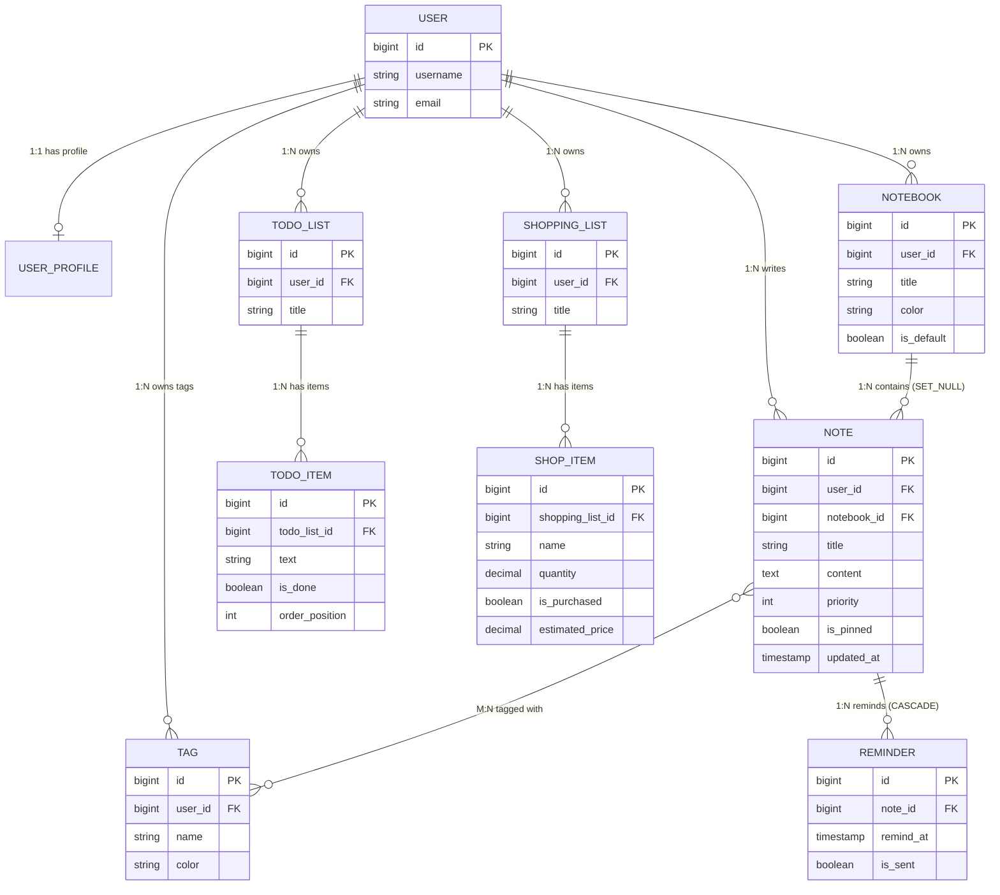
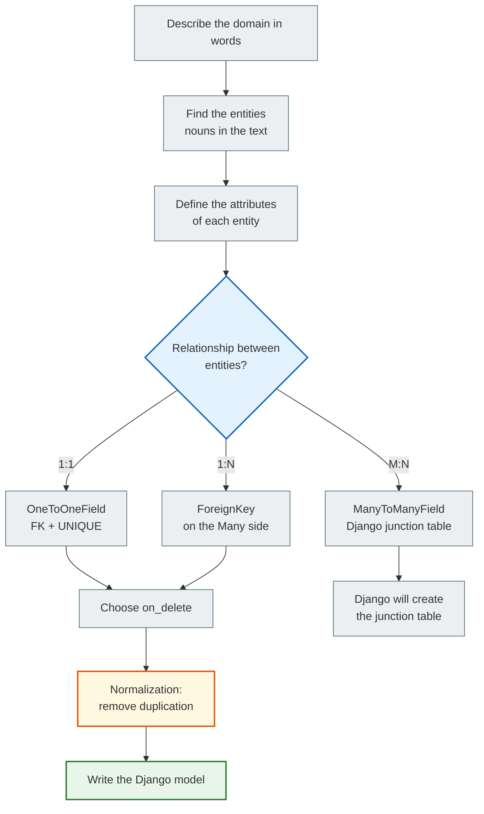

# ER diagrams and relationship types

> Three types of relationships between tables. The question "where does the FK live?" is not a technical one, it is an **architectural** one.

---

## Relationship types

### 1:1 — OneToOneField

> **FK + UNIQUE** · "user has exactly one profile"

```
USER                          USER_PROFILE
┌──────────────┬──────────┐   ┌────────────────┬──────────────────┐
│ id  bigint PK│          │──►│ id    bigint PK│                  │
│ username     │          │   │ user_id bigint │ UNIQUE FK        │
└──────────────┴──────────┘   │ display varchar│                  │
                              │ timezone       │                  │
                              └────────────────┴──────────────────┘
```

```python
class UserProfile(models.Model):
    user = models.OneToOneField(
        User,
        on_delete=models.CASCADE,
        related_name='profile',
    )
    display_name = models.CharField(max_length=60, blank=True)
    timezone     = models.CharField(max_length=40, default='UTC')
    avatar_url   = models.URLField(blank=True)

    def __str__(self):
        return f'Profile({self.user.username})'
```

**The SQL Django generates:**
```sql
CREATE TABLE "hello_app_userprofile" (
    "id"           bigint NOT NULL PRIMARY KEY GENERATED BY DEFAULT AS IDENTITY,
    "user_id"      bigint NOT NULL UNIQUE REFERENCES "auth_user" ("id") ON DELETE CASCADE,
    "display_name" varchar(60) NOT NULL DEFAULT '',
    "timezone"     varchar(40) NOT NULL DEFAULT 'UTC',
    "avatar_url"   varchar(200) NOT NULL DEFAULT ''
);
```

**Reverse — access from User:**
```python
user = User.objects.get(username='alice')
user.profile              # → UserProfile (not a QuerySet! UNIQUE FK → a single object)
user.profile.timezone     # → 'Europe/Kyiv'
```

> **Why is this 1:1?** An ordinary `FK` + `UNIQUE` on the column.
> The reverse is an **attribute** (not a QuerySet): `user.profile`.
> Useful for **vertical partitioning**: 5 basic fields in User, 20 optional ones in Profile — we do not clutter the main table.

**When to use 1:1?**
- "Vertical partitioning": 5 basic fields in User, 20 optional ones in Profile
- Different access patterns: User changes often, Profile rarely → a separate QuerySet
- Different permissions: `view_user` without `view_userprofile`

---

### 1:N — ForeignKey

> **FK on the "Many" side** · "notebook has many notes"

```
NOTEBOOK                    NOTE              NOTE              NOTE
┌──────────┬──────────┐     ┌───────────────────────┐
│ id       │ bigint PK│──┬─►│ id          bigint PK │
│ title    │ varchar  │  │  │ notebook_id bigint FK │← the FK is here!
└──────────┴──────────┘  ├─►│ title       varchar   │
                         │  └───────────────────────┘
                         ├─► (another note)
                         └─► (another note)
```

```python
class Note(models.Model):
    notebook = models.ForeignKey(
        'Notebook',                  # ← a string avoids circular imports
        on_delete=models.SET_NULL,   # Deleting the notebook → NULL (not CASCADE!)
        null=True,                   # NULL is required with SET_NULL
        blank=True,                  # Form: the field is optional
        related_name='notes',        # notebook.notes.all() → QuerySet of notes
    )
```

> **Where does the FK live?** Always on the **Many** side.
> `Notebook` **does not store** a list of notes — `Note` stores `notebook_id`.
> This is the physics of SQL: one column = one value.

```
WRONG way of thinking:         CORRECT way of thinking:
Notebook has a list of notes   Note belongs to Notebook
→ Notebook.notes = [...]      → Note.notebook_id = FK
→ a JOIN will happen           → Notebook.notes.all() = reverse

Notebook does NOT store a list of Note IDs!
That would break the normal form and complicate the JOIN.
```

**Reverse — access from the "One" side:**
```python
notebook = Notebook.objects.get(id=1)
notebook.notes.all()                    # ← related_name='notes' → QuerySet
notebook.notes.filter(is_pinned=True)   # Filter
notebook.notes.count()                  # Count

note = Note.objects.get(id=1)
note.notebook                           # ← FK attr → a Notebook object (or None)
note.notebook_id                        # ← the raw integer FK without a JOIN
note.notebook.title                     # ← JOIN: SELECT ... WHERE notebook_id=...
```

---

### M:N — ManyToManyField

> **Via a junction table** · Django creates it automatically

```
NOTE                  NOTE_TAGS (junction)    TAG
┌──────────┬──────┐   ┌──────────┬──────────┐  ┌──────────┬──────────┐
│ id       │  PK  │──►│ note_id  │ bigint FK│  │ id       │  PK      │
│ title    │      │   │ tag_id   │ bigint FK│─►│ name     │ varchar  │
└──────────┴──────┘   └──────────┴──────────┘  └──────────┴──────────┘
                       UNIQUE(note_id, tag_id)
                       Django: hello_app_note_tags
```

```python
class Note(models.Model):
    tags = models.ManyToManyField(
        'Tag',
        blank=True,              # A note can have no tags
        related_name='notes',    # tag.notes.all() → notes with this tag
    )
    # Django automatically creates the junction table: hello_app_note_tags
```

**M:N operations:**
```python
note = Note.objects.get(id=1)
tag_py = Tag.objects.get(name='python')
tag_dj = Tag.objects.get(name='django')

# Add tags
note.tags.add(tag_py, tag_dj)     # INSERT INTO note_tags (note_id, tag_id)

# The full list
note.tags.all()                    # SELECT * FROM tags JOIN note_tags ...

# Remove a specific tag
note.tags.remove(tag_py)           # DELETE FROM note_tags WHERE ...

# Replace all tags
note.tags.set([tag_dj])           # DELETE the old ones + INSERT the new ones

# Clear them all
note.tags.clear()                  # DELETE FROM note_tags WHERE note_id=...

# Reverse — notes with a tag:
tag_py.notes.all()                 # SELECT * FROM notes JOIN note_tags WHERE tag_id=...
```

> **A junction = a separate table.** There is no magic here — it is an ordinary table with two FKs.
> Want to add `added_at` or `role` to the relationship? Pass `through=` and describe your own junction model.

---

## on_delete — what happens when the parent is deleted?

> **Mistake:** CASCADE as the default for everything → deleting one user can wipe out hundreds of rows.
> Always choose the strategy **deliberately**. It is a business decision, not a technical one.

```python
# CASCADE — delete child records together with the parent
class Reminder(models.Model):
    note = models.ForeignKey(Note, on_delete=models.CASCADE, related_name='reminders')
    # Deleting a Note → all Reminders of that Note are deleted
    # Logic: a Reminder without a Note is meaningless → CASCADE is the right choice

# SET_NULL — the FK becomes NULL, the child record stays
class Note(models.Model):
    notebook = models.ForeignKey(
        Notebook, on_delete=models.SET_NULL,
        null=True, blank=True,  # ← null=True is REQUIRED with SET_NULL
    )
    # Deleting a Notebook → Note.notebook = NULL
    # Logic: the note must be kept! Only the notebook is deleted.

# PROTECT — forbids deletion if there are child records
# (a hypothetical example: in our project Note.tags is M:N, and M:N has no on_delete)
class Note(models.Model):
    category = models.ForeignKey(Category, on_delete=models.PROTECT)
    # Deleting a Category → ProtectedError (an exception)
    # Logic: do not allow a category to be deleted while it is in use

# RESTRICT — similar to PROTECT but allows a cascade from a higher level
# Complex hierarchies, rarely used

# SET_DEFAULT — the FK becomes the default value
class Note(models.Model):
    notebook = models.ForeignKey(
        Notebook, on_delete=models.SET_DEFAULT,
        default=1,  # ← pk of the default notebook
    )

# DO_NOTHING — leaves an orphan record (the FK points to a non-existent id)
# AVOID: leads to IntegrityError or dirty data
```

### The on_delete selection matrix

| Strategy | What it does | When to choose it |
|-----------|-----------|---------------|
| `CASCADE` | Delete the children automatically | `Reminder → Note`: a reminder without a note makes no sense |
| `SET_NULL` | FK → NULL, the children live on | `Note → Notebook`: a note exists without a notebook. The field must be `null=True` |
| `SET_DEFAULT` | FK → the `default` value | `Note → Notebook`: move it to the "Default" notebook |
| `PROTECT` | `ProtectedError`, deletion is forbidden | `Category` (hypothetical): do not allow deleting a category while it is in use |
| `RESTRICT` | Forbid, but allow a cascade from a higher level | Complex domains with several levels of ownership |
| `DO_NOTHING` | The DB decides by itself (often = orphan) | Almost never. Only if you manage consistency manually (triggers) |

**Specifically for the Notes Platform:**

| If you delete... | What do we want with the children? | on_delete |
|------------------|------------------------|-----------|
| Note | Delete the Reminders (they make no sense without the Note) | CASCADE |
| Notebook | Keep the Notes (the note is more important than the notebook) | SET_NULL |
| User | Delete all Notes (the content belongs to the user) | CASCADE |
| Tag | Note.tags is M:N: only the rows in `note_tags` are deleted, the notes stay | — (M:N has no `on_delete`) |

---

## The full schema: 11 tables of the Notes Platform

```
schema_v1 · 11 tables · 1 junction table · postgres-ready
─────────────────────────────────────────────────────────

USER (auth_user)                    USER_PROFILE  ←── 1:1 OneToOne
┌──────────────┬─────────────┐      ┌────────────────┬──────────────────┐
│ id           │ bigint PK   │──┐   │ id             │ bigint PK        │
│ username     │ varchar(150)│  └──►│ user_id        │ bigint UNIQUE FK │
│ email        │ varchar(254)│      │ display_name   │ varchar(60)      │
│ password     │ varchar(128)│      │ timezone       │ varchar(40)      │
│ date_joined  │ timestamp   │      │ avatar_url     │ text             │
└──────────────┴─────────────┘      └────────────────┴──────────────────┘
       │ owns 1:N              │ writes 1:N          │ owns tags 1:N
       ▼                       ▼                     ▼
NOTEBOOK                      NOTE (central)        TAG
┌─────────────┬──────────┐    ┌───────────────┬──────────────────┐    ┌──────────┬───────────────────┐
│ id          │ bigint PK│    │ id            │ bigint PK        │    │ id       │ bigint PK         │
│ user_id     │ bigint FK│    │ user_id       │ bigint FK        │    │ user_id  │ bigint FK         │
│ title       │ varchar  │    │ notebook_id   │ bigint NULL FK   │    │ name     │ varchar(50)       │
│ color       │ varchar  │    │ title         │ varchar(200)     │    │ color    │ varchar(7)        │
│ is_default  │ boolean  │    │ content       │ text             │    └──────────┴───────────────────┘
└─────────────┴──────────┘    │ priority      │ smallint         │     unique_together(user_id, name)
       │ contains 1:N         │ is_pinned     │ boolean          │
       └─────────────────────►│ is_archived   │ boolean          │◄──── M:N via NOTE_TAGS
                              │ created_at    │ timestamp        │
                              │ updated_at    │ timestamp        │
                              │ views_count   │ integer          │
                              └───────────────┴──────────────────┘
                                     │ reminds 1:N
                                     ▼
                              REMINDER                              NOTE_TAGS (junction)
                              ┌────────────────┬──────────────┐     ┌──────────┬────────────┐
                              │ id             │ bigint PK    │     │ note_id  │ bigint FK  │
                              │ note_id        │ bigint FK    │     │ tag_id   │ bigint FK  │
                              │ remind_at      │ timestamp    │     └──────────┴────────────┘
                              │ is_sent        │ boolean      │     UNIQUE(note_id, tag_id)
                              │ repeat_pattern │ varchar(20)  │     Django creates it automatically
                              └────────────────┴──────────────┘

TODO_LIST                     TODO_ITEM
┌─────────────┬──────────┐    ┌────────────────┬──────────────┐
│ id          │ bigint PK│    │ id             │ bigint PK    │
│ user_id     │ bigint FK│───►│ todo_list_id   │ bigint FK    │
│ title       │ varchar  │    │ text           │ varchar(500) │
│ is_completed│ boolean  │    │ is_done        │ boolean      │
└─────────────┴──────────┘    │ order_position │ integer      │
                              │ due_date       │ date NULL    │
                              └────────────────┴──────────────┘

SHOPPING_LIST                 SHOP_ITEM
┌─────────────┬──────────┐    ┌──────────────────┬──────────────────┐
│ id          │ bigint PK│    │ id               │ bigint PK        │
│ user_id     │ bigint FK│───►│ shopping_list_id │ bigint FK        │
│ title       │ varchar  │    │ name             │ varchar(120)     │
│ store_name  │ varchar  │    │ quantity         │ decimal(8,2)     │
└─────────────┴──────────┘    │ unit             │ varchar(5)       │
                              │ is_purchased     │ boolean          │
                              │ estimated_price  │ decimal(10,2)    │
                              └──────────────────┴──────────────────┘
                              ⚠️ DecimalField for money — not FloatField!
```

---

## Mermaid ER diagram



---

## Flowchart: the model design process



---

## Navigation

- Previous: [Domain design](domain_design.md)
- Next: [Django models](models.md)
