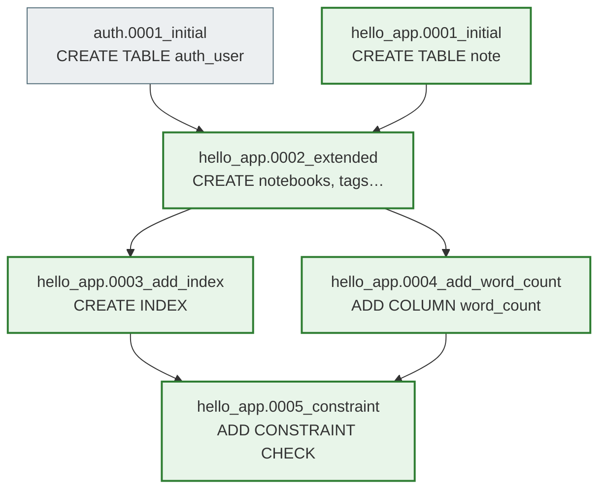
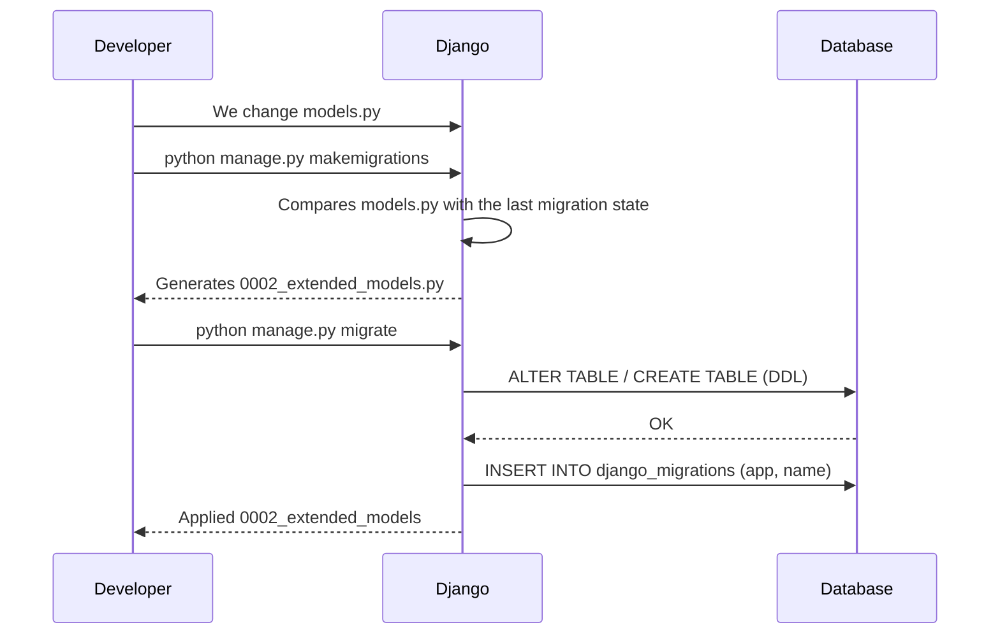

# Migrations

> **"Git for your database schema."**
> Each migration is a commit that describes schema changes. Django tracks which ones have already been applied in `django_migrations`.

---

## Migration Lifecycle — from a model change to ALTER TABLE

```
┌─────────────┐    ┌─────────────────────────────────┐    ┌──────────────────┐
│  Developer  │    │         Django ORM              │    │   PostgreSQL     │
└──────┬──────┘    └──────────────┬──────────────────┘    └────────┬─────────┘
       │                         │                                  │
  1. Changes in models.py        │                                  │
       │                         │                                  │
  2. $ makemigrations ──────────►│                                  │
       │              Compares   │                                  │
       │              models.py  │                                  │
       │              with the   │                                  │
       │              last state │                                  │
       │◄─────────────────────── │                                  │
  3. Receives 0003_add_field.py  │                                  │
       │                         │                                  │
  4. $ sqlmigrate (review)       │                                  │
       │                         │                                  │
  5. $ migrate ─────────────────►│                                  │
       │                         │  ALTER TABLE notes_note ────────►│
       │                         │  ADD COLUMN word_count integer;  │
       │                         │◄──────────────────────────────── │
       │                         │  INSERT INTO django_migrations   │
       │◄─────────────────────── │  (app, name, applied)            │
  6. ✓ Applied 0003_add_field    │                                  │
```

---

## Migration Dependency Graph (DAG)



> **`django_migrations`** is a special log table. `migrate` applies only the nodes
> that are not there yet, in the **topological order** of their dependencies.

---

## Key commands

```bash
# Generate a migration with a descriptive name
python manage.py makemigrations --name add_word_count_to_note

# Preview the SQL before running it (always do this before migrate!)
python manage.py sqlmigrate hello_app 0003

# Apply all new migrations
python manage.py migrate

# Show the state of all migrations (✓ applied, □ not yet)
python manage.py showmigrations

# Roll back to a specific migration
python manage.py migrate hello_app 0002
```

---

## Migration rules

| Rule | Why |
|---------|------|
| ✅ New field: always `default=` or `null=True` | Without a default, what should be written into existing rows? |
| ✅ Descriptive name `--name add_word_count` | `0003_add_word_count` is more readable than `0003_note` |
| ✅ Commit migrations to git | Otherwise your colleagues cannot update their DB |
| ✅ `sqlmigrate` before `migrate` | You check the SQL that will be executed |
| ❌ Editing an applied migration | Production and dev get out of sync — a disaster |
| ❌ Deleting migrations from git | Breaks the dependency graph |

---

## Step 5 — The migration workflow

---
> **Mental model:** Migrations are **Git for your database schema**. Each migration is a "commit" that describes schema changes. Django tracks which migrations have already been applied in the `django_migrations` table. `migrate` runs only the new ones.
>
> **Common mistake:** Editing a migration that has already been applied. If a migration has already been applied in production and you edit it, production and development get out of sync. Changing an applied migration = disaster. If you need a change → create a **new** migration.
---



```bash
# Steps for our project:

# 1. Go to the project folder
cd module_5/lesson_Django_ORM_Database/notes_project

# 2. Check that hello_app is in INSTALLED_APPS
# settings.py → INSTALLED_APPS must contain 'hello_app'

# 3. Generate the first migration
python manage.py makemigrations
# Expected output:
# Migrations for 'hello_app':
#   hello_app/migrations/0001_initial.py
#     - Create model UserProfile, Tag, Notebook, Note, Reminder,
#       TodoList, TodoItem, ShoppingList, ShopItem

# 4. Preview the SQL that will be executed (without running it)
python manage.py sqlmigrate hello_app 0001
# Useful: check column types, FKs, indexes

# 5. Run the migration
python manage.py migrate

# 6. Show the state of all migrations
python manage.py showmigrations
```

Look at what Django generated:

```sql
BEGIN;
CREATE TABLE "hello_app_tag" (
    "id"      bigint NOT NULL PRIMARY KEY,
    "user_id" bigint NOT NULL REFERENCES "auth_user" ("id"),
    "name"    varchar(50) NOT NULL,
    "color"   varchar(7) NOT NULL
);
CREATE UNIQUE INDEX "unique_user_tag" ON "hello_app_tag" ("user_id", "name");
-- ... and so on for every table
COMMIT;
```

### When you need a new migration (adding a field)

```python
# Add a new field to Note
class Note(models.Model):
    ...
    word_count = models.PositiveIntegerField(default=0)  # NEW FIELD
```

```bash
python manage.py makemigrations --name add_word_count_to_note
# → hello_app/migrations/0003_add_word_count_to_note.py

python manage.py sqlmigrate hello_app 0003
# ALTER TABLE "hello_app_note" ADD COLUMN "word_count" integer NOT NULL DEFAULT 0;

python manage.py migrate
```

---

## Step 6 — First run with SQLite

SQLite is ideal for development. Nothing to install.

```bash
# Initialize the DB (SQLite by default)
python manage.py migrate

# Create a superuser for the admin
python manage.py createsuperuser

# Start the server
python manage.py runserver
# http://127.0.0.1:8000/
# http://127.0.0.1:8000/admin/
# http://127.0.0.1:8000/notes/
```

### Testing the models in the Django shell

```bash
python manage.py shell
```

```python
from django.contrib.auth.models import User
from hello_app.models import *

# Create a user
user = User.objects.create_user('alice', 'alice@test.com', 'pass123')

# Profile (OneToOne)
profile = UserProfile.objects.create(user=user, display_name='Alice')
print(user.profile.display_name)  # via related_name

# Notebook
notebook = Notebook.objects.create(user=user, title='Work', is_default=True)

# Tags
tag_py = Tag.objects.create(user=user, name='python', color='#3776AB')
tag_dj = Tag.objects.create(user=user, name='django', color='#092E20')

# A note with tags
note = Note.objects.create(
    user=user, notebook=notebook,
    title='Django ORM', content='QuerySet — lazy evaluation...',
    priority=Note.PRIORITY_HIGH, is_pinned=True
)
note.tags.add(tag_py, tag_dj)  # M:N — INSERT into the junction table

# To-do list
todo = TodoList.objects.create(user=user, title='Learn the ORM')
TodoItem.objects.bulk_create([
    TodoItem(todo_list=todo, text='RELATIONAL_DB_FOUNDATIONS.md', order_position=1),
    TodoItem(todo_list=todo, text='DJANGO_ORM_DEEP.md', order_position=2),
    TodoItem(todo_list=todo, text='Build the project', order_position=3),
])

# Shopping list
shopping = ShoppingList.objects.create(user=user, title='Grocery run')
ShopItem.objects.create(
    shopping_list=shopping, name='Milk',
    quantity=2, unit=ShopItem.UNIT_LITER, estimated_price=45.00
)

print(f"Notes: {user.notes.count()}")
print(f"Tags: {[t.name for t in note.tags.all()]}")
```

---

## Changing a model after the first migration

```bash
# Add a new field:
# views_count = models.PositiveIntegerField(default=0)

python manage.py makemigrations hello_app
# → Migrations for 'hello_app':
#     hello_app/migrations/0002_note_views_count.py
#       - Add field views_count to note

python manage.py migrate
# → Applying hello_app.0002_note_views_count... OK
```

---

## Navigation

- Previous: [Django models](models.md)
- Next: [Services and Selectors](services_and_selectors.md)
