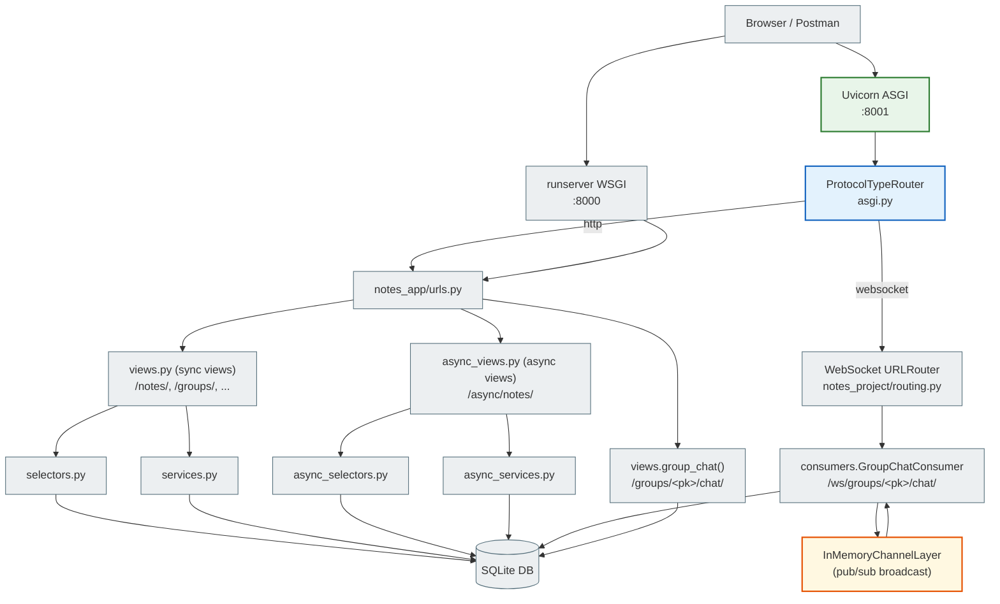
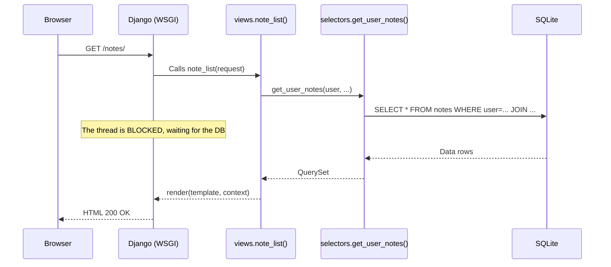
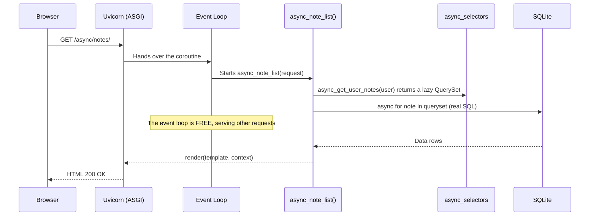

# 7A. Sync vs Async Django: an overview

## What this project is about

This is an already finished Django app for notes (Notes, Notebooks, Tags, TodoList, ShoppingList).
We are **not rewriting it from scratch**: we add async capabilities **alongside** the sync code.

**Two async demonstrations in one project:**

```
# Part 1: Async views (the same result, a different architecture)
http://127.0.0.1:8000/notes/          ← Sync view (classic Django)
http://127.0.0.1:8001/async/notes/    ← Async view (the same result, async ORM)

# Part 2: Real-time chat (here async is the only correct approach)
http://127.0.0.1:8001/groups/<pk>/chat/   ← Group WebSocket chat
```

Async views and the async ORM show **how** to write async code.
The group chat shows **why** async is needed: here sync simply does not fit.

!!! note "Learning status of the async_*.py modules"
    `async_selectors.py`, `async_services.py`, `async_views.py` and `test_async_views.py`
    are created **only within this learning step** to demonstrate Django async views.

    In the final version of **Notes Chat App** these modules are **absent**: all async logic
    is implemented directly in `consumers.py` (Django Channels) without separate async_*.py files.

---

## Project architecture



### File table

| File | Role | Changed? |
|------|------|---------------|
| `models.py` | 10 models: Note, Notebook, Tag, ..., **ChatMessage** | ✅ Added ChatMessage |
| `views.py` | 50+ sync views + **group_chat** | ✅ Added group_chat |
| `selectors.py` | Sync ORM SELECT queries | ❌ Unchanged |
| `services.py` | Sync business logic | ❌ Unchanged |
| `forms.py` | Django Forms | ❌ Unchanged |
| **`async_selectors.py`** | **Async ORM SELECT queries** | **✅ New** |
| **`async_services.py`** | **Async business logic** | **✅ New** |
| **`async_views.py`** | **Async def views** | **✅ New** |
| **`consumers.py`** | **WebSocket Consumer (Django Channels)** | **✅ New** |
| **`tests/test_async_views.py`** | **Async tests** | **✅ New** |
| `urls.py` | URL routing | ✅ Added async URLs + chat |
| `requirements.txt` | Dependencies | ✅ Added uvicorn, httpx, channels |
| `settings.py` | Django configuration | ✅ CHANNEL_LAYERS, channels in INSTALLED_APPS |
| `asgi.py` | ASGI entry point | ✅ ProtocolTypeRouter |
| **`notes_project/routing.py`** | **WebSocket URL patterns** | **✅ New** |
| **`notes_app/static/notes_app/js/group_chat.js`** | **Vanilla JS WebSocket client** | **✅ New** |

---

## The sync version: classic Django

The sync code in this project is standard Django without any changes.

### How a sync request works



### Sync URLs

| URL | Method | View | What it does |
|-----|-------|------|-----------|
| `/notes/` | GET | `note_list` | Note list |
| `/notes/<pk>/` | GET | `note_detail` | Note details |
| `/notes/new/` | GET/POST | `note_create` | Create form |
| `/notes/<pk>/edit/` | GET/POST | `note_edit` | Edit form |
| `/notes/<pk>/delete/` | GET/POST | `note_delete` | Deletion |

---

## The async version: what we added and why

We added new files **without changing** the sync code.
A student can open `views.py` and `async_views.py` side by side and see the difference.

### How an async request works



### Async URLs

| URL | Method | Async View | Sync counterpart |
|-----|-------|-----------|-------------|
| `/async/notes/` | GET | `async_note_list` | `note_list` |
| `/async/notes/<pk>/` | GET | `async_note_detail` | `note_detail` |
| `/async/notes/create/` | GET/POST | `async_note_create` | `note_create` |
| `/async/notes/<pk>/delete/` | GET/POST | `async_note_delete` | `note_delete` |
| `/async/notes/<pk>/pin/` | POST | `async_note_toggle_pin` | _(no separate URL)_ |

---

## When async is justified and when it is not

Async is not "better". Async is "for a different kind of task".

### ❌ Async is not needed (sync is enough)

| Feature | Why sync is enough |
|------------|-------------------|
| Note CRUD | Simple DB queries, one request = one response |
| TodoList, ShoppingList | No bottleneck, short requests |
| Forms, authentication | CPU operations without waiting on I/O |
| Admin panel | Rare complex queries, concurrency is not needed |

### ✅ Async is justified

| Feature | Why async is needed |
|------------|---------------------|
| **Group chat (this project!)** | WebSocket = thousands of open connections at once |
| Parallel API requests | `asyncio.gather()` → several requests at once |
| Streaming responses | Server-Sent Events, large files |
| High-concurrency API | 10,000+ req/s without blocking threads |

Rewriting the whole project in async without a real bottleneck is
overengineering + more complex code + the same results.

**We convert only Notes** so that a student can compare the architectures.
**The group chat** is a separate use case where async is the only correct choice.

---

## Running sync Django with runserver

### Step 1: Go to the directory

```bash
cd module_5/lesson_Django_Async/notes_chat_app
```

### Step 2: Create a virtualenv

```bash
# Create the virtualenv
python -m venv .venv

# Activate (Linux / macOS)
source .venv/bin/activate

# Activate (Windows)
.venv\Scripts\activate
```

### Step 3: Install dependencies

```bash
pip install -r requirements.txt
# Installs: Django 5.2, crispy-forms, uvicorn, httpx, and others
```

### Step 4: Migrations

```bash
python manage.py migrate
# Creates the SQLite db.sqlite3 with all tables
```

### Step 5: Superuser (optional)

```bash
python manage.py createsuperuser
# Username: admin
# Password: (enter your own)
# → http://127.0.0.1:8000/admin/
```

### Step 6: Start the sync server

```bash
python manage.py runserver
# ↑ Django starts on the built-in WSGI server
# Port: 8000 (default)
```

Open the browser: **http://127.0.0.1:8000/**

Sign up or log in. See the sync note list: **http://127.0.0.1:8000/notes/**

---

## Running async Django with Uvicorn (ASGI)

Uvicorn is an ASGI server. Unlike the built-in runserver, it uses
the asyncio event loop and serves async views natively.

### Step 1: Install the dependencies (including wsproto)

```bash
pip install -r requirements.txt
```

> **Why it matters:** `requirements.txt` contains `wsproto`, a WebSocket protocol library
> for uvicorn. Without it uvicorn logs `"No supported WebSocket library detected"` and returns
> HTTP 404 for all WS requests. Async views work, but **the chat will not**.

### Step 2: Start the ASGI server

```bash
uvicorn notes_project.asgi:application --reload --port 8001
```

Breaking down the command:

| Part | What it means |
|---------|-----------|
| `uvicorn` | ASGI server (the async counterpart of gunicorn) |
| `notes_project.asgi` | Python module: `notes_project/asgi.py` |
| `:application` | The object in the module (`application = ProtocolTypeRouter(...)`) |
| `--reload` | Auto-restart when files change (dev only!) |
| `--port 8001` | Port 8001 (8000 is taken by runserver) |

### An expected warning (NOT an error)

```
WARNING:  ASGI 'lifespan' protocol appears unsupported.
```

Uvicorn tries the lifespan protocol (startup/shutdown hooks) → Django does not implement it →
uvicorn logs a WARNING and keeps running. This is normal. The chat and async views work
fully. Ignore this message.

Open the browser: **http://127.0.0.1:8001/**

Now you can compare:
- **http://127.0.0.1:8000/notes/**: sync view (WSGI)
- **http://127.0.0.1:8001/async/notes/**: async view (ASGI)
- **http://127.0.0.1:8001/groups/**: group chat (WebSocket)

> **Important:** Both servers connect to ONE `db.sqlite3`.
> The data is the same. The execution architecture is different.

---

## URL comparison table

| Sync URL | Async URL | What we compare |
|----------|-----------|---------------|
| `GET /notes/` | `GET /async/notes/` | Note list, lazy ORM vs async for |
| `GET /notes/<pk>/` | `GET /async/notes/<pk>/` | Note details, `.get()` vs `.aget()` |
| `GET/POST /notes/new/` | `GET/POST /async/notes/create/` | Form + `create_note` vs `sync_to_async` |
| `GET/POST /notes/<pk>/delete/` | `GET/POST /async/notes/<pk>/delete/` | `.delete()` vs `.adelete()` |
| _(no separate URL)_ | `POST /async/notes/<pk>/pin/` | `.update(F(...))` vs `.aupdate(F(...))` |

---

## Next

Next chapter: **[7A. Async Views and the ORM](7a_async_views.md)**: a detailed breakdown of `async_selectors.py`, `async_services.py`, `async_views.py`.
