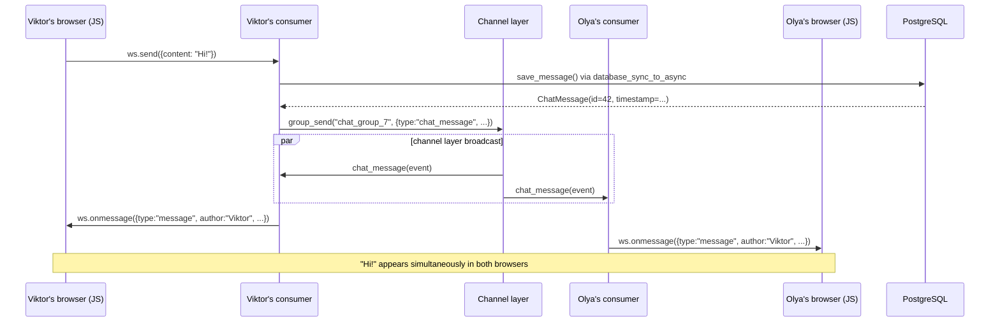

# 7B. Consumer

A Consumer is the equivalent of a view, but:
- It lives for the whole duration of the connection (not a single request)
- It runs as an async coroutine
- It handles events: connect, receive, disconnect, channel layer events

---

## Consumer lifecycle

```
The browser opens the chat tab:
  ┌─────────────────────────────────────────────────┐
  │ 1. connect()                                     │
  │    ├── checks authentication (is_authenticated)  │
  │    ├── checks membership                         │
  │    ├── group_add() → subscribes to the channel   │
  │    ├── accept() → confirms the WS connection     │
  │    └── send() history × N messages               │
  │                                                   │
  │ 2. receive() ← the browser sent a message        │
  │    ├── validates content                          │
  │    ├── save_message() → PostgreSQL               │
  │    └── group_send() → broadcast to everyone      │
  │                 │                                 │
  │ 3. chat_message() ← the channel layer delivered  │
  │    └── send() → sends to the browser             │
  │                                                   │
  │    (2 and 3 repeat N times)                      │
  │                                                   │
  │ 4. disconnect()                                   │
  │    └── group_discard() → unsubscribes            │
  └─────────────────────────────────────────────────┘
```

### The difference between receive() and chat_message()

```
receive()      — the browser of THIS connection sent a message
chat_message() — the channel layer delivered a broadcast from any participant

When Olya sends "Hi":
  Olya's consumer:   receive() → group_send("chat_group_7", {...})
  Olya's consumer:   chat_message() ← channel layer → send() → Olya's browser
  Masha's consumer:  chat_message() ← channel layer → send() → Masha's browser
  Viktor's consumer: chat_message() ← channel layer → send() → Viktor's browser
```

---

## GroupChatConsumer: the full code

```python
# notes_app/consumers.py
import json

from channels.db import database_sync_to_async
from channels.generic.websocket import AsyncWebsocketConsumer
from django.contrib.auth.models import Group

from .models import ChatMessage


class GroupChatConsumer(AsyncWebsocketConsumer):
    """
    WebSocket consumer for the group chat.

    URL: /ws/groups/<group_pk>/chat/

    Client → Server:
        {"content": "Message text"}

    Server → Client (history):
        {"type": "history", "message_id": 1, "author": "...", "content": "...", "timestamp": "..."}

    Server → Client (live):
        {"type": "message", "message_id": 2, "author": "...", "content": "...", "timestamp": "..."}
    """

    async def connect(self):
        self.user = self.scope['user']

        # 1. Authentication: not logged in → close() before accept() → handshake rejected
        if not self.user.is_authenticated:
            await self.close()
            return

        # 2. group_pk from the URL kwargs (the \d+ regex in routing.py guarantees digits)
        self.group_pk = int(self.scope['url_route']['kwargs']['group_pk'])

        # 3. Membership check (ORM in a worker thread)
        is_member = await self.check_membership(self.group_pk, self.user)
        if not is_member:
            await self.close()
            return

        # 4. Channel group name
        self.room_group_name = f"chat_group_{self.group_pk}"

        # 5. Subscribe to the channel group
        await self.channel_layer.group_add(
            self.room_group_name,
            self.channel_name,
        )

        # 6. Accept the connection
        await self.accept()

        # 7. Send the history (the last 50 messages)
        history = await self.load_history(self.group_pk)
        for msg in history:
            await self.send(text_data=json.dumps({
                'type': 'history',
                'message_id': msg['id'],
                'author': msg['author__username'],
                'content': msg['content'],
                'timestamp': msg['timestamp'].isoformat(),
            }))

    async def disconnect(self, close_code):
        # hasattr check: in case connect() finished before group_add
        if hasattr(self, 'room_group_name'):
            await self.channel_layer.group_discard(
                self.room_group_name,
                self.channel_name,
            )

    async def receive(self, text_data):
        try:
            data = json.loads(text_data)
            content = data.get('content', '').strip()
        except (json.JSONDecodeError, AttributeError):
            return

        # Basic validation: an empty or too long message is silently ignored
        if not content or len(content) > 2000:
            return

        msg = await self.save_message(self.group_pk, self.user, content)

        await self.channel_layer.group_send(
            self.room_group_name,
            {
                'type': 'chat_message',
                'message_id': msg.id,
                'author': self.user.username,
                'content': content,
                'timestamp': msg.timestamp.isoformat(),
            }
        )

    async def chat_message(self, event):
        await self.send(text_data=json.dumps({
            'type': 'message',
            'message_id': event['message_id'],
            'author': event['author'],
            'content': event['content'],
            'timestamp': event['timestamp'],
        }))

    # ─── ORM helpers ─────────────────────────────────────────────────

    @database_sync_to_async
    def check_membership(self, group_pk, user):
        try:
            group = Group.objects.get(pk=group_pk)
            return group.user_set.filter(pk=user.pk).exists()
        except Group.DoesNotExist:
            return False

    @database_sync_to_async
    def load_history(self, group_pk):
        qs = (
            ChatMessage.objects
            .filter(group_id=group_pk)
            .select_related('author')
            .order_by('-timestamp')[:50]
        )
        messages = list(qs.values('id', 'author__username', 'content', 'timestamp'))
        messages.reverse()
        return messages

    @database_sync_to_async
    def save_message(self, group_pk, user, content):
        return ChatMessage.objects.create(
            group_id=group_pk,
            author=user,
            content=content,
        )
```

Compared with an "ideal" consumer, the decisions here are deliberately simple:

- a refusal (`not is_authenticated`, not a group member) is a plain `await self.close()` without a custom code. Because `accept()` has not been called yet, the server rejects the handshake (HTTP 403), and the browser sees `onclose` with code `1006`;
- an empty or too long (> 2000 characters) message is just ignored; no error is sent to the client. The client-side limit is `maxlength="2000"` on the `<input>`;
- every frame carries `message_id` (the `ChatMessage` record id), which the JS client stores in `data-message-id`.

The full docstrings with explanations are in the file `notes_app/consumers.py` itself.

---

## database_sync_to_async: why the ORM needs a wrapper

The Django ORM is synchronous. Running sync code directly in an async context blocks the event loop and raises `SynchronousOnlyOperation`.

### How it works

```python
# ❌ WRONG — SynchronousOnlyOperation:
async def connect(self):
    group = Group.objects.get(pk=self.group_pk)
    # ↑ sync ORM in an async context → blocks the event loop → exception

# ✅ CORRECT — @database_sync_to_async:
@database_sync_to_async
def check_membership(self, group_pk, user):
    # A regular sync def
    # @database_sync_to_async runs it in the Django thread pool
    # The event loop is free while the thread executes the SQL
    try:
        group = Group.objects.get(pk=group_pk)
        return group.user_set.filter(pk=user.pk).exists()
    except Group.DoesNotExist:
        return False

async def connect(self):
    is_member = await self.check_membership(self.group_pk, self.user)
    # await = "run it in the thread pool and wait for the result without blocking the event loop"
```

### How it works under the hood

```
Event loop (one thread):
  coroutine connect() is running...
  
  → encounters: await self.check_membership(...)
  → @database_sync_to_async: submit to the thread pool executor
  → Event loop: keeps serving OTHER connections
  
Thread pool (a separate thread):
  → executes the sync Django ORM query (SELECT ... FROM ...)
  → returns the result
  
Event loop:
  → receives the result from the thread pool
  → resumes the coroutine connect() from the next line
```

### Critical: return a list, not a QuerySet

```python
# ❌ WRONG — the QuerySet is lazy and gets iterated in the async context:
@database_sync_to_async
def load_history(self, group_pk):
    return ChatMessage.objects.filter(group_id=group_pk).values(...)
    # The QuerySet has not executed the SQL! The SQL runs on iteration.
    # Iteration happens in the async context → SynchronousOnlyOperation

# ✅ CORRECT — list() forces the SQL in the worker thread:
@database_sync_to_async
def load_history(self, group_pk):
    qs = (
        ChatMessage.objects
        .filter(group_id=group_pk)
        .select_related('author')
        .order_by('-timestamp')[:50]
    )
    messages = list(qs.values('id', 'author__username', 'content', 'timestamp'))
    # list() executes the SQL HERE, in the worker thread
    messages.reverse()  # chronological order
    return messages      # a Python list — safe to return
```

### database_sync_to_async as an inline wrapper

```python
# Option 1: decorator (most common)
@database_sync_to_async
def save_message(self, group_pk, user, content):
    return ChatMessage.objects.create(group_id=group_pk, author=user, content=content)

# Option 2: inline wrapper (for one-off operations)
async def receive(self, text_data):
    msg = await database_sync_to_async(ChatMessage.objects.create)(
        group_id=self.group_pk,
        author=self.user,
        content=content,
    )
```

| Wrapper | When to use | In this project |
|---------|---------------------|-----------------|
| `database_sync_to_async` | Django ORM (optimized for Django DB connections) | `check_membership`, `load_history`, `save_message` |
| `sync_to_async` | Any sync code without the DB | _(in async_services.py for `create_note`)_ |

---

## Broadcast: channel_layer.group_send

### How the channel layer delivers a message to all participants

```
The channel layer is the message bus for Django Channels.
Each Consumer subscribes to a "group" (a named channel).
group_send() → delivers to ALL subscribers of the group.

Channel layer state for the chat of group 7:
  Group "chat_group_7":
    ├── Viktor's consumer (channel_name: "specific.abc123")
    ├── Olya's consumer   (channel_name: "specific.def456")
    └── Masha's consumer  (channel_name: "specific.ghi789")
```

### The group_send flow

```
Viktor sends "Hi":

1. Viktor's consumer: receive("Hi")
2. Viktor's consumer: group_send("chat_group_7", {
       'type': 'chat_message',
       'message_id': 42,
       'author': 'Viktor',
       'content': 'Hi',
       'timestamp': '2025-01-01T12:00:00',
   })

3. The channel layer finds the group "chat_group_7"
   → Viktor's consumer: chat_message(event) → send() → Viktor's browser
   → Olya's consumer:   chat_message(event) → send() → Olya's browser
   → Masha's consumer:  chat_message(event) → send() → Masha's browser

Result: "Hi" appears simultaneously in all three browsers.
```

### type → method mapping

```python
# 'type' in group_send → the method name in the Consumer
# Dot → underscore:

group_send(room, {'type': 'chat_message', ...})     → Consumer.chat_message(event)
group_send(room, {'type': 'chat.message', ...})     → Consumer.chat_message(event)
group_send(room, {'type': 'user.joined', ...})      → Consumer.user_joined(event)
group_send(room, {'type': 'typing.indicator', ...}) → Consumer.typing_indicator(event)
```

**An important detail:** `type: 'chat_message'` in `group_send()` → Django Channels
automatically looks for the `chat_message()` method on the Consumer. A dot in the type → an underscore.

### InMemoryChannelLayer: pub/sub in memory

```
Channel layer state when 3 users have opened the chat of group 7:

  Viktor's channel_name: "specific.abc123"
  Olya's channel_name:   "specific.def456"
  Masha's channel_name:  "specific.ghi789"

  group "chat_group_7" → subscribers: ["specific.abc123", "specific.def456", "specific.ghi789"]

Olya sends "Hi":
  Olya's consumer: group_send("chat_group_7", {type: "chat_message", content: "Hi"})
                    │
                    ├── the channel layer finds all subscribers of chat_group_7
                    │
                    ├── delivers the event to Viktor's consumer → chat_message() → send("Hi")
                    ├── delivers the event to Olya's consumer   → chat_message() → send("Hi")
                    └── delivers the event to Masha's consumer  → chat_message() → send("Hi")

Result: "Hi" appears simultaneously in all three browsers.
```

`InMemoryChannelLayer` is in-process, for a single server. For production
with several servers, `channels-redis` is used (a channel layer over Redis).
In this project `settings.py` picks `RedisChannelLayer` when `REDIS_URL` is set
(that is how the Docker stack runs), and `InMemoryChannelLayer` only locally without Redis.
The pub/sub logic is the same for both.

---

## What to check in connect()

The full list of checks for a secure Consumer (as they are implemented in `notes_app/consumers.py`):

| Check | Code | Reaction in the project |
|-----------|-----|-----------|
| Authentication | `if not self.user.is_authenticated` | `close()` before `accept()` |
| Group membership | `check_membership(group_pk, user)` | `close()` before `accept()` |
| Valid group_pk | the `(?P<group_pk>\d+)` regex in `routing.py` | a non-numeric URL matches no route |
| Group exists | `except Group.DoesNotExist` in `check_membership` | `close()` before `accept()` |
| JSON validity | `except (json.JSONDecodeError, AttributeError)` in `receive()` | _(ignore)_ |
| Empty content | `if not content` | _(ignore)_ |
| Content length | `len(content) > 2000` | _(ignore)_ |

`close()` without an argument passes no custom code: the handshake is rejected, and the browser gets `onclose` with code `1006`. Custom codes (for example, `4001` for not authenticated, `4003` for no access) can be added as an improvement: `await self.close(code=4003)`. Then the client can tell a refused access from a network drop.

### disconnect() cleanup

```python
async def disconnect(self, close_code):
    # The hasattr check is MANDATORY:
    # If connect() finished before group_add (for example, authentication was refused),
    # room_group_name may not exist → AttributeError
    if hasattr(self, 'room_group_name'):
        await self.channel_layer.group_discard(
            self.room_group_name,
            self.channel_name,
        )
```

---

## The full flow: from pressing Enter to the message appearing for everyone



This whole path happens **without a single HTTP request**. Only WebSocket frames.

---

## Next

Next chapter: **[7B. WebSocket JS client](7b_websocket_client.md)** — the vanilla JS WebSocket API, the full client, XSS protection, escapeHtml.
