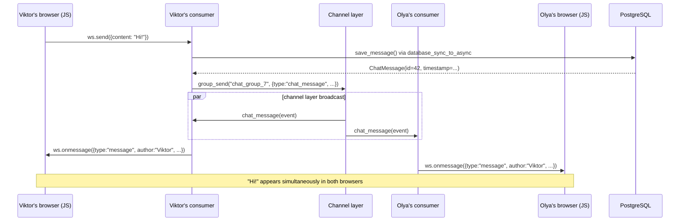

# 7B. The WebSocket JS client

---

## The vanilla JS WebSocket API

The browser WebSocket API is built in, no libraries needed:

```javascript
// Open a connection
const ws = new WebSocket('ws://127.0.0.1:8001/ws/groups/7/chat/')
//                        ↑ ws:// for HTTP, wss:// for HTTPS

ws.onopen    = () => { /* connection established */ }
ws.onmessage = (e) => { const data = JSON.parse(e.data) }  // the server sent something
ws.onclose   = (e) => { /* close code: 1000=normal, 1006=abnormal */ }
ws.onerror   = (e) => { /* connection error */ }

ws.send(JSON.stringify({ content: "Hi!" }))  // send to the server
ws.close()                                    // close the connection
```

### readyState values

| `ws.readyState` | Constant | Meaning |
|-----------------|-----------|----------|
| `0` | `WebSocket.CONNECTING` | The connection is being established |
| `1` | `WebSocket.OPEN` | The connection is open, you can send |
| `2` | `WebSocket.CLOSING` | The connection is closing |
| `3` | `WebSocket.CLOSED` | The connection is closed |

### Close codes

| Code | Meaning |
|-----|----------|
| `1000` | Normal closure — do NOT reconnect |
| `1001` | The page is closing — do NOT reconnect |
| `1006` | Abnormal (the internet connection dropped) — reconnect |
| `4001` | Custom (example): not authenticated — not used in notes_chat_app |
| `4003` | Custom (example): not a member of the group — not used in notes_chat_app |

An application may choose codes `4000–4999` itself. `GroupChatConsumer` in this project rejects a connection with a plain `close()` before `accept()`, so the browser sees `1006`.

---

## The full notes_chat_app JS client

```javascript
// notes_app/static/notes_app/js/group_chat.js
// WebSocket chat client (vanilla JavaScript). The long explanatory comment at the top of the file is omitted here.

// IIFE: all the code inside a function, so no global variables are created.
(function () {
    'use strict';

    // ── Config (data attributes of the hidden div#chat-config) ──
    const config    = document.getElementById('chat-config');
    const GROUP_PK  = config.dataset.groupPk;
    const USERNAME  = config.dataset.username;

    // ── DOM refs ──
    const messagesEl  = document.getElementById('chat-messages');
    const placeholderEl = document.getElementById('chat-placeholder');
    const inputEl     = document.getElementById('chat-input');
    const formEl      = document.getElementById('chat-form');
    const sendBtnEl   = document.getElementById('chat-send-btn');
    const statusDotEl = document.getElementById('status-dot');
    const statusTextEl = document.getElementById('status-text');

    // ws:// for HTTP, wss:// for HTTPS (ngrok); location.host includes the port
    const protocol = window.location.protocol === 'https:' ? 'wss' : 'ws';
    const WS_URL   = `${protocol}://${window.location.host}/ws/groups/${GROUP_PK}/chat/`;

    let socket = null;
    // Exponential backoff: 1s → 2s → 4s ... → at most 30s
    let reconnectDelay = 1000;

    function connect() {
        setStatus('connecting');
        socket = new WebSocket(WS_URL);

        socket.onopen = function () {
            setStatus('connected');
            reconnectDelay = 1000; // reset the backoff after a successful connection
            inputEl.disabled = false;
            sendBtnEl.disabled = false;
            inputEl.focus();
            placeholderEl.style.display = 'none';
        };

        socket.onmessage = function (event) {
            let data;
            try {
                data = JSON.parse(event.data);
            } catch (e) {
                console.error('[chat] Невалідний JSON від сервера:', event.data);
                return;
            }
            // history comes from load_history() on connect(); message is real-time from chat_message()
            if (data.type === 'history' || data.type === 'message') {
                appendMessage(data);
            }
        };

        socket.onerror = function (event) {
            console.error('[chat] WebSocket помилка:', event);
            setStatus('error');
        };

        socket.onclose = function (event) {
            setStatus('disconnected');
            inputEl.disabled = true;
            sendBtnEl.disabled = true;

            // Do not reconnect on 1000/1001 (intentional closure); otherwise backoff + 0–1s jitter
            if (event.code !== 1000 && event.code !== 1001) {
                const jitter = Math.random() * 1000;
                setTimeout(connect, reconnectDelay + jitter);
                reconnectDelay = Math.min(reconnectDelay * 2, 30000);
            }
        };
    }

    // ── SEND ──
    formEl.addEventListener('submit', function (event) {
        event.preventDefault(); // do NOT submit the form as an HTTP POST

        const content = inputEl.value.trim();
        if (!content) return;
        if (!socket || socket.readyState !== WebSocket.OPEN) return;

        socket.send(JSON.stringify({ content: content }));

        inputEl.value = '';
        inputEl.focus();
    });

    // Enter → submit (Shift+Enter → no send)
    inputEl.addEventListener('keydown', function (event) {
        if (event.key === 'Enter' && !event.shiftKey) {
            event.preventDefault();
            formEl.dispatchEvent(new Event('submit'));
        }
    });

    // ── RENDER MESSAGE ──
    function appendMessage(data) {
        const isMine = data.author === USERNAME;   // own messages on the right, others on the left

        const time = new Date(data.timestamp).toLocaleTimeString('uk-UA', {
            hour: '2-digit',
            minute: '2-digit',
        });

        const wrapper = document.createElement('div');
        wrapper.className = `d-flex mb-2 ${isMine ? 'justify-content-end' : 'justify-content-start'}`;
        if (data.message_id) {
            wrapper.dataset.messageId = data.message_id;
        }

        // escapeHtml() is MANDATORY before any user content in innerHTML
        wrapper.innerHTML = `
          <div class="chat-bubble ${isMine ? 'chat-mine' : 'chat-other'}">
            ${!isMine ? `<div class="chat-author">${escapeHtml(data.author)}</div>` : ''}
            <div class="chat-content">${escapeHtml(data.content)}</div>
            <div class="chat-time">${time}</div>
          </div>`;

        messagesEl.appendChild(wrapper);
        messagesEl.scrollTop = messagesEl.scrollHeight;
    }

    // ── STATUS INDICATOR ──
    const STATUS_CONFIG = {
        connecting:   { color: '#ffc107', text: 'Підключення...' },
        connected:    { color: '#198754', text: 'Підключено' },
        disconnected: { color: '#6c757d', text: 'Відключено. Перепідключення...' },
        error:        { color: '#dc3545', text: 'Помилка з\'єднання' },
    };

    function setStatus(key) {
        const cfg = STATUS_CONFIG[key] || STATUS_CONFIG.error;
        statusDotEl.style.background = cfg.color;
        statusTextEl.textContent = cfg.text;
    }

    // ── XSS PREVENTION ──
    function escapeHtml(str) {
        return String(str)
            .replace(/&/g, '&amp;')
            .replace(/</g, '&lt;')
            .replace(/>/g, '&gt;')
            .replace(/"/g, '&quot;')
            .replace(/'/g, '&#039;');
    }

    // ── START ──
    inputEl.disabled = true;     // the input is disabled until the connection is established
    sendBtnEl.disabled = true;
    connect();

}());
```

Key details of the real client:

- the code is wrapped in an **IIFE** `(function () { ... }())`; the script is loaded at the end of the page, so `DOMContentLoaded` is not needed;
- `GROUP_PK` and `USERNAME` are read from the hidden `div#chat-config`; `USERNAME` is needed to show your own messages on the right;
- the connection status is shown by two elements: the colored dot `#status-dot` and the text `#status-text`;
- reconnecting: on any code except `1000`/`1001`, the delay doubles from 1 s up to a maximum of 30 s, plus a random 0–1 s jitter; there is no attempt limit;
- the client does not handle frames with `type: 'error'`; the consumer does not send them either.

The UI strings stay in Ukrainian, as in the real file: `Підключення...` (Connecting...), `Підключено` (Connected), `Відключено. Перепідключення...` (Disconnected. Reconnecting...), `Помилка з'єднання` (Connection error).

---

## The chat template

```html
{# notes_app/templates/notes_app/group_chat.html (abridged) #}




  <i class="bi bi-chat-dots me-2 text-primary"></i>Чат групи: {{ group.name }}



<div class="d-flex flex-column" style="height: calc(100vh - 130px);">

  {# Status bar: the #status-dot dot + the #status-text text #}
  <div id="chat-status"
       class="d-flex align-items-center gap-2 px-3 py-2 mb-2 rounded small"
       style="background: var(--card-bg); border: 1px solid var(--card-border);">
    <span id="status-dot"
          style="width:8px; height:8px; border-radius:50%; background:#6c757d;
                 display:inline-block; transition: background .3s;"></span>
    <span id="status-text" class="text-muted">Підключення...</span>
    <span class="ms-auto text-muted">
      <i class="bi bi-people me-1"></i>{{ group.name }}
    </span>
  </div>

  {# Message feed; JS inserts the history and new messages here #}
  <div id="chat-messages"
       class="flex-grow-1 overflow-y-auto p-3 mb-2"
       style="background: var(--card-bg); border-radius: 10px;
              border: 1px solid var(--card-border);">
    <div id="chat-placeholder" class="text-center text-muted py-5">
      <i class="bi bi-chat-dots fs-1 opacity-25 d-block mb-2"></i>
      <small>Завантаження повідомлень...</small>
    </div>
  </div>

  {# form#chat-form: JS intercepts submit, the message goes over WebSocket, not HTTP POST #}
  <form id="chat-form" class="d-flex gap-2" autocomplete="off">
    <input id="chat-input"
           type="text"
           class="form-control"
           placeholder="Напишіть повідомлення..."
           maxlength="2000"
           autocomplete="off">
    <button type="submit" class="btn btn-primary px-4" id="chat-send-btn">
      <i class="bi bi-send"></i>
    </button>
  </form>

</div>

{# #chat-config: data for JavaScript via data attributes (no inline <script>) #}
<div id="chat-config"
     data-group-pk="{{ group.pk }}"
     data-username="{{ request.user.username }}"
     style="display:none;"></div>




<script src=""></script>

```

**How `group_pk` gets to the JS:**
```html
<div id="chat-config" data-group-pk="{{ group.pk }}" data-username="{{ request.user.username }}" style="display:none;"></div>
```
```javascript
const config   = document.getElementById('chat-config');
const GROUP_PK = config.dataset.groupPk;
// ↑ dataset.groupPk reads the data-group-pk attribute (automatic camelCase conversion)
```

---

## Connection state (the status bar in the UI)

```
connecting → connected → (on failure) disconnected → (auto-reconnect) connecting → ...

Auto-reconnect logic (socket.onclose):
  1000 = normal closure        → do NOT reconnect
  1001 = the page is closing   → do NOT reconnect
  any other code (including 1006: internet, the server crashed,
  or the server rejected the handshake) → reconnect

Exponential backoff with jitter:
  Attempt 1: after ~1000ms (+ 0–1000ms jitter)
  Attempt 2: after ~2000ms
  Attempt 3: after ~4000ms
  ...
  Maximum: 30000ms (Math.min(reconnectDelay * 2, 30000))
  There is no attempt limit; after a successful onopen the delay resets to 1000ms.
  A refused access (not a group member) also arrives as 1006,
  so the client keeps retrying with a backoff of up to 30 s.
```

### Two types of messages from the server

| `type` | When | From what | What is displayed |
|--------|------|----------|-------------------|
| `history` | Right after connect() | `load_history()` in the consumer | The last 50 messages from the DB |
| `message` | Real-time | `chat_message()` in the consumer | A new message from anyone |

---

## XSS protection: the escapeHtml function

The chat displays content from other users — a classic XSS attack point.

### The attack vector

```
An attacker sends to the chat:
  

If the JS client inserts it via innerHTML without escaping:
  div.innerHTML = data.content  ← DANGEROUS

→ The browser parses the HTML → the img fails to load → onerror fires
→ fetch() sends the cookies to evil.com → sessions are stolen
→ Session Hijacking: the attacker obtains the sessionid of every chat participant
```

### Three safe options

```javascript
// ✅ Method 1: textContent (text only, HTML is not parsed)
messageDiv.textContent = data.content

// ✅ Method 2: createTextNode
messageDiv.appendChild(document.createTextNode(data.content))

// ✅ Method 3: escapeHtml() before innerHTML (if you need HTML markup)
function escapeHtml(text) {
    const div = document.createElement('div')
    div.appendChild(document.createTextNode(text))
    return div.innerHTML
    // & → &amp;  < → &lt;  > → &gt;  (quotes are NOT escaped, so unsafe inside attributes)
}
wrapper.innerHTML = `<strong>${escapeHtml(data.author)}</strong>: ${escapeHtml(data.content)}`
```

### Why innerHTML is dangerous without escaping

```javascript
// ❌ DANGEROUS: user content directly in innerHTML
div.innerHTML = data.content  // the attacker sends <script>...</script> → XSS

// ✅ CORRECT: escapeHtml() before any user content
wrapper.innerHTML = `<div class="chat-content">${escapeHtml(data.content)}</div>`
// escapeHtml replaces: & → &amp;  < → &lt;  > → &gt;  " → &quot;  ' → &#039;
```

**In notes_chat_app** we use method 3 (`escapeHtml`) — we need HTML markup for the message (author, time and content in separate elements), so `textContent` won't do. The real `group_chat.js` implements `escapeHtml()` as a chain of `.replace()` calls that also escapes `"` and `'` (see the full code above).

---

## The full flow: from pressing Enter to the message appearing for everyone



This whole path happens **without a single HTTP request**. Only WebSocket frames.

---

## Testing the chat in the browser

**Step 1:** Start the ASGI server (the chat requires ASGI, not runserver):

```bash
# Locally:
uvicorn notes_project.asgi:application --reload --port 8001

# Or via Docker:
docker compose up -d
```

**Step 2:** Open http://127.0.0.1:8001/ and log in.

**Step 3:** Go to any group (http://127.0.0.1:8001/groups/) and click «Відкрити чат» ("Open chat").

**Step 4:** Open the same URL in a second tab (or another browser) as a different user.

**Step 5:** Send a message — it will appear in both tabs **instantly**, without a page reload.

### What to check in DevTools

```
DevTools → Network → WS tab:
  - Find the ws://... row (the WebSocket connection)
  - Click on it
  - The "Messages" tab — all WS frames in real time
  - ↑ Green = sent by the browser (send)
  - ↓ White = received from the server (receive)
```

> **To see the difference:** try to imagine the same chat built with polling (a GET every 2 sec).
> With WebSocket — a single row (the WS connection).
> With polling — a new row every 2 seconds, even when nobody is writing anything.

---

## Next

Next chapter: **[Checkpoint](checkpoint.md)** — the 7A and 7B checklists, Consumer tests, common mistakes, navigation.
