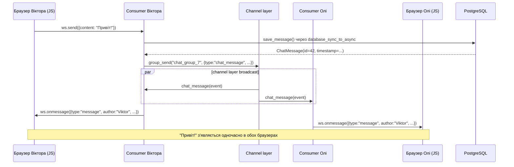

# 7B. WebSocket JS клієнт

---

## Vanilla JS WebSocket API

Браузерний WebSocket API — вбудований, без бібліотек:

```javascript
// Відкрити з'єднання
const ws = new WebSocket('ws://127.0.0.1:8001/ws/groups/7/chat/')
//                        ↑ ws:// для HTTP, wss:// для HTTPS

ws.onopen    = () => { /* з'єднання встановлено */ }
ws.onmessage = (e) => { const data = JSON.parse(e.data) }  // сервер надіслав
ws.onclose   = (e) => { /* код закриття: 1000=норм, 1006=аварія */ }
ws.onerror   = (e) => { /* помилка з'єднання */ }

ws.send(JSON.stringify({ content: "Привіт!" }))  // надіслати на сервер
ws.close()                                        // закрити з'єднання
```

### readyState значення

| `ws.readyState` | Константа | Значення |
|-----------------|-----------|----------|
| `0` | `WebSocket.CONNECTING` | З'єднання встановлюється |
| `1` | `WebSocket.OPEN` | З'єднання відкрите, можна надсилати |
| `2` | `WebSocket.CLOSING` | З'єднання закривається |
| `3` | `WebSocket.CLOSED` | З'єднання закрите |

### Close codes

| Код | Значення |
|-----|----------|
| `1000` | Нормальне закриття — НЕ перепідключатись |
| `1001` | Сторінка закривається — НЕ перепідключатись |
| `1006` | Аварійне (інтернет обірвався) — перепідключитись |
| `4001` | Custom (приклад): не авторизований — у notes_chat_app не використовується |
| `4003` | Custom (приклад): не є членом групи — у notes_chat_app не використовується |

Коди `4000–4999` застосунок може обрати сам. `GroupChatConsumer` у цьому проєкті відхиляє з'єднання звичайним `close()` до `accept()`, тому браузер бачить `1006`.

---

## Повний JS клієнт notes_chat_app

```javascript
// notes_app/static/notes_app/js/group_chat.js
// WebSocket чат клієнт (vanilla JavaScript). Великий коментар-пояснення на початку файлу тут пропущено.

// IIFE: весь код у функції, щоб не створювати глобальних змінних.
(function () {
    'use strict';

    // ── Config (data-атрибути прихованого div#chat-config) ──
    const config    = document.getElementById('chat-config');
    const GROUP_PK  = config.dataset.groupPk;
    const USERNAME  = config.dataset.username;

    // ── DOM refs ──
    const messagesEl  = document.getElementById('chat-messages');
    const placeholderEl = document.getElementById('chat-placeholder');
    const inputEl     = document.getElementById('chat-input');
    const formEl      = document.getElementById('chat-form');
    const sendBtnEl   = document.getElementById('chat-send-btn');
    const statusDotEl = document.getElementById('status-dot');
    const statusTextEl = document.getElementById('status-text');

    // ws:// для HTTP, wss:// для HTTPS (ngrok); location.host включає порт
    const protocol = window.location.protocol === 'https:' ? 'wss' : 'ws';
    const WS_URL   = `${protocol}://${window.location.host}/ws/groups/${GROUP_PK}/chat/`;

    let socket = null;
    // Exponential backoff: 1с → 2с → 4с ... → максимум 30с
    let reconnectDelay = 1000;

    function connect() {
        setStatus('connecting');
        socket = new WebSocket(WS_URL);

        socket.onopen = function () {
            setStatus('connected');
            reconnectDelay = 1000; // скидаємо backoff після успішного підключення
            inputEl.disabled = false;
            sendBtnEl.disabled = false;
            inputEl.focus();
            placeholderEl.style.display = 'none';
        };

        socket.onmessage = function (event) {
            let data;
            try {
                data = JSON.parse(event.data);
            } catch (e) {
                console.error('[chat] Невалідний JSON від сервера:', event.data);
                return;
            }
            // history — з load_history() при connect(); message — real-time з chat_message()
            if (data.type === 'history' || data.type === 'message') {
                appendMessage(data);
            }
        };

        socket.onerror = function (event) {
            console.error('[chat] WebSocket помилка:', event);
            setStatus('error');
        };

        socket.onclose = function (event) {
            setStatus('disconnected');
            inputEl.disabled = true;
            sendBtnEl.disabled = true;

            // Не перепідключаємось при 1000/1001 (навмисне закриття); інакше backoff + jitter 0–1с
            if (event.code !== 1000 && event.code !== 1001) {
                const jitter = Math.random() * 1000;
                setTimeout(connect, reconnectDelay + jitter);
                reconnectDelay = Math.min(reconnectDelay * 2, 30000);
            }
        };
    }

    // ── SEND ──
    formEl.addEventListener('submit', function (event) {
        event.preventDefault(); // НЕ надсилати HTTP POST форму

        const content = inputEl.value.trim();
        if (!content) return;
        if (!socket || socket.readyState !== WebSocket.OPEN) return;

        socket.send(JSON.stringify({ content: content }));

        inputEl.value = '';
        inputEl.focus();
    });

    // Enter → submit (Shift+Enter → без надсилання)
    inputEl.addEventListener('keydown', function (event) {
        if (event.key === 'Enter' && !event.shiftKey) {
            event.preventDefault();
            formEl.dispatchEvent(new Event('submit'));
        }
    });

    // ── RENDER MESSAGE ──
    function appendMessage(data) {
        const isMine = data.author === USERNAME;   // свої праворуч, чужі ліворуч

        const time = new Date(data.timestamp).toLocaleTimeString('uk-UA', {
            hour: '2-digit',
            minute: '2-digit',
        });

        const wrapper = document.createElement('div');
        wrapper.className = `d-flex mb-2 ${isMine ? 'justify-content-end' : 'justify-content-start'}`;
        if (data.message_id) {
            wrapper.dataset.messageId = data.message_id;
        }

        // escapeHtml() — ОБОВ'ЯЗКОВО перед будь-яким user content в innerHTML
        wrapper.innerHTML = `
          <div class="chat-bubble ${isMine ? 'chat-mine' : 'chat-other'}">
            ${!isMine ? `<div class="chat-author">${escapeHtml(data.author)}</div>` : ''}
            <div class="chat-content">${escapeHtml(data.content)}</div>
            <div class="chat-time">${time}</div>
          </div>`;

        messagesEl.appendChild(wrapper);
        messagesEl.scrollTop = messagesEl.scrollHeight;
    }

    // ── STATUS INDICATOR ──
    const STATUS_CONFIG = {
        connecting:   { color: '#ffc107', text: 'Підключення...' },
        connected:    { color: '#198754', text: 'Підключено' },
        disconnected: { color: '#6c757d', text: 'Відключено. Перепідключення...' },
        error:        { color: '#dc3545', text: 'Помилка з\'єднання' },
    };

    function setStatus(key) {
        const cfg = STATUS_CONFIG[key] || STATUS_CONFIG.error;
        statusDotEl.style.background = cfg.color;
        statusTextEl.textContent = cfg.text;
    }

    // ── XSS PREVENTION ──
    function escapeHtml(str) {
        return String(str)
            .replace(/&/g, '&amp;')
            .replace(/</g, '&lt;')
            .replace(/>/g, '&gt;')
            .replace(/"/g, '&quot;')
            .replace(/'/g, '&#039;');
    }

    // ── START ──
    inputEl.disabled = true;     // input вимкнений до встановлення з'єднання
    sendBtnEl.disabled = true;
    connect();

}());
```

Ключові деталі реального клієнта:

- код загорнуто в **IIFE** `(function () { ... }())` — скрипт підключається в кінці сторінки, тому `DOMContentLoaded` не потрібен;
- `GROUP_PK` і `USERNAME` читаються з прихованого `div#chat-config`; `USERNAME` потрібен, щоб показувати свої повідомлення праворуч;
- статус з'єднання показують два елементи: кольорова крапка `#status-dot` і текст `#status-text`;
- перепідключення: при будь-якому коді, крім `1000`/`1001`, затримка подвоюється від 1 с до максимуму 30 с, плюс випадковий jitter 0–1 с; ліміту спроб немає;
- фрейми з `type: 'error'` клієнт не обробляє — consumer їх і не надсилає.

---

## Шаблон чату

```html
{# notes_app/templates/notes_app/group_chat.html (скорочено) #}




  <i class="bi bi-chat-dots me-2 text-primary"></i>Чат групи: {{ group.name }}



<div class="d-flex flex-column" style="height: calc(100vh - 130px);">

  {# Status bar: крапка #status-dot + текст #status-text #}
  <div id="chat-status"
       class="d-flex align-items-center gap-2 px-3 py-2 mb-2 rounded small"
       style="background: var(--card-bg); border: 1px solid var(--card-border);">
    <span id="status-dot"
          style="width:8px; height:8px; border-radius:50%; background:#6c757d;
                 display:inline-block; transition: background .3s;"></span>
    <span id="status-text" class="text-muted">Підключення...</span>
    <span class="ms-auto text-muted">
      <i class="bi bi-people me-1"></i>{{ group.name }}
    </span>
  </div>

  {# Стрічка повідомлень; JS вставляє сюди history і нові повідомлення #}
  <div id="chat-messages"
       class="flex-grow-1 overflow-y-auto p-3 mb-2"
       style="background: var(--card-bg); border-radius: 10px;
              border: 1px solid var(--card-border);">
    <div id="chat-placeholder" class="text-center text-muted py-5">
      <i class="bi bi-chat-dots fs-1 opacity-25 d-block mb-2"></i>
      <small>Завантаження повідомлень...</small>
    </div>
  </div>

  {# form#chat-form: JS перехоплює submit, повідомлення йде через WebSocket, не HTTP POST #}
  <form id="chat-form" class="d-flex gap-2" autocomplete="off">
    <input id="chat-input"
           type="text"
           class="form-control"
           placeholder="Напишіть повідомлення..."
           maxlength="2000"
           autocomplete="off">
    <button type="submit" class="btn btn-primary px-4" id="chat-send-btn">
      <i class="bi bi-send"></i>
    </button>
  </form>

</div>

{# #chat-config: дані для JavaScript через data-атрибути (без inline <script>) #}
<div id="chat-config"
     data-group-pk="{{ group.pk }}"
     data-username="{{ request.user.username }}"
     style="display:none;"></div>




<script src=""></script>

```

**Як `group_pk` потрапляє до JS:**
```html
<div id="chat-config" data-group-pk="{{ group.pk }}" data-username="{{ request.user.username }}" style="display:none;"></div>
```
```javascript
const config   = document.getElementById('chat-config');
const GROUP_PK = config.dataset.groupPk;
// ↑ dataset.groupPk читає data-group-pk атрибут (camelCase автоконверсія)
```

---

## Стан з'єднання (status bar у UI)

```
connecting → connected → (якщо аварія) disconnected → (авторепідключення) connecting → ...

Логіка авторепідключення (socket.onclose):
  1000 = нормальне закриття    → НЕ перепідключатись
  1001 = сторінка закривається → НЕ перепідключатись
  будь-який інший код (зокрема 1006: інтернет, сервер впав,
  або сервер відхилив handshake) → перепідключитись

Exponential backoff з jitter:
  Спроба 1: через ~1000ms (+ 0–1000ms jitter)
  Спроба 2: через ~2000ms
  Спроба 3: через ~4000ms
  ...
  Максимум: 30000ms (Math.min(reconnectDelay * 2, 30000))
  Ліміту спроб немає; після успішного onopen затримка скидається до 1000ms.
  Відмова в доступі (не член групи) теж приходить як 1006,
  тому клієнт продовжує спроби з backoff до 30 с.
```

### Два типи повідомлень від сервера

| `type` | Коли | Від чого | Що відображається |
|--------|------|----------|-------------------|
| `history` | Одразу після connect() | `load_history()` у consumer | Останні 50 повідомлень з БД |
| `message` | Real-time | `chat_message()` у consumer | Нове повідомлення від будь-кого |

---

## XSS захист: escapeHtml функція

Чат показує контент від інших юзерів — класична точка XSS атаки.

### Вектор атаки

```
Зловмисник надсилає в чат:
  

Якщо JS клієнт вставляє через innerHTML без escaping:
  div.innerHTML = data.content  ← НЕБЕЗПЕЧНО

→ Браузер парсить HTML → img не завантажується → onerror спрацьовує
→ fetch() відправляє cookies на evil.com → сесії вкрадені
→ Session Hijacking: зловмисник отримує sessionid всіх учасників чату
```

### Три безпечних варіанти

```javascript
// ✅ Метод 1: textContent (тільки текст, HTML не парситься)
messageDiv.textContent = data.content

// ✅ Метод 2: createTextNode
messageDiv.appendChild(document.createTextNode(data.content))

// ✅ Метод 3: escapeHtml() перед innerHTML (якщо потрібна HTML верстка)
function escapeHtml(text) {
    const div = document.createElement('div')
    div.appendChild(document.createTextNode(text))
    return div.innerHTML
    // & → &amp;  < → &lt;  > → &gt;  (лапки НЕ екрануються — не підходить для атрибутів)
}
wrapper.innerHTML = `<strong>${escapeHtml(data.author)}</strong>: ${escapeHtml(data.content)}`
```

### Чому innerHTML небезпечний без escaping

```javascript
// ❌ НЕБЕЗПЕЧНО: user content напряму в innerHTML
div.innerHTML = data.content  // зловмисник надсилає <script>...</script> → XSS

// ✅ ПРАВИЛЬНО: escapeHtml() перед будь-яким user content
wrapper.innerHTML = `<div class="chat-content">${escapeHtml(data.content)}</div>`
// escapeHtml замінює: & → &amp;  < → &lt;  > → &gt;  " → &quot;  ' → &#039;
```

**У notes_chat_app** використовуємо метод 3 (`escapeHtml`) — нам потрібна HTML верстка повідомлення (автор, час, контент у різних елементах), тому `textContent` не підійде. Реальний `group_chat.js` реалізує `escapeHtml()` ланцюжком `.replace()`, який екранує також `"` і `'` (див. повний код вище).

---

## Повний flow: від натискання Enter до появи повідомлення у всіх



Весь цей шлях — **без жодного HTTP запиту**. Тільки WebSocket frames.

---

## Тестування чату в браузері

**Крок 1:** Запусти ASGI-сервер (чат вимагає ASGI, не runserver):

```bash
# Локально:
uvicorn notes_project.asgi:application --reload --port 8001

# Або через Docker:
docker compose up -d
```

**Крок 2:** Відкрий http://127.0.0.1:8001/ і залогінься.

**Крок 3:** Перейди до будь-якої групи (http://127.0.0.1:8001/groups/) і натисни «Відкрити чат».

**Крок 4:** Відкрий той самий URL у другій вкладці (або іншому браузері) під іншим користувачем.

**Крок 5:** Надішли повідомлення — воно з'явиться в обох вкладках **миттєво** без перезавантаження.

### Що перевірити в DevTools

```
DevTools → Network → WS вкладка:
  - Знайди рядок ws://... (WebSocket з'єднання)
  - Кліпни на нього
  - Вкладка "Messages" — всі WS frames в реальному часі
  - ↑ Зелені = надіслані браузером (send)
  - ↓ Білі  = отримані від сервера (receive)
```

> **Щоб побачити різницю:** спробуй уявити той самий чат через polling (GET кожні 2 сек).
> При WebSocket — один рядок (WS-з'єднання).
> При polling — новий рядок кожні 2 секунди, навіть коли ніхто нічого не пише.

---

## Далі

Наступна глава: **[Checkpoint](checkpoint.md)** — чеклисти 7A і 7B, Consumer тести, типові помилки, навігація.
