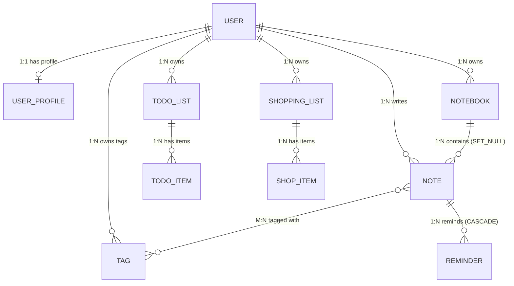
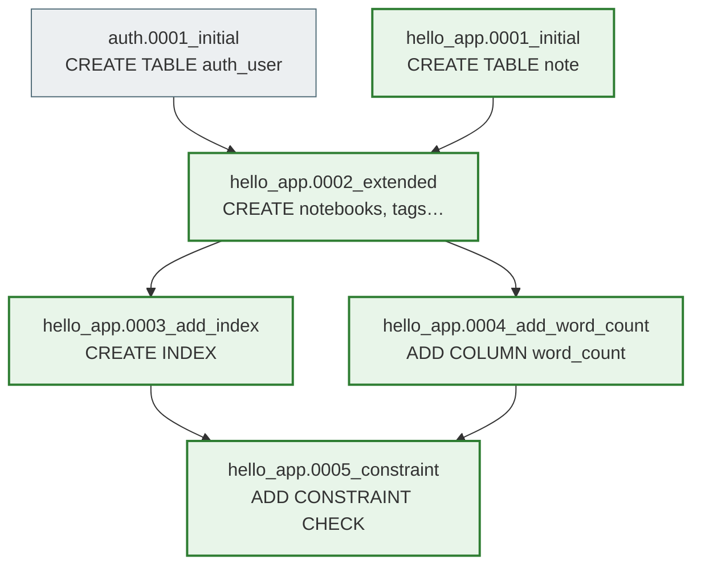
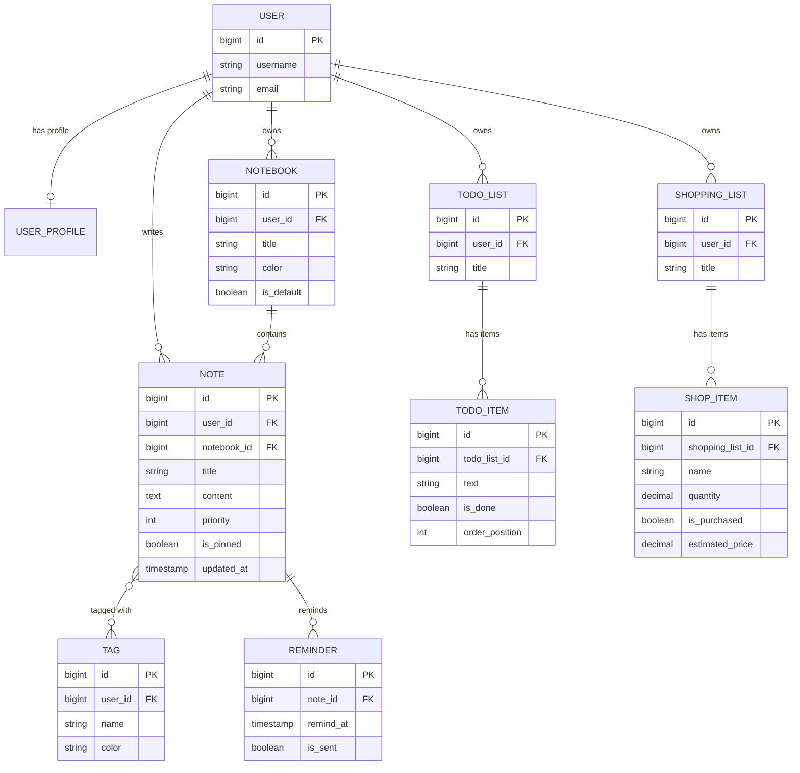
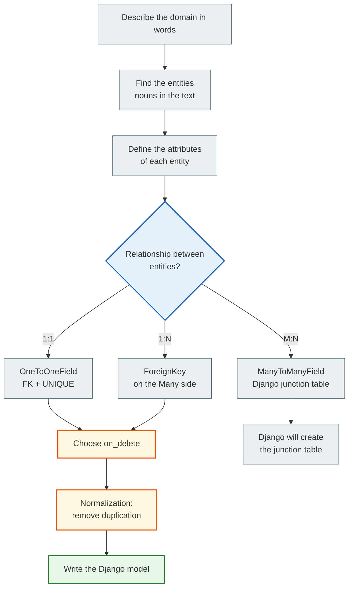
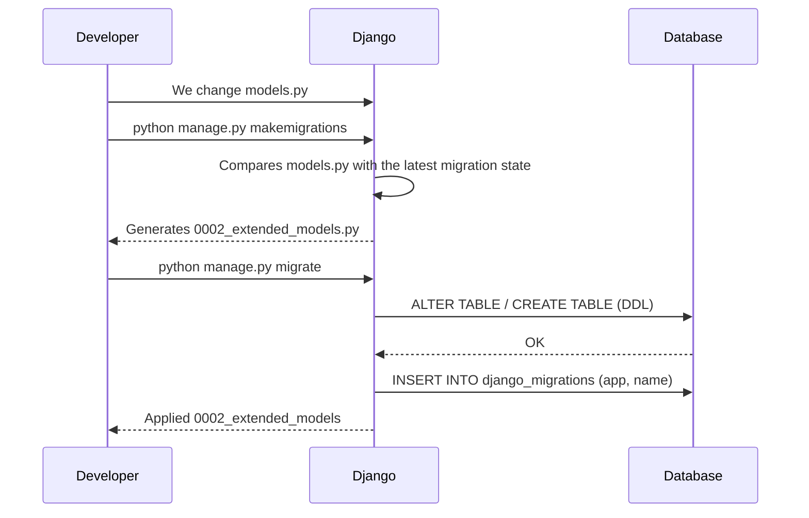

# Notes Project — from model design to PostgreSQL

> This tutorial walks you through the **full cycle**:
> come up with a data structure → draw the schema → write the models → migrations → queries → selectors/services → templates → switch from SQLite to PostgreSQL.
>
> The project is a **personal records manager**: notes, reminders, notebooks, to-do lists, shopping lists.
> Different data types were chosen on purpose to show every type of relationship between tables.

---

## Contents

**Architectural foundation** _(read before the code)_
- [01 · DOMAIN → SCHEMA — the design method](#01--domain--schema)
- [02 · RELATIONSHIP TYPES — where the FK lives](#02--relationship-types)
- [03 · APPLICATION LAYERS — layered architecture](#03--application-layers)
- [04 · NORMALIZATION — one truth for one fact](#04--normalization)
- [05 · MIGRATIONS — Git for the DB schema](#05--migrations)

🔬 **[orm_laboratory.ipynb](hello_app/orm_laboratory.ipynb)** — an interactive lab: run each cell and look at the SQL

**Step-by-step implementation**
1. [Step 0 — From domain to schema (the right start)](#step-0--from-domain-to-schema)
2. [Step 1 — Designing the domain: what we are building](#step-1--designing-the-domain)
3. [Step 2 — Identifying entities and relationships](#step-2--entities-and-relationships)
4. [Step 3 — ER diagrams (table schemas)](#step-3--er-diagrams)
5. [Step 4 — Writing Django models](#step-4--django-models)
6. [Step 5 — Migrations: schema → database](#step-5--migrations)
7. [Step 6 — First run with SQLite](#step-6--running-with-sqlite)
8. [Step 7 — Architecture: Services & Selectors](#step-7--architecture-services--selectors)
9. [Step 8 — Views and templates](#step-8--views-and-templates)
10. [Step 9 — QuerySet API: basic queries](#step-9--querysets)
11. [Step 10 — Switching from SQLite to PostgreSQL](#step-10--postgresql)
12. [Project file structure](#file-structure)

---

## 01 · DOMAIN → SCHEMA

> **"Design before code."**  
> Mistake #1 — starting with `class Note(models.Model)` and adding fields "on the fly".  
> A month later — a schema refactor = a migration that is hard to roll back in production.  
> **30 minutes of design = weeks of time saved.**

The architecture board describes **7 steps** from business words to a working database:

| # | Step | What you do | Example |
|---|------|----------|---------|
| **1** | **DOMAIN** | Describe in words what you are building | "A user has notebooks. Notebooks contain notes. Notes have tags and reminders." |
| **2** | **ENTITIES** | Find the nouns in the text | `User`, `Notebook`, `Note`, `Tag`, `Reminder`, `TodoList`, `ShoppingList` |
| **3** | **ATTRIBUTES** | What do we know about each entity? | `Note` → `title`, `content`, `priority`, `is_pinned`, `updated_at`… |
| **4** | **RELATIONSHIPS** | How are the entities related? | `1:1` User↔Profile · `1:N` Notebook→Notes · `M:N` Note↔Tag |
| **5** | **NORMALIZATION** | Remove duplication | `author_name` in Note? — No, only an FK to User |
| **6** | **on_delete** | What happens when the parent is deleted? | CASCADE / SET_NULL / PROTECT / RESTRICT |
| **7** | **DJANGO MODEL** | _Only now_ do we write `models.py` | ← Mistake #1: starting here |

> ⚠️ **Anti-pattern.** Starting with `class Note(models.Model)` and adding fields "on the fly".  
> The ER diagram is a **contract** between you and the database. Break it in code — and you pay with a migration.

### Full schema: 11 tables of the Notes Platform

```
schema_v1 · 11 tables · 1 junction table · postgres-ready
─────────────────────────────────────────────────────────

USER (auth_user)                    USER_PROFILE  ←── 1:1 OneToOne
┌──────────────┬─────────────┐      ┌────────────────┬──────────────────┐
│ id           │ bigint PK   │──┐   │ id             │ bigint PK        │
│ username     │ varchar(150)│  └──►│ user_id        │ bigint UNIQUE FK │
│ email        │ varchar(254)│      │ display_name   │ varchar(60)      │
│ password     │ varchar(128)│      │ timezone       │ varchar(40)      │
│ date_joined  │ timestamp   │      │ avatar_url     │ text             │
└──────────────┴─────────────┘      └────────────────┴──────────────────┘
       │ owns 1:N              │ writes 1:N          │ owns tags 1:N
       ▼                       ▼                     ▼
NOTEBOOK                      NOTE (central)        TAG
┌─────────────┬──────────┐    ┌───────────────┬──────────────────┐    ┌──────────┬───────────────────┐
│ id          │ bigint PK│    │ id            │ bigint PK        │    │ id       │ bigint PK         │
│ user_id     │ bigint FK│    │ user_id       │ bigint FK        │    │ user_id  │ bigint FK         │
│ title       │ varchar  │    │ notebook_id   │ bigint NULL FK   │    │ name     │ varchar(50)       │
│ color       │ varchar  │    │ title         │ varchar(200)     │    │ color    │ varchar(7)        │
│ is_default  │ boolean  │    │ content       │ text             │    └──────────┴───────────────────┘
└─────────────┴──────────┘    │ priority      │ smallint         │     unique_together(user_id, name)
       │ contains 1:N         │ is_pinned     │ boolean          │
       └─────────────────────►│ is_archived   │ boolean          │◄──── M:N via NOTE_TAGS
                              │ created_at    │ timestamp        │
                              │ updated_at    │ timestamp        │
                              │ views_count   │ integer          │
                              └───────────────┴──────────────────┘
                                     │ reminds 1:N
                                     ▼
                              REMINDER                         NOTE_TAGS (junction)
                              ┌───────────┬──────────────┐     ┌──────────┬────────────┐
                              │ id        │ bigint PK    │     │ note_id  │ bigint FK  │
                              │ note_id   │ bigint FK    │     │ tag_id   │ bigint FK  │
                              │ remind_at │ timestamp    │     └──────────┴────────────┘
                              │ is_sent   │ boolean      │     UNIQUE(note_id, tag_id)
                              │ repeat    │ varchar(20)  │     Django creates it automatically
                              └───────────┴──────────────┘

TODO_LIST                     TODO_ITEM
┌─────────────┬──────────┐    ┌────────────────┬──────────────┐
│ id          │ bigint PK│    │ id             │ bigint PK    │
│ user_id     │ bigint FK│───►│ todo_list_id   │ bigint FK    │
│ title       │ varchar  │    │ text           │ varchar(500) │
│ is_completed│ boolean  │    │ is_done        │ boolean      │
└─────────────┴──────────┘    │ order_position │ integer      │
                              │ due_date       │ date NULL    │
                              └────────────────┴──────────────┘

SHOPPING_LIST                 SHOP_ITEM
┌─────────────┬──────────┐    ┌──────────────────┬──────────────────┐
│ id          │ bigint PK│    │ id               │ bigint PK        │
│ user_id     │ bigint FK│───►│ shopping_list_id │ bigint FK        │
│ title       │ varchar  │    │ name             │ varchar(120)     │
│ store_name  │ varchar  │    │ quantity         │ decimal(8,2)     │
└─────────────┴──────────┘    │ unit             │ varchar(20)      │
                              │ is_purchased     │ boolean          │
                              │ estimated_price  │ decimal(10,2)    │
                              └──────────────────┴──────────────────┘
                              ⚠️ DecimalField for money — not FloatField!
```



---

## 02 · RELATIONSHIP TYPES

There are three types of relationships between tables. The question "where does the FK live?" is not a technical question, it is an **architectural** one.

### 1:1 — OneToOneField

> **FK + UNIQUE** · "user has exactly one profile"

```
USER                          USER_PROFILE
┌──────────────┬──────────┐   ┌────────────────┬──────────────────┐
│ id  bigint PK│          │──►│ id    bigint PK│                  │
│ username     │          │   │ user_id bigint │ UNIQUE FK        │
└──────────────┴──────────┘   │ display varchar│                  │
                              │ timezone       │                  │
                              └────────────────┴──────────────────┘
```

```python
class UserProfile(models.Model):
    user = models.OneToOneField(
        User, on_delete=CASCADE,
        related_name='profile',
    )
```

> **Why is this 1:1?** A regular `FK` + `UNIQUE` on the column.  
> The reverse is an **attribute** (not a QuerySet): `user.profile`.  
> Useful for **vertical partitioning**: 5 basic fields in User, 20 optional ones in Profile — we don't clutter the main table.

---

### 1:N — ForeignKey

> **FK on the "Many" side** · "notebook has many notes"

```
NOTEBOOK                    NOTE              NOTE              NOTE
┌──────────┬──────────┐     ┌───────────────────────┐
│ id       │ bigint PK│──┬─►│ id          bigint PK │
│ title    │ varchar  │  │  │ notebook_id bigint FK │← FK here!
└──────────┴──────────┘  ├─►│ title       varchar   │
                         │  └───────────────────────┘
                         ├─► (another note)
                         └─► (another note)
```

```python
class Note(models.Model):
    notebook = models.ForeignKey(
        Notebook, on_delete=SET_NULL,
        null=True, related_name='notes',
    )
```

> **Where does the FK live?** Always on the **Many** side.  
> `Notebook` **does not store** a list of notes — `Note` stores `notebook_id`.  
> That is the physics of SQL: one column = one value.

---

### M:N — ManyToManyField

> **Via a junction table** · Django creates it automatically

```
NOTE                  NOTE_TAGS (junction)    TAG
┌──────────┬──────┐   ┌──────────┬──────────┐  ┌──────────┬──────────┐
│ id       │  PK  │──►│ note_id  │ bigint FK│  │ id       │  PK      │
│ title    │      │   │ tag_id   │ bigint FK│─►│ name     │ varchar  │
└──────────┴──────┘   └──────────┴──────────┘  └──────────┴──────────┘
                       UNIQUE(note_id, tag_id)
                       Django: hello_app_note_tags
```

```python
class Note(models.Model):
    tags = models.ManyToManyField(Tag, blank=True)

# Django creates it ITSELF: hello_app_note_tags(note_id, tag_id)
note.tags.add(tag_py, tag_dj)   # INSERT × 2 into the junction
tag_py.notes.all()              # reverse → SELECT JOIN
```

> **Junction = a separate table.** There is no magic here — it is an ordinary table with two FKs.  
> Want to add `added_at` or `role` to the relationship? Pass `through=` and describe your own junction model.

---

### on_delete — what happens when the parent is deleted?

> ⚠️ **Mistake:** CASCADE by default for everything → deleting a single user can wipe out hundreds of rows.  
> Always choose the strategy **consciously**. It is a business decision, not a technical one.

| Strategy | What it does | When to choose it |
|-----------|-----------|---------------|
| `CASCADE` | Delete the children automatically | `Reminder → Note`: a reminder without a note makes no sense |
| `SET_NULL` | FK → NULL, the children live on | `Note → Notebook`: a note exists without a notebook. The field must be `null=True` |
| `SET_DEFAULT` | FK → the `default` value | `Note → Notebook`: move it to the "Default" notebook |
| `PROTECT` | `ProtectedError`, deletion is forbidden | `Tag`: don't allow deleting a tag while it is in use |
| `RESTRICT` | Forbid, but allow a cascade from a higher level | Complex domains with several levels of ownership |
| `DO_NOTHING` | The DB decides by itself (often = orphan) | Almost never. Only if you manage consistency manually (triggers) |

---

## 03 · APPLICATION LAYERS

> **Thin Views · Selectors Read · Services Write**  
> Each layer has **one responsibility**. Breaking this rule is the main cause of the "fat view" anti-pattern.

### Layered architecture

```
HTTP REQUEST
     │
     ▼
┌─────────────────────────────────────────┐
│  views.py                               │
│  ✓ parses the request                   │
│  ✓ calls a selector / service           │
│  ✓ render / redirect                    │
│  ✗ no QuerySets                         │
└────────────┬───────────────┬────────────┘
             │ READ →        │ WRITE →
             ▼               ▼
┌────────────────────┐  ┌──────────────────────────────┐
│  selectors.py      │  │  services.py                 │
│  SELECT only       │  │  CREATE / UPDATE / DELETE    │
│                    │  │                              │
│  get_user_notes()  │  │  create_note()               │
│  get_note_detail() │  │  update_note()               │
│  get_notebooks()   │  │  toggle_todo_item()          │
│  get_reminders()   │  │  mark_reminder_sent()        │
│                    │  │                              │
│  select_related,   │  │  transaction.atomic,         │
│  prefetch_related, │  │  F(), select_for_update      │
│  annotate — here   │  │  — here                      │
└────────┬───────────┘  └───────────┬──────────────────┘
         │ SELECT                   │ INSERT/UPDATE/DELETE
         └──────────┬───────────────┘
                    ▼
             ┌─────────────┐
             │  PostgreSQL │
             │  Database   │
             └─────────────┘
```

> **Why separate them?** The same query is needed in a View, a Celery task, an API endpoint, a test.  
> Without `selectors.py` you copy the QuerySet into 10 places. Change the logic → 10 places to update.  
> With `selectors.py` → **one function** that everyone uses.

---

### Responsibility matrix

| Layer | ✓ Does | ✗ Does not |
|-----|---------|------------|
| `models.py` | Structure · fields · relationships · constraints · indexes | Business logic, HTTP |
| `selectors.py` | SELECT QuerySets · annotate · prefetch · filters | INSERT / UPDATE / DELETE |
| `services.py` | CREATE / UPDATE / DELETE · transaction · F() · locks | HTTP, render, redirect |
| `views.py` | Parse the request · call a selector/service · render | QuerySets, business logic |
| `forms.py` | Validate HTTP input · `clean_*` | DB queries (except a queryset for choices) |
| `templates/` | HTML markup · context from the View | Any logic |

> **Check yourself:** if you see `Note.objects.filter(...)` in `views.py`, that is a signal to move it into `selectors.py`.  
> If you see an access-permission check condition in a template, that is a violation too.

---

### READ flow — tracing GET /notes/?q=python

```
01 │ Browser      │ GET /notes/?q=python
02 │ urls.py      │ match → views.note_list
03 │ views.py     │ search = request.GET['q']
04 │ views.py     │ selectors.get_user_notes(user, search='python')
05 │ selectors.py │ QuerySet.filter().select_related('notebook').prefetch_related('tags')
06 │ ORM          │ SQLCompiler → 2 SQL (note + tags prefetch)
07 │ PostgreSQL   │ executes the plan, returns rows
08 │ ORM          │ ModelIterable → list[Note] with a populated _result_cache
09 │ views.py     │ render('note_list.html', {notes, tags, notebooks})
10 │ Browser      │ 200 OK · HTML
```

> **The View stays thin:** 3 lines of code (parse + delegate + render).  
> All the complexity is in `selectors.get_user_notes`: filters, JOINs, the prefetch cache.

---

### WRITE flow — tracing POST /notes/create/

```
01 │ Browser      │ POST /notes/create/ form=...
02 │ views.py     │ form = NoteForm(POST, user=request.user) · is_valid?
03 │ views.py     │ services.create_note(user, title, tag_ids)
04 │ services.py  │ with transaction.atomic():
05 │ services.py  │ Note.objects.create(...) → BEGIN, INSERT note
06 │ services.py  │ Tag.objects.filter(user=user, id__in=...) · ownership check
07 │ services.py  │ note.tags.set(valid) → INSERT × N into the junction
08 │ PostgreSQL   │ COMMIT · on_commit callbacks
09 │ views.py     │ messages.success(...)  ·  return redirect('note_detail', pk)
10 │ Browser      │ 302 → GET /notes/42/  (PRG pattern: F5 is safe)
```

> **PRG (Post / Redirect / Get).** A POST does not render — it redirects.  
> F5 repeats the GET — that is safe. Without PRG: F5 = a duplicate record.

> **Ownership via FK traversal.** `Tag.objects.filter(user=user, id__in=...)` —  
> don't let a user attach someone else's tags to their own note.

---

## 04 · NORMALIZATION

> **"One truth for one fact."**  
> Normalization is the process of finding and eliminating duplication in a relational schema.  
> Goal: every fact is stored in **exactly one place**.

### Before / After — 3NF by example

**❌ BEFORE (1NF) — everything in a single `employees` table:**

| id | name  | dept_id | dept_name   | location | salary |
|----|-------|---------|-------------|----------|--------|
| 1  | Alice | 10      | **Engineering** | **Kyiv** | 50000  |
| 2  | Bob   | 10      | **Engineering** | **Kyiv** | 45000  |
| 3  | Carol | 20      | **Design**      | **Lviv** | 48000  |
| 4  | Dan   | 10      | **Engineering** | **Kyiv** | 52000  |
| 5  | Eva   | 20      | **Design**      | **Lviv** | 49000  |

**Problem:** "Engineering / Kyiv" is repeated 3 times.  
Moved to Kharkiv? `UPDATE` 1000 rows. Made a typo in the name? Inconsistency.

---  →  3NF: **move it into a separate table**  ---

**✅ AFTER — `employees` (FK → `departments.id`):**

| id | name  | dept_id | salary |
|----|-------|---------|--------|
| 1  | Alice | **10**  | 50000  |
| 2  | Bob   | **10**  | 45000  |
| 3  | Carol | **20**  | 48000  |
| 4  | Dan   | **10**  | 52000  |
| 5  | Eva   | **20**  | 49000  |

**✅ `departments` — one truth:**

| id | name        | location |
|----|-------------|----------|
| 10 | Engineering | Kyiv     |
| 20 | Design      | Lviv     |

```python
# Django model after normalization:
class Department(models.Model):
    name     = models.CharField(max_length=80)
    location = models.CharField(max_length=80)

class Employee(models.Model):
    name       = models.CharField(max_length=80)
    department = models.ForeignKey(Department, on_delete=models.PROTECT)
    salary     = models.DecimalField(max_digits=10, decimal_places=2)
```

> **Moving now:** `UPDATE departments SET location='Kharkiv' WHERE id=10;`  
> **1 row instead of 1000.** Inconsistency is impossible.

### The three normal forms — cheat sheet

| Form | Rule | Violation — example |
|-------|---------|---------------------|
| **1NF** | All values are atomic, no arrays in a cell | `tags = "python,django,orm"` in a single column |
| **2NF** | All non-key attributes depend on the **whole** PK | In a `(order_id, product_id)` table → `product_name` depends only on `product_id` |
| **3NF** | No **transitive** dependencies (A→B→C where B is not a key) | `employee.dept_name` depends on `dept_id`, not on `employee.id` |

> **Practical rule:** if changing one fact requires an `UPDATE` of > 1 row, the schema is not normalized.

---

## 05 · MIGRATIONS

> **"Git for the database schema."**  
> Each migration is a commit that describes schema changes. Django tracks which ones have already been applied in `django_migrations`.

### Migration Lifecycle — from a model change to ALTER TABLE

```
┌─────────────┐    ┌─────────────────────────────────┐    ┌──────────────────┐
│  Developer  │    │         Django ORM              │    │   PostgreSQL     │
└──────┬──────┘    └──────────────┬──────────────────┘    └────────┬─────────┘
       │                         │                                  │
  1. Changes in models.py        │                                  │
       │                         │                                  │
  2. $ makemigrations ──────────►│                                  │
       │              Compares   │                                  │
       │              models.py  │                                  │
       │              with the   │                                  │
       │              last state │                                  │
       │◄─────────────────────── │                                  │
  3. Receives 0003_add_field.py  │                                  │
       │                         │                                  │
  4. $ sqlmigrate (check)        │                                  │
       │                         │                                  │
  5. $ migrate ─────────────────►│                                  │
       │                         │  ALTER TABLE notes_note ────────►│
       │                         │  ADD COLUMN word_count integer;  │
       │                         │◄──────────────────────────────── │
       │                         │  INSERT INTO django_migrations   │
       │◄─────────────────────── │  (app, name, applied)            │
  6. ✓ Applied 0003_add_field    │                                  │
```

### Migration Dependency Graph (DAG)



> **`django_migrations`** is a special log table. `migrate` applies only the nodes  
> that are not there yet, in the **topological order** of dependencies.

### Key commands

```bash
# Generate a migration with a descriptive name
python manage.py makemigrations --name add_word_count_to_note

# View the SQL before running it (always do this before migrate!)
python manage.py sqlmigrate hello_app 0003

# Apply all new migrations
python manage.py migrate

# Show the state of all migrations (✓ applied, □ not yet)
python manage.py showmigrations

# Roll back to a specific migration
python manage.py migrate hello_app 0002
```

### Migration rules

| Rule | Why |
|---------|------|
| ✅ New field: always `default=` or `null=True` | Without a default — what should be written into existing rows? |
| ✅ Descriptive name `--name add_word_count` | `0003_add_word_count` is more readable than `0003_note` |
| ✅ Commit migrations to git | Otherwise your colleagues won't be able to update their DB |
| ✅ `sqlmigrate` before `migrate` | You check the SQL that will be executed |
| ❌ Editing an applied migration | Production and dev get out of sync — a disaster |
| ❌ Deleting migrations from git | Breaks the dependency graph |

---

## Step 0 — From domain to schema

---
> **🧠 Mental model:** Database design is not "which table should I add". It is **modeling the real world**. First you think in the language of the business: "a user can have notebooks, each notebook contains notes, notes can have tags". Then you translate this into data structures. Django models are the last step, not the first.
>
> **📚 Where mistakes begin:** Most DB schema problems happen because the developer starts writing code right away without thinking about relationships. A month later it turns out a new relationship is needed — and adding it without a massive migration is impossible. **30 minutes of design = weeks of time saved**.
>
> **❌ Common mistake:** Starting by writing the model. The right order: **domain → entities → attributes → relationships → normalization → Django model**.
---

### The design process (the right order):

```
1. DOMAIN — describe in words what we are building
   "A user has notebooks. Notebooks contain notes.
    Notes can be in to-do lists. There are reminders with a date."

2. ENTITIES — find the "nouns" in the domain description
   User, Notebook, Note, To-do list, List item,
   Reminder, Shopping list, Product, Tag

3. ATTRIBUTES — for each entity: what do we know about it?
   Note: title, content, created_at, is_pinned, priority

4. RELATIONSHIPS — how are the entities related to each other?
   Note → Notebook: many notes in one notebook (FK)
   Note ↔ Tag: one note, many tags; one tag, many notes (M:N)

5. NORMALIZATION — check: is there duplication?
   If Note has an author_name field, that duplicates User. Replace it with an FK.

6. CHOOSING on_delete — what happens when the parent record is deleted?
   Deleting a Notebook → delete all its notes (CASCADE)?
   Or move them to a "General notebook" (SET_DEFAULT)?

7. DJANGO MODEL — only after all of the above
```

---

## Step 1 — Designing the domain

We are building a **personal records manager** — like Notion or Evernote, but simplified.

### What our product should be able to do:

| Feature | Description |
|---------|------|
| 📓 Notebooks | Collections of notes (like folders). Each note is in one notebook |
| 📝 Notes | Text records with a title, content, tags, priority |
| 🏷️ Tags | Labels for notes. One note = many tags. One tag = many notes |
| ✅ To-do lists | A to-do list. Each list has items with a checkbox |
| 🛒 Shopping lists | A list of products with a quantity and whether it was bought |
| ⏰ Reminders | Notifications tied to a note or a date |
| 📌 Pinning | Notes can be pinned to the top |

---

## Step 2 — Entities and relationships

### Analyzing relationships by type:

```
ONE-TO-ONE (1:1) — "one has exactly one":
  User ←→ UserProfile
  (each user has one profile, one profile belongs to one user)

ONE-TO-MANY (1:N) — "one has many":
  User → Notebook          (one user, many notebooks)
  Notebook → Note          (one notebook, many notes)
  User → Note              (a note has an author)
  User → TodoList          (one user, many to-do lists)
  TodoList → TodoItem      (one list, many items)
  User → ShoppingList      (one user, many shopping lists)
  ShoppingList → ShopItem  (one list, many products)
  Note → Reminder          (one note can have several reminders)

MANY-TO-MANY (M:N) — "many related to many":
  Note ↔ Tag  (a note has tags, a tag is in many notes)
```

### Where the FK lives — the "Many side" rule:

```
Notebook → Note (1:N):

  notebooks:                   notes:
  ┌────┬──────────┐            ┌────┬─────────────┬─────────────┐
  │ id │ title    │            │ id │ title        │ notebook_id │  ← FK here
  ├────┼──────────┤            ├────┼─────────────┼─────────────┤
  │  1 │ Work     │◄───────────│  1 │ Django ORM   │      1      │
  │  2 │ Personal │◄───────────│  2 │ Python tips  │      1      │
  │    │          │◄───────────│  3 │ Borscht soup │      2      │
  └────┴──────────┘            └────┴─────────────┴─────────────┘

Notebook does NOT store a list of notes.
Note stores a REFERENCE to its notebook (notebook_id=1).
```

---

## Step 3 — ER diagrams

### Main ER diagram



### Flowchart: the model design process



---

## Step 4 — Django models

The detailed model code is in `hello_app/models.py`. Here are the key principles:

```python
# A brief overview of all the models and their relationships

class UserProfile(models.Model):
    user = models.OneToOneField(User, on_delete=CASCADE, related_name='profile')
    # OneToOne = FK + UNIQUE. Each User → at most one Profile.


class Tag(models.Model):
    user = models.ForeignKey(User, on_delete=CASCADE)
    name = models.CharField(max_length=50)
    # Tags are bound to a specific user (privacy!)
    class Meta:
        unique_together = [('user', 'name')]  # Alice and Bob can have the same tag


class Notebook(models.Model):
    user = models.ForeignKey(User, on_delete=CASCADE, related_name='notebooks')
    title = models.CharField(max_length=100)
    is_default = models.BooleanField(default=False)


class Note(models.Model):
    user = models.ForeignKey(User, on_delete=CASCADE, related_name='notes')
    notebook = models.ForeignKey(Notebook, on_delete=SET_NULL, null=True, blank=True)
    tags = models.ManyToManyField(Tag, blank=True)
    # Three types of relationships in one model:
    # user: FK (required, CASCADE)
    # notebook: FK (optional, SET_NULL — a note can exist without a notebook)
    # tags: M:N (Django automatically creates the junction table)
    priority = models.PositiveSmallIntegerField(default=1)
    is_pinned = models.BooleanField(default=False)
    is_archived = models.BooleanField(default=False)


class Reminder(models.Model):
    note = models.ForeignKey(Note, on_delete=CASCADE, related_name='reminders')
    remind_at = models.DateTimeField()
    is_sent = models.BooleanField(default=False)


class TodoList(models.Model):
    user = models.ForeignKey(User, on_delete=CASCADE, related_name='todo_lists')

class TodoItem(models.Model):
    todo_list = models.ForeignKey(TodoList, on_delete=CASCADE, related_name='items')
    text = models.CharField(max_length=500)
    is_done = models.BooleanField(default=False)
    order_position = models.PositiveIntegerField(default=0)


class ShoppingList(models.Model):
    user = models.ForeignKey(User, on_delete=CASCADE, related_name='shopping_lists')

class ShopItem(models.Model):
    shopping_list = models.ForeignKey(ShoppingList, on_delete=CASCADE, related_name='items')
    quantity = models.DecimalField(max_digits=8, decimal_places=2, default=1)
    # DecimalField for money and quantities! FloatField → 0.1+0.2 = 0.30000000000000004
    estimated_price = models.DecimalField(max_digits=10, decimal_places=2, null=True)
```

---

## Step 5 — Migrations

---
> **🧠 Mental model:** Migrations are **Git for the database schema**. Each migration is a "commit" that describes schema changes. Django tracks which migrations have already been applied in the `django_migrations` table. `migrate` runs only the new ones.
>
> **❌ Common mistake:** Editing a migration that has already been applied. If a migration has already been applied in production and you edit it, production and development get out of sync. Changing an applied migration = a disaster. If you need a change → a **new** migration.
---

### Migration workflow — step by step:



```bash
# Steps for our project:

# 1. Go to the project folder
cd module_5/lesson_Django_ORM_Database/notes_project

# 2. Check that hello_app is in INSTALLED_APPS
# settings.py → INSTALLED_APPS must contain 'hello_app'

# 3. Generate the first migration
python manage.py makemigrations
# Expected output:
# Migrations for 'hello_app':
#   hello_app/migrations/0001_initial.py
#     - Create model UserProfile, Tag, Notebook, Note, Reminder,
#       TodoList, TodoItem, ShoppingList, ShopItem

# 4. View the SQL that will be executed (without executing it)
python manage.py sqlmigrate hello_app 0001
# Useful: check column types, FKs, indexes

# 5. Run the migration
python manage.py migrate

# 6. Show the state of all migrations
python manage.py showmigrations
```

### When a new migration is needed (adding a field):

```python
# Add a new field to Note
class Note(models.Model):
    ...
    word_count = models.PositiveIntegerField(default=0)  # NEW FIELD
```

```bash
python manage.py makemigrations --name add_word_count_to_note
# → hello_app/migrations/0003_add_word_count_to_note.py

python manage.py sqlmigrate hello_app 0003
# ALTER TABLE "hello_app_note" ADD COLUMN "word_count" integer NOT NULL DEFAULT 0;

python manage.py migrate
```

| Rule | Why |
|---------|------|
| New field: always `default=` or `null=True` | Without a default — what should be written into existing rows? |
| Never edit an applied migration | Production and dev get out of sync |
| Descriptive name (`add_word_count`) | `0003_add_word_count` > `0003_note` |
| Commit migrations to git | Otherwise your colleagues won't be able to update their DB |

---

## Step 6 — Running with SQLite

SQLite is ideal for development. Nothing to install.

```bash
# Initialize the DB (SQLite by default)
python manage.py migrate

# Create a superuser for the admin
python manage.py createsuperuser

# Start the server
python manage.py runserver
# http://127.0.0.1:8000/
# http://127.0.0.1:8000/admin/
# http://127.0.0.1:8000/notes/
```

### Testing the models in the Django shell:

```bash
python manage.py shell
```

```python
from django.contrib.auth.models import User
from hello_app.models import *

# Create a user
user = User.objects.create_user('alice', 'alice@test.com', 'pass123')

# Profile (OneToOne)
profile = UserProfile.objects.create(user=user, display_name='Alice')
print(user.profile.display_name)  # via related_name

# Notebook
notebook = Notebook.objects.create(user=user, title='Робота', is_default=True)

# Tags
tag_py = Tag.objects.create(user=user, name='python', color='#3776AB')
tag_dj = Tag.objects.create(user=user, name='django', color='#092E20')

# A note with tags
note = Note.objects.create(
    user=user, notebook=notebook,
    title='Django ORM', content='QuerySet — лінива оцінка...',
    priority=Note.PRIORITY_HIGH, is_pinned=True
)
note.tags.add(tag_py, tag_dj)  # M:N — INSERT into the junction table

# To-do list
todo = TodoList.objects.create(user=user, title='Вивчити ORM')
TodoItem.objects.bulk_create([
    TodoItem(todo_list=todo, text='RELATIONAL_DB_FOUNDATIONS.md', order_position=1),
    TodoItem(todo_list=todo, text='DJANGO_ORM_DEEP.md', order_position=2),
    TodoItem(todo_list=todo, text='Зробити проект', order_position=3),
])

# Shopping list
shopping = ShoppingList.objects.create(user=user, title='В магазин')
ShopItem.objects.create(
    shopping_list=shopping, name='Молоко',
    quantity=2, unit=ShopItem.UNIT_LITER, estimated_price=45.00
)

print(f"Нотаток: {user.notes.count()}")
print(f"Теги: {[t.name for t in note.tags.all()]}")
```

---

## Step 7 — Architecture: Services & Selectors

> **Detailed documentation (read separately):**
> - [DJANGO_SERVICES_SELECTORS.md](../DJANGO_SERVICES_SELECTORS.md) — the full architecture: View→Service→Selector→ORM, data flow, anti-patterns, a responsibility table
> - [DJANGO_SELECTORS.md](../DJANGO_SELECTORS.md) — an in-depth look at Selectors: CQRS-light, naming convention, QuerySet vs evaluated list, centralizing N+1
> - [DJANGO_SERVICES.md](../DJANGO_SERVICES.md) — an in-depth look at Services: stateless functions, `@transaction.atomic`, `on_commit()`, Celery as a transport layer

---
> **🧠 Mental model:** A View is a **traffic controller**, not a worker. It accepts an HTTP request, delegates the work and returns a response. If a View runs all the DB queries itself, it is a "fat view", and a month later the code becomes unreadable. Selector = reading. Service = writing/changing.
>
> **📚 Why Services/Selectors:** The same DB query is needed in a View, in a Celery task, in an API, in a test. Without a Selector you copy the QuerySet into 10 places. Change the business logic → 10 places to update. With a Selector → 1 function.
>
> **🌐 Architectural split:**
> - `selectors.py` — ONLY reading (SELECT). No INSERT/UPDATE/DELETE.
> - `services.py` — ONLY writing (CREATE/UPDATE/DELETE). No direct SELECTs in the View.
> - `views.py` — ONLY HTTP logic. Calls selectors and services.
>
> **❌ Common mistake:** `Note.objects.filter(user=user)` directly in a View is a violation. All QuerySets → into selectors.
---

### The `hello_app/selectors.py` file:

```python
# hello_app/selectors.py
"""
Selectors — the data READING layer.
All SELECT queries live here.
Views, Tasks, API — they all use selectors.
"""
from django.db.models import Count, Q, Prefetch
from django.utils import timezone

from .models import Note, Notebook, Tag, TodoList, TodoItem, ShoppingList, Reminder


def get_user_notes(user, *, archived=False, notebook=None, tag=None, search=None):
    """
    The user's list of notes with filters.
    select_related + prefetch_related — solves the N+1 problem.
    """
    qs = Note.objects.filter(
        user=user,
        is_archived=archived
    ).select_related(
        'notebook'           # FK → JOIN (1 query instead of N)
    ).prefetch_related(
        'tags'               # M:N → a 2nd query (not N+1)
    )

    if notebook:
        qs = qs.filter(notebook=notebook)

    if tag:
        qs = qs.filter(tags=tag)

    if search:
        qs = qs.filter(
            Q(title__icontains=search) | Q(content__icontains=search)
        )

    return qs.order_by('-is_pinned', '-priority', '-updated_at')


def get_note_detail(user, note_id):
    """
    Note detail — with all relationships.
    Raises Note.DoesNotExist if not found or not the owner.
    """
    return Note.objects.select_related(
        'notebook', 'user'
    ).prefetch_related(
        'tags',
        Prefetch(
            'reminders',
            queryset=Reminder.objects.filter(
                remind_at__gte=timezone.now()
            ).order_by('remind_at')
        )
    ).get(id=note_id, user=user)


def get_user_notebooks(user):
    """All notebooks with their note count."""
    return Notebook.objects.filter(user=user).annotate(
        note_count=Count('notes', filter=Q(notes__is_archived=False))
    ).order_by('-is_default', 'title')


def get_user_tags(user):
    """Tags with their note count."""
    return Tag.objects.filter(user=user).annotate(
        note_count=Count('notes')
    ).order_by('name')


def get_user_todo_lists(user):
    """To-do lists with progress."""
    return TodoList.objects.filter(
        user=user
    ).annotate(
        total_items=Count('items'),
        done_items=Count('items', filter=Q(items__is_done=True))
    ).prefetch_related('items').order_by('is_completed', '-created_at')


def get_pending_reminders():
    """For the Celery worker: reminders that need to be sent."""
    return Reminder.objects.filter(
        is_sent=False,
        remind_at__lte=timezone.now()
    ).select_related('note__user')
```

### The `hello_app/services.py` file:

```python
# hello_app/services.py
"""
Services — the data WRITING layer.
All the business logic lives here: CREATE, UPDATE, DELETE.
Services may call selectors, but not the other way around.
"""
from django.db import transaction
from django.db.models import F
from django.utils.text import slugify

from .models import Note, Notebook, Tag, TodoItem, Reminder


def create_note(*, user, title, content='', notebook=None, priority=1, tag_ids=None):
    """
    Creating a note with tags.
    transaction.atomic() — either the Note and its tags are saved together, or nothing is.
    """
    with transaction.atomic():
        note = Note.objects.create(
            user=user,
            title=title,
            content=content,
            notebook=notebook,
            priority=priority,
        )
        if tag_ids:
            # Check that the tags belong to this user (security!)
            valid_tags = Tag.objects.filter(id__in=tag_ids, user=user)
            note.tags.set(valid_tags)

    return note


def update_note(note, *, title=None, content=None, priority=None,
                notebook=None, is_pinned=None, tag_ids=None):
    """
    Updating a note — only the given fields.
    update_fields → generates an UPDATE only for the changed columns.
    """
    changed_fields = []

    if title is not None:
        note.title = title
        changed_fields.append('title')
    if content is not None:
        note.content = content
        changed_fields.append('content')
    if priority is not None:
        note.priority = priority
        changed_fields.append('priority')
    if notebook is not None:
        note.notebook = notebook
        changed_fields.append('notebook')
    if is_pinned is not None:
        note.is_pinned = is_pinned
        changed_fields.append('is_pinned')

    if changed_fields:
        note.save(update_fields=changed_fields)

    if tag_ids is not None:
        valid_tags = Tag.objects.filter(id__in=tag_ids, user=note.user)
        note.tags.set(valid_tags)

    return note


def archive_note(note):
    """Archiving a note (not deleting it)."""
    Note.objects.filter(pk=note.pk).update(is_archived=True)


def delete_note(note):
    """Deleting a note. CASCADE will delete the Reminders automatically."""
    note.delete()


def toggle_todo_item(item_id, *, user):
    """
    Check/uncheck a list item.
    select_for_update() — prevents a race condition on simultaneous clicks.
    """
    with transaction.atomic():
        item = TodoItem.objects.select_for_update().get(
            id=item_id,
            todo_list__user=user   # access-permission check via FK traversal
        )
        item.is_done = not item.is_done
        item.save(update_fields=['is_done'])
    return item


def mark_reminder_sent(reminder_id):
    """
    Atomically mark a reminder as sent.
    F() + update() — race condition safe.
    """
    Reminder.objects.filter(pk=reminder_id).update(is_sent=True)


def create_tag(*, user, name, color='#808080'):
    """Creating a tag with a uniqueness check."""
    tag, created = Tag.objects.get_or_create(
        user=user,
        name=name.lower().strip(),
        defaults={'color': color}
    )
    return tag, created
```

---

## Step 8 — Views and templates

---
> **🧠 Mental model:** A View is a **thin layer**. It: (1) parses the HTTP request, (2) calls a selector or a service, (3) renders a template or returns a redirect. **No business logic, no QuerySets directly in the View**.
>
> **📚 The PRG pattern:** Post/Redirect/Get is the standard for forms. GET → show the form. POST → process it → **redirect** (not render). Why? Without a redirect: the user presses F5 → the browser repeats the POST → a duplicate record. With a redirect → F5 repeats the GET → safe.
>
> **❌ Common mistake:** `Note.objects.filter(...)` directly in a View. This breaks the architectural split. 3 months later the same query is needed in a Celery task → you copy it → duplication → things get out of sync.
---

### `hello_app/views.py`:

```python
# hello_app/views.py
from django.shortcuts import render, redirect, get_object_or_404
from django.contrib import messages
from django.contrib.auth.decorators import login_required

from .models import Note
from .forms import NoteForm
from . import selectors, services


@login_required
def note_list(request):
    """
    The current user's list of notes.
    The View only: gets the filters from GET → calls a selector → renders.
    """
    search = request.GET.get('q', '')
    tag_id = request.GET.get('tag')
    notebook_id = request.GET.get('notebook')

    # The Selector decides WHICH query, the View decides WHICH parameters
    notes = selectors.get_user_notes(
        request.user,
        search=search or None,
        tag=tag_id or None,
    )
    notebooks = selectors.get_user_notebooks(request.user)
    tags = selectors.get_user_tags(request.user)

    return render(request, 'hello_app/note_list.html', {
        'notes': notes,
        'notebooks': notebooks,
        'tags': tags,
        'search': search,
        'active_tag': tag_id,
    })


@login_required
def note_detail(request, pk):
    """Note detail. The Selector raises Note.DoesNotExist if the user is not the owner."""
    try:
        note = selectors.get_note_detail(request.user, pk)
    except Note.DoesNotExist:
        from django.http import Http404
        raise Http404("Нотатку не знайдено")

    return render(request, 'hello_app/note_detail.html', {'note': note})


@login_required
def note_create(request):
    """
    PRG: GET → an empty form. POST → service.create_note() → redirect.
    """
    if request.method == 'POST':
        form = NoteForm(request.POST)
        if form.is_valid():
            note = services.create_note(
                user=request.user,
                title=form.cleaned_data['title'],
                content=form.cleaned_data.get('content', ''),
                priority=form.cleaned_data.get('priority', 1),
            )
            messages.success(request, f'Нотатку "{note.title}" створено!')
            return redirect('hello_app:note_detail', pk=note.pk)
    else:
        form = NoteForm()

    return render(request, 'hello_app/note_form.html', {
        'form': form,
        'action': 'Створити',
        'title': 'Нова нотатка',
    })


@login_required
def note_edit(request, pk):
    """Editing. The Service runs an UPDATE only for the changed fields."""
    note = get_object_or_404(Note, pk=pk, user=request.user)

    if request.method == 'POST':
        form = NoteForm(request.POST, instance=note)
        if form.is_valid():
            services.update_note(
                note,
                title=form.cleaned_data['title'],
                content=form.cleaned_data.get('content', ''),
                priority=form.cleaned_data.get('priority', note.priority),
            )
            messages.success(request, f'Нотатку "{note.title}" оновлено!')
            return redirect('hello_app:note_detail', pk=note.pk)
    else:
        form = NoteForm(instance=note)

    return render(request, 'hello_app/note_form.html', {
        'form': form,
        'note': note,
        'action': 'Зберегти',
        'title': f'Редагувати: {note.title}',
    })


@login_required
def note_delete(request, pk):
    """
    Deletion via POST (not GET!).
    GET → a confirmation page. POST → service.delete_note() → redirect.
    """
    note = get_object_or_404(Note, pk=pk, user=request.user)

    if request.method == 'POST':
        title = note.title
        services.delete_note(note)
        messages.warning(request, f'Нотатку "{title}" видалено.')
        return redirect('hello_app:note_list')

    return render(request, 'hello_app/note_confirm_delete.html', {'note': note})
```

### Templates

**`hello_app/templates/hello_app/note_list.html`:**

```html



Мої нотатки


<div class="container py-4">
    <div class="row">
        <!-- Sidebar: filters -->
        <div class="col-md-3">
            <div class="card mb-3">
                <div class="card-header fw-bold">📓 Записники</div>
                <ul class="list-group list-group-flush">
                    <li class="list-group-item">
                        <a href="" class="text-decoration-none">
                            Всі нотатки
                        </a>
                    </li>
                    
                    <li class="list-group-item d-flex justify-content-between">
                        <a href="?notebook={{ nb.id }}" class="text-decoration-none">
                            {{ nb.title }}
                        </a>
                        <span class="badge bg-secondary">{{ nb.note_count }}</span>
                    </li>
                    
                </ul>
            </div>

            <div class="card">
                <div class="card-header fw-bold">🏷️ Теги</div>
                <div class="card-body">
                    
                    <a href="?tag={{ tag.id }}"
                       class="badge text-decoration-none me-1 mb-1"
                       style="background-color: {{ tag.color }};">
                        #{{ tag.name }}
                        <small>({{ tag.note_count }})</small>
                    </a>
                    
                </div>
            </div>
        </div>

        <!-- Main content -->
        <div class="col-md-9">
            <div class="d-flex justify-content-between align-items-center mb-3">
                <h2>📝 Нотатки</h2>
                <a href="" class="btn btn-primary">
                    ➕ Нова нотатка
                </a>
            </div>

            <!-- Search -->
            <form method="get" class="mb-3">
                <div class="input-group">
                    <input type="text" name="q" value="{{ search }}"
                           class="form-control" placeholder="Пошук нотаток...">
                    <button type="submit" class="btn btn-outline-secondary">🔍</button>
                </div>
            </form>

            <!-- Django Messages -->
            
            <div class="alert alert-{{ message.tags }} alert-dismissible" role="alert">
                {{ message }}
                <button type="button" class="btn-close" data-bs-dismiss="alert"></button>
            </div>
            

            <!-- List of notes -->
            
            <div class="row row-cols-1 row-cols-md-2 g-3">
                
                <div class="col">
                    <div class="card h-100 border-warning">
                        <div class="card-body">
                            <div class="d-flex justify-content-between">
                                <h5 class="card-title">
                                    📌 
                                    <a href=""
                                       class="text-decoration-none text-dark">
                                        {{ note.title }}
                                    </a>
                                </h5>
                                <!-- Priority -->
                                <span class="badge
                                    bg-danger
                                    bg-warning text-dark
                                    bg-info text-dark
                                    bg-light text-dark">
                                    {{ note.get_priority_display }}
                                </span>
                            </div>

                            <p class="card-text text-muted small">
                                {{ note.content|truncatechars:100 }}
                            </p>

                            <!-- Tags (loaded via prefetch_related — no N+1!) -->
                            <div class="mb-2">
                                
                                <a href="?tag={{ tag.id }}"
                                   class="badge text-decoration-none"
                                   style="background-color: {{ tag.color }};">
                                    #{{ tag.name }}
                                </a>
                                
                            </div>
                        </div>

                        <div class="card-footer d-flex justify-content-between">
                            <small class="text-muted">
                                📁 {{ note.notebook.title|default:"Без записника" }}
                                · {{ note.updated_at|date:"d.m.Y" }}
                            </small>
                            <div>
                                <a href=""
                                   class="btn btn-sm btn-outline-secondary">✏️</a>
                                <a href=""
                                   class="btn btn-sm btn-outline-danger">🗑️</a>
                            </div>
                        </div>
                    </div>
                </div>
                
            </div>

            
            <div class="text-center py-5">
                <div class="display-1">📝</div>
                <p class="text-muted">
                    
                        Нотаток за запитом "{{ search }}" не знайдено.
                    
                        У вас ще немає нотаток.
                    
                </p>
                <a href="" class="btn btn-primary">
                    Створити першу нотатку
                </a>
            </div>
            
        </div>
    </div>
</div>

```

**`hello_app/templates/hello_app/note_detail.html`:**

```html


{{ note.title }}


<div class="container py-4">
    <div class="row">
        <div class="col-lg-8 mx-auto">

            <!-- Breadcrumb -->
            <nav aria-label="breadcrumb" class="mb-3">
                <ol class="breadcrumb">
                    <li class="breadcrumb-item">
                        <a href="">Нотатки</a>
                    </li>
                    
                    <li class="breadcrumb-item">{{ note.notebook.title }}</li>
                    
                    <li class="breadcrumb-item active">{{ note.title }}</li>
                </ol>
            </nav>

            <div class="card">
                <div class="card-header d-flex justify-content-between align-items-start">
                    <div>
                        <h1 class="h3 mb-1">
                            📌 
                            {{ note.title }}
                        </h1>
                        <small class="text-muted">
                            Створено: {{ note.created_at|date:"d.m.Y H:i" }}
                            · Оновлено: {{ note.updated_at|date:"d.m.Y H:i" }}
                        </small>
                    </div>
                    <span class="badge
                        bg-danger
                        bg-warning text-dark
                        bg-info text-dark
                        bg-secondary">
                        {{ note.get_priority_display }}
                    </span>
                </div>

                <div class="card-body">
                    <!-- Tags -->
                    <div class="mb-3">
                        
                        <span class="badge" style="background-color: {{ tag.color }};">
                            #{{ tag.name }}
                        </span>
                        
                        <span class="text-muted small">Без тегів</span>
                        
                    </div>

                    <!-- Content -->
                    <div class="note-content">
                        {{ note.content|linebreaks }}
                    </div>
                </div>

                <!-- Reminders -->
                
                <div class="card-footer">
                    <h6>⏰ Майбутні нагадування:</h6>
                    
                    <div class="d-flex align-items-center mb-1">
                        <span class="badge bg-light text-dark me-2">
                            {{ reminder.remind_at|date:"d.m.Y H:i" }}
                        </span>
                        
                        <small>{{ reminder.message }}</small>
                        
                    </div>
                    
                </div>
                
            </div>

            <!-- Action buttons -->
            <div class="mt-3 d-flex gap-2">
                <a href=""
                   class="btn btn-outline-primary">✏️ Редагувати</a>
                <a href=""
                   class="btn btn-outline-danger">🗑️ Видалити</a>
                <a href=""
                   class="btn btn-outline-secondary">← До списку</a>
            </div>
        </div>
    </div>
</div>

```

**`hello_app/templates/hello_app/note_form.html`:**

```html


{{ title }}


<div class="container py-4">
    <div class="row">
        <div class="col-md-8 mx-auto">
            <div class="card">
                <div class="card-header">
                    <h2 class="h4 mb-0">{{ title }}</h2>
                </div>
                <div class="card-body">
                    <form method="post" novalidate>
                        

                        
                        <div class="mb-3">
                            <label class="form-label fw-semibold" for="{{ field.id_for_label }}">
                                {{ field.label }}
                                
                                <span class="text-danger">*</span>
                                
                            </label>

                            
                            <textarea
                                class="form-control is-invalid"
                                id="{{ field.id_for_label }}"
                                name="{{ field.html_name }}"
                                rows="6">{{ field.value|default:'' }}</textarea>
                            
                            <input
                                type="{{ field.field.widget.input_type }}"
                                class="form-control is-invalid"
                                id="{{ field.id_for_label }}"
                                name="{{ field.html_name }}"
                                value="{{ field.value|default:'' }}">
                            

                            
                            <div class="invalid-feedback">
                                {{ field.errors|join:', ' }}
                            </div>
                            

                            
                            <div class="form-text text-muted">{{ field.help_text }}</div>
                            
                        </div>
                        

                        <div class="d-flex gap-2">
                            <button type="submit" class="btn btn-primary">
                                💾 {{ action }}
                            </button>
                            
                            <a href=""
                               class="btn btn-outline-secondary">Скасувати</a>
                            
                            <a href=""
                               class="btn btn-outline-secondary">Скасувати</a>
                            
                        </div>
                    </form>
                </div>
            </div>
        </div>
    </div>
</div>

```

**`hello_app/templates/hello_app/note_confirm_delete.html`:**

```html


Видалити нотатку


<div class="container py-4">
    <div class="row">
        <div class="col-md-6 mx-auto">
            <div class="card border-danger">
                <div class="card-header bg-danger text-white">
                    <h4 class="mb-0">🗑️ Підтвердження видалення</h4>
                </div>
                <div class="card-body">
                    <p class="mb-1">Ви впевнені що хочете видалити нотатку:</p>
                    <h5 class="text-danger">{{ note.title }}</h5>

                    
                    <div class="alert alert-warning">
                        ⚠️ Разом з нотаткою будуть видалені {{ note.reminders.count }} нагадування (CASCADE).
                    </div>
                    

                    <p class="text-muted small">Цю дію не можна відмінити.</p>
                </div>
                <div class="card-footer d-flex gap-2">
                    <form method="post">
                        
                        <button type="submit" class="btn btn-danger">
                            Так, видалити
                        </button>
                    </form>
                    <a href=""
                       class="btn btn-outline-secondary">Скасувати</a>
                </div>
            </div>
        </div>
    </div>
</div>

```

---

## Step 8.5 — Detailed tutorial: every function explained

> Here we will go through EVERY function from `selectors.py`, `services.py`, `views.py`
> and `forms.py` step by step — what happens inside and why.

---

### `selectors.py` — function by function

#### `get_user_notes(user, *, archived, notebook, tag, search)`

```
What it does: returns the user's filtered list of notes
Where it is called: views.note_list()
```

**Step by step:**

```python
# Step 1: The base QuerySet (LAZY — the SQL has not run yet!)
qs = Note.objects.filter(user=user, is_archived=archived)
#    SQL so far: WHERE note.user_id=? AND note.is_archived=?
#    But the SQL is NOT executed — Django waits until someone iterates the QuerySet!

# Step 2: select_related('notebook') — attach the FK with one JOIN
qs = qs.select_related('notebook')
#    The SQL becomes: LEFT JOIN hello_app_notebook nb ON note.notebook_id = nb.id
#    Consequence: note.notebook.title → does NOT trigger a new SELECT (already in memory!)
#
#    WITHOUT select_related: for note in qs: print(note.notebook.title)
#                        → 1 SELECT + N SELECTs = the N+1 problem!
#    WITH select_related: 1 SELECT with a JOIN — always!

# Step 3: prefetch_related('tags') — load the M:N
qs = qs.prefetch_related('tags')
#    QUERY 1: SELECT * FROM note WHERE ...
#    QUERY 2: SELECT tag.* ... WHERE note_id IN (1, 2, 3, ...)
#    Python: Django joins them by itself
#    Consequence: note.tags.all() → already in the cache, NOT a new SELECT!

# Step 4: Optional filters — a CHAIN (lazy)
if notebook is not None:
    qs = qs.filter(notebook=notebook)
    # SQL gets: AND note.notebook_id = ?

if tag is not None:
    qs = qs.filter(tags=tag)
    # SQL: AND EXISTS (SELECT 1 FROM note_tags WHERE note_id=? AND tag_id=?)

if search:
    qs = qs.filter(Q(title__icontains=search) | Q(content__icontains=search))
    # SQL: AND (note.title ILIKE '%search%' OR note.content ILIKE '%search%')

# Step 5: Ordering and return (still LAZY!)
return qs.order_by('-is_pinned', '-priority', '-updated_at')
# SQL: ORDER BY is_pinned DESC, priority DESC, updated_at DESC
# The SQL runs only when the View passes notes to the template and !
```

---

#### `get_note_detail(user, note_id)`

```
What it does: loads ONE note with all its relationships for the detail page
Where it is called: views.note_detail()
```

**The key difference from get_user_notes:**

```python
# get_user_notes → a QuerySet (a list, not executed yet)
# get_note_detail → ONE object (already executed!)

note = Note.objects.select_related('notebook', 'user')  # JOIN for the FKs
.prefetch_related(
    'tags',         # M:N: 2 queries
    Prefetch(       # A FILTERED prefetch!
        'reminders',
        queryset=Reminder.objects.filter(
            remind_at__gte=timezone.now()  # only FUTURE reminders
        ).order_by('remind_at'),
        to_attr='upcoming_reminders'  # store it in a SEPARATE attribute!
    )
).get(id=note_id, user=user)  # .get() → EXECUTES the SQL + checks permissions

# Why Prefetch with to_attr?
# WITHOUT to_attr:  note.reminders.all()         → NEW QuerySet (another SELECT!)
#              note.reminders.filter(...)      → NEW QuerySet (a different SELECT!)
# WITH to_attr:   note.upcoming_reminders        → list[Reminder] (already in memory!)
#   In the template:   ← NOT a SELECT!
```

---

#### `get_user_notebooks(user)` and `get_user_tags(user)`

```
What they do: notebooks/tags with the NUMBER of notes in a single SQL
Where they are called: views.note_list() → sidebar
```

**Why annotate and not a separate count():**

```python
# ❌ WRONG: N+1!
notebooks = Notebook.objects.filter(user=user)
for nb in notebooks:
    count = nb.notes.filter(is_archived=False).count()  # a separate SELECT!
# 10 notebooks → 11 SQL queries!

# ✅ RIGHT: a single GROUP BY
notebooks = Notebook.objects.filter(user=user).annotate(
    note_count=Count('notes', filter=Q(notes__is_archived=False))
)
# SQL: SELECT nb.*, COUNT(note.id) FILTER (WHERE note.is_archived=FALSE) AS note_count
#      FROM notebook nb LEFT JOIN note ON note.notebook_id=nb.id
#      WHERE nb.user_id=? GROUP BY nb.id
# 1 SQL! nb.note_count → a number, already in memory!
```

---

#### `get_user_todo_lists(user)` — double annotation

```python
TodoList.objects.filter(user=user).annotate(
    total_items=Count('items'),                                    # total items
    done_items=Count('items', filter=Q(items__is_done=True))       # done ones
)
# SQL: SELECT todolist.*,
#             COUNT(item.id) AS total_items,
#             COUNT(item.id) FILTER (WHERE item.is_done=TRUE) AS done_items
#      FROM todolist LEFT JOIN todoitem item ON item.todo_list_id = todolist.id
#      WHERE todolist.user_id = ? GROUP BY todolist.id
#
# In the template:
# todo.total_items → 5 (without a single SELECT!)
# todo.done_items  → 3 (without a single SELECT!)
# Progress: 3/5 = 60%
```

---

#### `get_pending_reminders()` — for Celery

```python
# This function is NOT for a View — it is for a background task!
Reminder.objects.filter(
    is_sent=False,                  # not sent yet
    remind_at__lte=timezone.now()   # the time has come (remind_at <= now)
).select_related('note__user')      # traversal THROUGH TWO FKs
# SQL JOIN: reminder → note → user
# reminder.note.user.email → without a single extra SELECT!

# Usage in Celery:
# @shared_task
# def send_reminders():
#     for r in selectors.get_pending_reminders():
#         send_email(to=r.note.user.email, ...)  ← no N+1!
#         services.mark_reminder_sent(r.id)
```

---

### `services.py` — function by function

#### `create_note(*, user, title, content, notebook, priority, tag_ids)`

```
What it does: atomically creates a note + attaches tags
Where it is called: views.note_create() after form.is_valid()
```

**Step by step:**

```python
# Why the asterisk * before the arguments?
# def create_note(*, user, title, ...)
# → all arguments are KEYWORD-ONLY (no positional ones after *)
# → call: services.create_note(user=user, title="Test")  ✓
# → call: services.create_note(user, "Test")             ✗ TypeError!
# Why? More readable, fewer mistakes when refactoring.

with transaction.atomic():  # SQL: BEGIN;
    # Step 1: INSERT the note
    note = Note.objects.create(user=user, title=title, ...)
    # SQL: INSERT INTO note (...) VALUES (...) RETURNING id, created_at, ...

    if tag_ids:
        # Step 2: Check the tags (SECURITY!)
        valid_tags = Tag.objects.filter(id__in=tag_ids, user=user)
        # SQL: SELECT * FROM tag WHERE id IN (1,2,3) AND user_id=?
        # Without user=user: Alice could add Bob's tag to her own note!

        # Step 3: Set the M:N relationship
        note.tags.set(valid_tags)
        # SQL: INSERT INTO hello_app_note_tags (note_id, tag_id) VALUES (?,?), ...

# Step 4: COMMIT (or ROLLBACK if any operation failed!)
# If tags.set() raises an Exception → automatic ROLLBACK for the Note too!
return note  # after COMMIT: note.id is available
```

---

#### `update_note(note, *, title, content, priority, ...)` — partial update

```python
# The "partial update" pattern:
# - If the argument=None → the field is NOT updated
# - If the argument is passed → we update it

changed_fields = []
if title is not None:
    note.title = title
    changed_fields.append('title')
# ... for each field ...

if changed_fields:
    note.save(update_fields=changed_fields)
    # update_fields=['title'] → SQL: UPDATE note SET title=? WHERE id=?
    # Without update_fields:      → SQL: UPDATE note SET title=?, content=?,
    #                                priority=?, is_pinned=?, ... (ALL fields!)
    # With update_fields: only the changed ones! Safer for concurrent writes.

# M:N: a separate operation (not in update_fields!)
if tag_ids is not None:  # None = "don't change", [] = "remove all"
    note.tags.set(Tag.objects.filter(id__in=tag_ids, user=note.user))
```

---

#### `toggle_todo_item(item_id, *, user)` — race condition prevention

```python
# WHY select_for_update()?
# The problem without locking:
#   Thread A: SELECT item WHERE id=5 → is_done=False
#   Thread B: SELECT item WHERE id=5 → is_done=False  (THE SAME VALUE!)
#   Thread A: UPDATE item SET is_done=True
#   Thread B: UPDATE item SET is_done=True  ← both set True!
#   Bug: the second click should have unchecked it!

with transaction.atomic():  # select_for_update REQUIRES atomic!
    item = TodoItem.objects.select_for_update().get(
        id=item_id,
        todo_list__user=user  # SECURITY: check access permission via the FK!
    )
    # SQL: SELECT ... FROM todoitem
    #      JOIN todolist ON todoitem.todo_list_id = todolist.id
    #      WHERE todoitem.id=? AND todolist.user_id=?
    #      FOR UPDATE  ← locks the row!

    item.is_done = not item.is_done
    item.save(update_fields=['is_done'])
# COMMIT → releases the row lock
```

---

#### `create_or_get_tag(*, user, name, color)` — an idempotent operation

```python
tag, created = Tag.objects.get_or_create(
    user=user,
    name=name.lower().strip(),  # normalization: "Python" → "python"
    defaults={'color': color}   # color is set ONLY on CREATE
)
# get_or_create:
#   1. SELECT WHERE user=? AND name=?
#   2. If found → return (existing_tag, False)
#   3. If not found → INSERT → return (new_tag, True)
#
# Atomic! The UNIQUE constraint (user, name) protects against a race condition.
# Two simultaneous requests: one INSERT wins, the other gets the SELECT.

return tag, created
# views.py: tag, created = services.create_or_get_tag(user=user, name='python')
```

---

#### `complete_todo_list(todo_list)` — bulk update

```python
with transaction.atomic():
    # Step 1: mark the list
    todo_list.is_completed = True
    todo_list.save(update_fields=['is_completed'])

    # Step 2: mark all items in bulk
    todo_list.items.filter(is_done=False).update(is_done=True)
    # SQL: UPDATE todoitem SET is_done=TRUE
    #      WHERE todo_list_id=? AND is_done=FALSE
    #
    # WRONG:
    # for item in todo_list.items.all():
    #     item.is_done = True
    #     item.save()  # N queries instead of 1!
    #
    # RIGHT: .update() → 1 SQL for all rows!
```

---

### `forms.py` — function by function

#### `NoteForm.__init__(self, *args, user=None, **kwargs)`

```python
def __init__(self, *args, user=None, **kwargs):
    # Step 1: initialize the parent ModelForm
    super().__init__(*args, **kwargs)
    # After super().__init__:
    #   self.fields = {
    #       'title': CharField(max_length=200),
    #       'notebook': ModelChoiceField(queryset=Notebook.objects.all()),  ← ALL!
    #       'tags': ModelMultipleChoiceField(queryset=Tag.objects.all()),    ← ALL!
    #       ...
    #   }

    # Step 2: filter the queryset by user (SECURITY!)
    if user is not None:
        self.fields['notebook'].queryset = Notebook.objects.filter(user=user)
        # Now the dropdown shows ONLY this user's notebooks!
        self.fields['tags'].queryset = Tag.objects.filter(user=user)
        # Now the checkboxes show ONLY this user's tags!
    else:
        self.fields['notebook'].queryset = Notebook.objects.none()
        self.fields['tags'].queryset = Tag.objects.none()

    # Step 3: a custom label for the empty option
    self.fields['notebook'].empty_label = '── Без записника ──'
    self.fields['notebook'].required = False

# Calls:
# GET: form = NoteForm(user=request.user)           → an empty form
# GET: form = NoteForm(instance=note, user=request.user)  → a form for editing
# POST: form = NoteForm(request.POST, user=request.user)  → validation
```

---

#### `TagForm.clean_name(self)` — custom field cleaning

```python
def clean_name(self):
    # Validation Pipeline:
    # 1. to_python("  Python  ") → str "  Python  "
    # 2. validate("  Python  ") → OK (required, max_length)
    # 3. run_validators → (no custom ones)
    # 4. clean_name(self) ← WE ARE HERE
    #    self.cleaned_data['name'] = "  Python  " (the string that passed validate)

    name = self.cleaned_data['name']
    normalized = name.lower().strip()   # "  Python  " → "python"

    if not normalized:
        raise forms.ValidationError("Назва тегу не може бути порожньою.")

    return normalized  # ← you MUST return it!
    # cleaned_data['name'] = "python" (normalized!)
```

---

### `views.py` — function by function

#### `note_list(request)` — a GET request with filters

```
URL: GET /notes/?q=python&notebook=3&tag=7
```

```python
# Step 1: Read the filters from the URL
search = request.GET.get('q', '').strip()  # '' if missing
tag_id = request.GET.get('tag')            # '7' or None

# Step 2: Convert id → objects (with a permission check!)
tag = None
if tag_id:
    try:
        tag = Tag.objects.get(id=int(tag_id), user=request.user)
        #                          ↑                ↑
        #              string→int conversion    only your own tag!
    except (Tag.DoesNotExist, ValueError):
        pass  # invalid id → just ignore it

# Step 3: Get the data via a selector
notes = selectors.get_user_notes(request.user, search=search or None, tag=tag)
# '' → None: so the selector knows search is absent (not an empty string)

# Step 4: Render (this is where the QuerySet is executed!)
return render(request, 'hello_app/note_list.html', {'notes': notes, ...})
# During rendering:  → the SQL SELECT is executed!
```

---

#### `note_create(request)` — the PRG pattern

```
GET  /notes/new/  → show an empty form
POST /notes/new/  → process the form → redirect
```

```python
if request.method == 'POST':
    # 1. Bind the POST data to the form (the form becomes "bound")
    form = NoteForm(request.POST, user=request.user)

    # 2. Validation Pipeline:
    #    to_python → validate → run_validators → clean_<field> → clean
    if form.is_valid():
        # 3. Extract tag_ids from the M:N field
        tags = form.cleaned_data.get('tags')   # QuerySet[Tag] or None
        tag_ids = [t.id for t in tags] if tags else None  # [1, 3] or None

        # 4. Business logic → a Service (not here in the View!)
        note = services.create_note(
            user=request.user,
            title=form.cleaned_data['title'],  # a typed str (validated!)
            tag_ids=tag_ids,
            ...
        )

        # 5. PRG: messages + redirect (not render!)
        messages.success(request, f'Нотатку "{note.title}" створено!')
        return redirect('hello_app:note_detail', pk=note.pk)
        # HTTP 302 → GET /notes/42/ → safe, F5 does not duplicate!
    # If is_valid=False → we fall through to the render below

else:  # GET
    form = NoteForm(user=request.user)  # an empty form

# Render for GET and for a POST with errors:
return render(request, 'hello_app/note_form.html', {'form': form, ...})
```

---

#### `note_delete(request, pk)` — why POST only

```
GET  /notes/42/delete/  → confirmation page
POST /notes/42/delete/  → deletion → redirect
```

```python
# Why can't GET delete?
# Browsers, bots, antivirus software make GET requests AUTOMATICALLY
# (prefetch links, availability checks, etc.)
# If GET /notes/42/delete/ deleted things → notes would disappear "by themselves"!

note = get_object_or_404(Note, pk=pk, user=request.user)
# SQL: SELECT WHERE id=42 AND user_id=request.user.id
# 404 if not found → Alice cannot delete Bob's notes!

if request.method == 'POST':  # the form in the confirmation template
    title = note.title  # save it BEFORE deletion
    services.delete_note(note)
    # CASCADE: deleting the note → automatically deletes the Reminders
    messages.warning(request, f'Нотатку "{title}" видалено.')
    return redirect('hello_app:note_list')

# GET → show the page with a warning and a confirmation form
return render(request, 'hello_app/note_confirm_delete.html', {'note': note})
```

---

## Step 9 — QuerySets

### select_related — solving N+1 for FKs

```python
# ❌ N+1: 100 notes + 100 queries for user + 100 for category = 201 queries
notes = Note.objects.filter(is_archived=False)[:100]
for note in notes:
    print(note.user.username, note.notebook.title)  # new SQL for each one!

# ✅ select_related: 1 query with a JOIN
notes = Note.objects.select_related(
    'user', 'notebook'
).filter(is_archived=False)[:100]
for note in notes:
    print(note.user.username, note.notebook.title)  # already in memory
```

### prefetch_related — for M:N and reverse FKs

```python
# ✅ 2 queries: one for notes, one for tags
notes = Note.objects.prefetch_related('tags').all()[:50]
for note in notes:
    print([t.name for t in note.tags.all()])  # already in memory!

# ✅ A combination (the most efficient for note_list)
notes = (
    Note.objects
    .select_related('user', 'notebook')     # FK → SQL JOIN (1 query)
    .prefetch_related('tags', 'reminders')  # M:N + reverse FK (2 queries)
    .filter(is_archived=False)
    .order_by('-is_pinned', '-priority', '-updated_at')
)
```

### F() — atomic operations

```python
from django.db.models import F

# ✅ Atomic increment (race-condition safe!)
# UPDATE hello_app_note SET views_count = views_count + 1 WHERE id = 42
Note.objects.filter(pk=42).update(views_count=F('views_count') + 1)

# ✅ Comparing two fields with each other
Note.objects.filter(views_count__gt=F('likes_count'))
# WHERE views_count > likes_count  (comparing COLUMNS, not values)

# ❌ Dangerous with concurrent requests:
note = Note.objects.get(pk=42)
note.views_count += 1   # reads in Python
note.save()             # writes it back → race condition!
```

### transaction.atomic()

```python
from django.db import transaction

# An atomic operation: either both INSERTs, or neither
with transaction.atomic():
    note = Note.objects.create(
        title='Нова нотатка', user=user, content='...'
    )
    Reminder.objects.create(
        note=note,
        remind_at=timezone.now() + timedelta(days=1),
        message='Перегляньте завтра'
    )
    # If an exception happens here → both INSERTs are rolled back (ROLLBACK)
```

### select_for_update() — preventing race conditions

```python
with transaction.atomic():
    # SELECT ... FOR UPDATE → locks the row until the end of the transaction
    note = Note.objects.select_for_update().get(pk=note_id)
    if not note.is_archived:
        note.is_archived = True
        note.save(update_fields=['is_archived'])
    # COMMIT → the lock is released

# nowait=True: raises DatabaseError instead of waiting if the row is already locked
try:
    note = Note.objects.select_for_update(nowait=True).get(pk=note_id)
except DatabaseError:
    return JsonResponse({'error': 'Ресурс зайнятий, спробуйте пізніше'}, status=409)
```

---

## File structure

```
notes_project/
├── notes_project/              ← Django project config
│   ├── settings.py             ← DATABASES, INSTALLED_APPS, AUTH
│   ├── urls.py                 ← root URL router
│   └── wsgi.py / asgi.py       ← production entry point
│
├── hello_app/                  ← Django app
│   ├── models.py               ← 8 models (UserProfile, Tag, Notebook, Note,
│   │                             Reminder, TodoList, TodoItem, ShoppingList, ShopItem)
│   ├── selectors.py            ← ALL SELECT queries live here (reading)
│   ├── services.py             ← ALL business logic lives here (writing/changing)
│   ├── views.py                ← ONLY HTTP: parse the request → selector/service → render
│   ├── forms.py                ← Django Forms for input validation
│   ├── admin.py                ← admin panel registration (with select_related)
│   ├── urls.py                 ← app URL routes
│   └── migrations/
│       ├── 0001_initial.py           ← the initial Note model
│       └── 0002_extended_models.py   ← all the extended models
│
├── hello_app/templates/hello_app/
│   ├── note_list.html          ← list of notes + sidebar filters
│   ├── note_detail.html        ← note detail + reminders
│   ├── note_form.html          ← create/edit form
│   └── note_confirm_delete.html ← deletion confirmation page
│
├── templates/
│   └── base.html               ← base template (Bootstrap navbar, messages)
│
├── manage.py
├── requirements.txt            ← Django, psycopg2-binary, python-decouple
├── docker-compose.yml          ← PostgreSQL in Docker
└── .env                        ← secrets (never commit it!)
```

### Where each responsibility lives:

| Component | Responsibility | Does NOT do |
|-----------|-----------------|-----------|
| `models.py` | Describes the data structure and relationships | Business logic, HTTP |
| `selectors.py` | SELECT queries (reading) | INSERT/UPDATE/DELETE |
| `services.py` | Business logic, CREATE/UPDATE/DELETE | HTTP, render |
| `views.py` | HTTP: parses the request, calls a selector/service, renders | QuerySets, logic |
| `forms.py` | Validating HTTP input | DB queries |
| `templates/` | HTML markup | Business logic |

---

## Step 10 — PostgreSQL

### 10.1 Running PostgreSQL with Docker

```bash
# Run via docker-compose:
docker-compose up -d

# Or directly via docker run:
docker run -d \
  --name notes_postgres \
  -e POSTGRES_DB=notes_db \
  -e POSTGRES_USER=notes_user \
  -e POSTGRES_PASSWORD=notes_pass \
  -p 5432:5432 \
  postgres:16-alpine
```

```yaml
# docker-compose.yml
version: '3.9'
services:
  db:
    image: postgres:16-alpine
    environment:
      POSTGRES_DB: notes_db
      POSTGRES_USER: notes_user
      POSTGRES_PASSWORD: notes_pass
    volumes:
      - postgres_data:/var/lib/postgresql/data
    ports:
      - "5432:5432"
volumes:
  postgres_data:
```

### 10.2 Configuring Django

```bash
pip install psycopg2-binary python-decouple
```

```python
# settings.py — after switching to PostgreSQL
from decouple import config

DATABASES = {
    'default': {
        'ENGINE': 'django.db.backends.postgresql',
        'NAME': config('DB_NAME', default='notes_db'),
        'USER': config('DB_USER', default='notes_user'),
        'PASSWORD': config('DB_PASSWORD', default='notes_pass'),
        'HOST': config('DB_HOST', default='localhost'),
        'PORT': config('DB_PORT', default='5432'),
        'CONN_MAX_AGE': 60,  # keep connections open between requests
    }
}
```

```
# .env (never commit it!)
DB_NAME=notes_db
DB_USER=notes_user
DB_PASSWORD=notes_pass
DB_HOST=localhost
DB_PORT=5432
```

### 10.3 Migrating data from SQLite

```bash
# Step 1: Dump from SQLite (while it is still connected)
python manage.py dumpdata \
  --natural-foreign --natural-primary \
  --exclude=contenttypes --exclude=auth.permission \
  --indent=2 > data_backup.json

# Step 2: Switch settings.py to PostgreSQL

# Step 3: Run migrations on the new DB
python manage.py migrate

# Step 4: Load the data
python manage.py loaddata data_backup.json

# Step 5: Verify
python manage.py shell -c "from hello_app.models import Note; print(f'Notes: {Note.objects.count()}')"
```

### 10.4 PostgreSQL-specific fields (after the switch)

```python
# PostgreSQL only — ArrayField, JSONField with full capabilities
from django.contrib.postgres.fields import ArrayField

class Note(models.Model):
    # An array of tags in a column (an alternative to M:N for simple scenarios)
    quick_labels = ArrayField(
        models.CharField(max_length=30),
        blank=True, default=list
    )
    # metadata as JSON (does not need a separate table)
    metadata = models.JSONField(default=dict, blank=True)

# Filtering by JSON/Array:
Note.objects.filter(quick_labels__contains=['python'])
Note.objects.filter(metadata__word_count__gte=100)
Note.objects.filter(metadata__language='uk')
```
