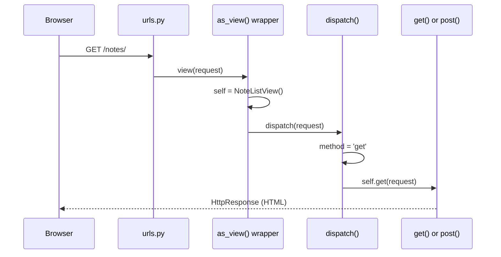
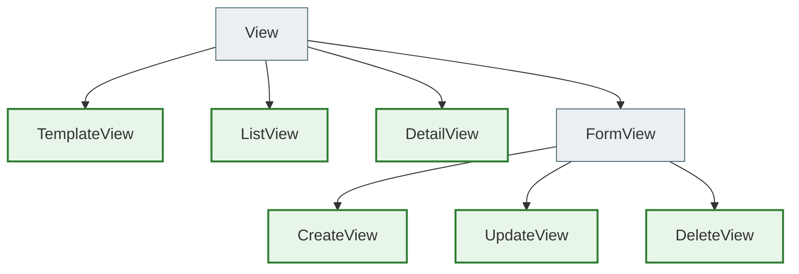
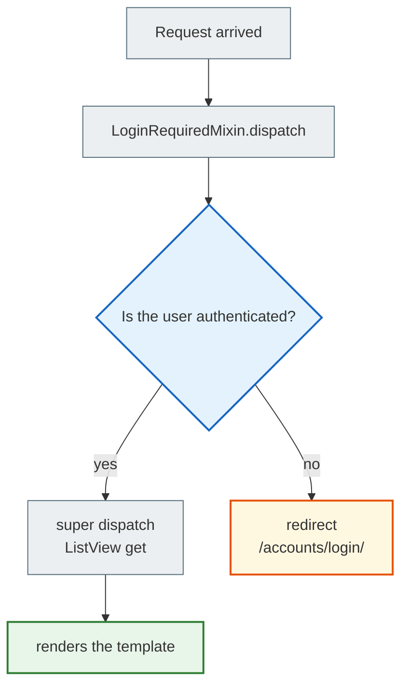

# notes_project_cbv — Class-Based Views

> The same notes platform as in `notes_project/`, but **views.py and urls.py are completely rewritten as CBVs**.
>
> **What changed:** only `hello_app/views.py` + `hello_app/urls.py`  
> **What stayed the same:** models, forms, selectors, services, templates — with no changes at all  
>
> Compare with [`../notes_project/`](../notes_project/) — the FBV original.  
> CBV theory: [`../Django_Views.md`](../Django_Views.md)

---

## Contents

- [What CBVs are and why](#what-cbvs-are-and-why)
- [Step 1 — The CBV contract: `as_view()` and `dispatch()`](#step-1--the-cbv-contract-as_view-and-dispatch)
- [Step 2 — Generic Views: the hierarchy and what each one does automatically](#step-2--generic-views-the-hierarchy)
- [Step 3 — `LoginRequiredMixin` and the MRO](#step-3--loginrequiredmixin-and-the-mro)
- [Step 4 — `UserQuerySetMixin`: DRY data isolation](#step-4--userquerysetmixin-dry-data-isolation)
- [Step 5 — `ListView`: a list of notes with filters](#step-5--listview-a-list-of-notes-with-filters)
- [Step 6 — `DetailView`: object detail](#step-6--detailview-object-detail)
- [Step 7 — `CreateView` and `get_form_kwargs()`](#step-7--createview-and-get_form_kwargs)
- [Step 8 — `UpdateView`: editing with an instance](#step-8--updateview-editing-with-an-instance)
- [Step 9 — `DeleteView`: safe deletion via POST only](#step-9--deleteview-safe-deletion-via-post-only)
- [Step 10 — `get_success_url()` and `reverse_lazy`](#step-10--get_success_url-and-reverse_lazy)
- [Step 11 — Services architecture in CBVs: `form_valid()` instead of `form.save()`](#step-11--services-architecture-in-cbvs)
- [Step 12 — CBVs in `urls.py`: why `.as_view()` is needed](#step-12--cbvs-in-urlspy)
- [FBV → CBV quick comparison](#fbv--cbv-quick-comparison)
- [Project file structure](#file-structure)
- [How to run](#how-to-run)
- [Documentation links](#documentation-links)

---

## What CBVs are and why

**FBV (Function-Based Views)** — a view as a function:

```python
def note_list(request):
    notes = Note.objects.filter(user=request.user)
    return render(request, 'note_list.html', {'notes': notes})
```

**CBV (Class-Based Views)** — a view as a class:

```python
class NoteListView(LoginRequiredMixin, ListView):
    model = Note
    template_name = 'hello_app/note_list.html'
    context_object_name = 'notes'
```

**Why CBVs?**

| Problem with FBVs | Solution with CBVs |
|----------------|---------------|
| `@login_required` has to be added to _every_ function | `LoginRequiredMixin` once in the class |
| `Note.objects.filter(user=request.user)` is repeated in 5 places | `UserQuerySetMixin.get_queryset()` — once |
| `if request.method == 'POST': form = ...; if form.is_valid(): ...` — boilerplate code | `CreateView`/`UpdateView` do this automatically |
| No standard way to extend the logic | We override hooks: `get_queryset()`, `form_valid()`, `get_context_data()` |

> **Important:** CBVs do not replace the architecture. Selectors/Services stayed exactly where they were — only the calls moved from functions into class methods.

---

## Step 1 — The CBV contract: `as_view()` and `dispatch()`

### Why a class can't be put directly into `urls.py`

The Django router expects a **callable** (a function):

```python
# ❌ DOES NOT WORK — NoteListView is a class, not a callable
path('notes/', views.NoteListView, name='note_list')

# ✅ CORRECT — .as_view() returns a callable wrapper function
path('notes/', views.NoteListView.as_view(), name='note_list')
```

### What `as_view()` does

`as_view()` is a **classmethod** that Django calls once when the server starts. It returns an ordinary wrapper function `view`. On every HTTP request this function:

1. Creates a **new instance** of the class (a new one every time — thread-safe!)
2. Copies `request`, `args`, `kwargs` onto the instance
3. Calls `instance.dispatch(request, *args, **kwargs)`

```python
# Simplified pseudocode of what as_view() does inside Django:
@classmethod
def as_view(cls, **initkwargs):
    def view(request, *args, **kwargs):
        self = cls(**initkwargs)          # 1. new instance
        self.request = request            # 2. copy the request
        self.args = args
        self.kwargs = kwargs
        return self.dispatch(request, *args, **kwargs)  # 3. dispatch
    return view
```

### What `dispatch()` does

`dispatch()` is the **main router** of a CBV. It looks at the HTTP method of the request and delegates the call to the corresponding class method:

```python
# Pseudocode of dispatch() from the base View:
def dispatch(self, request, *args, **kwargs):
    method = request.method.lower()          # 'get', 'post', 'put', ...
    handler = getattr(self, method, None)    # self.get, self.post, ...
    if handler:
        return handler(request, *args, **kwargs)
    return HttpResponseNotAllowed(...)       # 405 Method Not Allowed
```

### Sequence diagram: request from the browser to the method



> **Reference:** `Django_Views.md` — Section 4.2 (dispatch mechanism)

---

## Step 2 — Generic Views: the hierarchy

Django ships ready-made CBVs for typical CRUD operations — **Generic Views**.

### Class hierarchy



### What each Generic View does automatically

| Generic View | GET | POST | Key attributes |
|---|---|---|---|
| `TemplateView` | renders the template | — | `template_name` |
| `ListView` | gets the list via `get_queryset()`, renders | — | `model`, `template_name`, `context_object_name` |
| `DetailView` | gets one object via `get_object()`, renders | — | `model`, `template_name`, `context_object_name` |
| `CreateView` | renders an empty form | validates → `form_valid()` or `form_invalid()` | `model`, `form_class`, `template_name` |
| `UpdateView` | renders the form with `instance=object` | validates → `form_valid()` or `form_invalid()` | the same + loads `get_object()` |
| `DeleteView` | renders a confirmation | deletes → `success_url` | `model`, `template_name`, `success_url` |

### Class attributes instead of arguments

In FBVs, parameters were passed into the function or hardcoded inside it. In CBVs we declare them as **class attributes**:

```python
class NoteListView(LoginRequiredMixin, ListView):
    model = Note                              # ← which model to use
    template_name = 'hello_app/note_list.html'  # ← which template to render
    context_object_name = 'notes'            # ← what to call the list in the template
                                             #   (instead of the default 'object_list')
```

> **Reference:** `Django_Views.md` — Section 5 (Generic Views)

---

## Step 3 — `LoginRequiredMixin` and the MRO

### FBV: the `@login_required` decorator

```python
from django.contrib.auth.decorators import login_required

@login_required
def note_list(request):
    ...
```

### CBV: `LoginRequiredMixin` — first in the list of base classes

```python
from django.contrib.auth.mixins import LoginRequiredMixin

class NoteListView(LoginRequiredMixin, ListView):
    ...
```

### Why the order in the parentheses is critically important

Python determines the method lookup order through the **MRO (Method Resolution Order)**. When Django calls `dispatch()`, Python looks it up along the MRO from left to right:

```
NoteListView → LoginRequiredMixin → ListView → View
```

`LoginRequiredMixin.dispatch()` checks authentication **first** — before `ListView.dispatch()` does anything at all.

```python
# ✅ CORRECT: LoginRequiredMixin first → the auth check comes FIRST
class NoteListView(LoginRequiredMixin, UserQuerySetMixin, ListView):
    ...

# ❌ WRONG: ListView first → the auth check comes AFTER the data is loaded
class NoteListView(UserQuerySetMixin, ListView, LoginRequiredMixin):
    ...
```

### Flowchart: authentication check



> By default the redirect goes to `/accounts/login/?next=/notes/`. You can change this via `login_url` and `redirect_field_name` on the class.

---

## Step 4 — `UserQuerySetMixin`: DRY data isolation

### The problem: duplicating the user filter

Without a mixin, every `Detail`, `Update`, `Delete` view has to repeat:

```python
# In NoteDetailView:
queryset = Note.objects.filter(user=self.request.user)

# In NoteUpdateView:
queryset = Note.objects.filter(user=self.request.user)

# In NoteDeleteView:
queryset = Note.objects.filter(user=self.request.user)
```

This is not just code repetition — **it's a security hole**: if you forget it in one place, Alice will see Bob's notes.

### The solution: a custom mixin

```python
class UserQuerySetMixin:
    """
    Mixin for automatically filtering the QuerySet by the current user.
    """
    def get_queryset(self):
        # super().get_queryset() → returns model.objects.all()
        # .filter(user=...) → restrict to this user's objects only
        return super().get_queryset().filter(user=self.request.user)
```

### How Django uses `get_queryset()` for protection

`DetailView`, `UpdateView`, `DeleteView` load the object via `get_object()`:

```python
# Pseudocode of get_object() in DetailView:
def get_object(self, queryset=None):
    queryset = self.get_queryset()        # ← our filtered queryset!
    pk = self.kwargs.get('pk')
    return queryset.get(pk=pk)           # SQL: WHERE id=pk AND user_id=current_user
```

If Alice tries to open Bob's note (`/notes/42/`):
- `get_queryset()` returns `Note.objects.filter(user=Alice)`
- `get_object()` does `.get(pk=42)` on this queryset
- SQL: `SELECT * FROM note WHERE id=42 AND user_id=<Alice_id>` → nothing found
- Django raises `Note.DoesNotExist` → `Http404`

**Alice sees a 404, not Bob's data.**

### MRO with UserQuerySetMixin

```python
class NoteDetailView(LoginRequiredMixin, UserQuerySetMixin, DetailView):
    ...

# Python MRO:
# NoteDetailView → LoginRequiredMixin → UserQuerySetMixin → DetailView → View
#
# When get_queryset() is called:
#   1. Finds UserQuerySetMixin.get_queryset()
#   2. super().get_queryset() → goes further → DetailView.get_queryset()
#   3. DetailView.get_queryset() → returns Note.objects.all()
#   4. UserQuerySetMixin adds .filter(user=self.request.user)
#   Result: Note.objects.all().filter(user=self.request.user)
```

---

## Step 5 — `ListView`: a list of notes with filters

`NoteListView` is the most complex view in the project: it supports search and filtering by tag and notebook.

### Class attributes

```python
class NoteListView(LoginRequiredMixin, ListView):
    model = Note
    template_name = 'hello_app/note_list.html'
    context_object_name = 'notes'   # instead of the default 'object_list'
```

### `get_queryset()` — which collection to return

In FBVs we read the GET parameters right inside the function. In CBVs we do it in `get_queryset()` via `self.request.GET`:

```python
def get_queryset(self):
    self._get_filters()       # parse GET params once (cached on self)
    return selectors.get_user_notes(
        self.request.user,
        search=self.search or None,
        tag=self.active_tag,
        notebook=self.active_notebook,
    )
```

> The architecture is preserved: the selector does all the ORM logic. `get_queryset()` only delegates.

### `get_context_data()` — what data to pass to the template

`ListView` automatically adds to the context:
- `notes` (or `object_list`) — the result of `get_queryset()`
- `page_obj` — if there is pagination
- `is_paginated` — a boolean

We **extend** the context via `super()`:

```python
def get_context_data(self, **kwargs):
    self._get_filters()
    ctx = super().get_context_data(**kwargs)   # ← already contains 'notes'!
    ctx['notebooks'] = selectors.get_user_notebooks(self.request.user)
    ctx['tags'] = selectors.get_user_tags(self.request.user)
    ctx['search'] = self.search
    ctx['active_tag'] = self.active_tag
    ctx['active_notebook'] = self.active_notebook
    return ctx
```

**Always** call `super().get_context_data(**kwargs)` and add to the dictionary — don't replace it.

### `_get_filters()` — a private helper for DRY

Both methods (`get_queryset` and `get_context_data`) need the same GET parameters. To avoid parsing them twice — a private helper that caches on `self`:

```python
def _get_filters(self):
    if hasattr(self, '_filters_parsed'):   # already parsed earlier
        return
    self._filters_parsed = True

    self.search = self.request.GET.get('q', '').strip()

    tag_id = self.request.GET.get('tag')
    self.active_tag = None
    if tag_id:
        try:
            # check permissions! user=request.user
            self.active_tag = Tag.objects.get(id=int(tag_id), user=self.request.user)
        except (Tag.DoesNotExist, ValueError):
            pass   # invalid id → simply ignore it
```

---

## Step 6 — `DetailView`: object detail

```python
class NoteDetailView(LoginRequiredMixin, UserQuerySetMixin, DetailView):
    model = Note
    template_name = 'hello_app/note_detail.html'
    context_object_name = 'note'
```

### What `DetailView` does automatically

1. Reads `pk` from `self.kwargs['pk']` (from the URL pattern `<int:pk>`)
2. Calls `get_object()` → `get_queryset().get(pk=pk)`
3. Passes the object to the template as `'note'` (our `context_object_name`)
4. Renders `template_name`
5. If not found → 404 automatically

### Overriding `get_object()` for Prefetch

In our project the selector loads the note with `Prefetch(to_attr='upcoming_reminders')`. So we override `get_object()` to use the selector instead of the standard `queryset.get(pk=pk)`:

```python
def get_object(self, queryset=None):
    try:
        return selectors.get_note_detail(self.request.user, self.kwargs['pk'])
    except Note.DoesNotExist:
        raise Http404("Нотатку не знайдено")
```

> `Http404` is a standard Django exception. It automatically returns a 404 page.

### `get_context_data()` — adding reminders

```python
def get_context_data(self, **kwargs):
    ctx = super().get_context_data(**kwargs)
    # upcoming_reminders is set via Prefetch(to_attr=) in the selector
    ctx['reminders'] = getattr(self.object, 'upcoming_reminders', [])
    return ctx
```

`self.object` is the loaded object (always available after `get_object()`).

---

## Step 7 — `CreateView` and `get_form_kwargs()`

```python
class NoteCreateView(LoginRequiredMixin, CreateView):
    model = Note
    form_class = NoteForm
    template_name = 'hello_app/note_form.html'
```

### What `CreateView` does automatically

**GET request:**
1. `get_form()` → `form_class(**get_form_kwargs())` → an empty form
2. `get_context_data()` → adds `{'form': form}`
3. Renders the template

**POST request:**
1. `get_form()` → a form with `data=request.POST`
2. `form.is_valid()`:
   - `True` → calls `form_valid(form)`
   - `False` → calls `form_invalid(form)` → renders the template with errors

### The problem: how to pass `user=` into the form

`NoteForm.__init__` needs `user=` to filter the QuerySet for the `notebook` and `tags` fields:

```python
# FBV:
form = NoteForm(request.POST, user=request.user)

# CBV: how do we do this if CreateView builds the form automatically?
```

### The solution: `get_form_kwargs()`

`CreateView` builds the form via `get_form()`:

```python
# Inside CreateView (simplified):
def get_form(self):
    return self.form_class(**self.get_form_kwargs())
```

`get_form_kwargs()` returns a dictionary of arguments for the form. We **extend** it:

```python
def get_form_kwargs(self):
    kwargs = super().get_form_kwargs()
    # super() returns: {'data': request.POST, 'files': request.FILES, ...}
    kwargs['user'] = self.request.user   # ← add user=
    return kwargs
    # Result: NoteForm(data=POST, files=FILES, user=request.user)
```

### `get_initial()` — initial values for the form

`TagCreateView` supports `?name=python` — it pre-fills the field:

```python
def get_initial(self):
    initial = super().get_initial()
    name = self.request.GET.get('name')
    if name:
        initial['name'] = name
    return initial
```

`get_initial()` returns a dictionary of initial values. `CreateView` passes them into the form as `initial=`.

---

## Step 8 — `UpdateView`: editing with an instance

```python
class NoteUpdateView(LoginRequiredMixin, UserQuerySetMixin, UpdateView):
    model = Note
    form_class = NoteForm
    template_name = 'hello_app/note_form.html'
```

### What `UpdateView` does automatically (compared with `CreateView`)

`UpdateView` does everything `CreateView` does, plus:

- Before rendering on GET: loads the existing object via `get_object()`
- Passes `instance=object` into the form → all fields are pre-filled
- `UserQuerySetMixin.get_queryset()` → 404 if the object belongs to someone else

```python
# Inside UpdateView (simplified):
def get_form_kwargs(self):
    kwargs = super().get_form_kwargs()
    kwargs['instance'] = self.object    # ← the key difference from CreateView
    return kwargs
```

### `get_form_kwargs()` — passing `user=`

```python
def get_form_kwargs(self):
    kwargs = super().get_form_kwargs()
    kwargs['user'] = self.request.user
    return kwargs
    # Result: NoteForm(data=POST, instance=note, user=request.user)
```

### `get_context_data()` — breadcrumbs

```python
def get_context_data(self, **kwargs):
    ctx = super().get_context_data(**kwargs)
    ctx['note'] = self.object           # for breadcrumbs in the template
    ctx['action'] = 'Зберегти зміни'
    ctx['title'] = f'Редагувати: {self.object.title}'
    return ctx
```

---

## Step 9 — `DeleteView`: safe deletion via POST only

```python
class NoteDeleteView(LoginRequiredMixin, UserQuerySetMixin, DeleteView):
    model = Note
    template_name = 'hello_app/note_confirm_delete.html'
    success_url = reverse_lazy('hello_app:note_list')
    context_object_name = 'note'
```

### Why DELETE only via POST?

**Deleting via GET violates HTTP semantics:**

```
GET /notes/42/delete/   ← Dangerous!
```

- The browser may **prefetch** these URLs — deleting without a click!
- A search bot crawls the links — deleting all records!
- `` in an email — deletes when it's opened!

**`DeleteView` automatically requires POST for the actual deletion:**
- `GET` → renders the confirmation page ("Are you sure?")
- `POST` → deletes and redirects

### `form_valid()` — the POST confirmation hook

```python
def form_valid(self, form):
    note = self.get_object()
    title = note.title    # save it BEFORE deletion!
    services.delete_note(note)
    messages.warning(self.request, f'🗑️ Нотатку "{title}" видалено.')
    return redirect(self.success_url)
```

> We save `title` before `services.delete_note()` — after deletion `note.title` may be unavailable.

### `get_context_data()` — showing a warning

In `NotebookDeleteView` we add the number of notes that will be left without a notebook:

```python
def get_context_data(self, **kwargs):
    ctx = super().get_context_data(**kwargs)
    ctx['note_count'] = self.object.notes.count()
    return ctx
```

The template shows: _"Deleting will not delete the notes, they will be left without a notebook"_.

---

## Step 10 — `get_success_url()` and `reverse_lazy`

After a successful save/delete, the CBV needs to know where to redirect.

### Option 1: `success_url` — a static URL

```python
class NoteDeleteView(..., DeleteView):
    success_url = reverse_lazy('hello_app:note_list')
```

**Why `reverse_lazy` and not `reverse()`?**

`success_url = reverse('hello_app:note_list')` is executed **when the class is loaded** (when Django starts), before the URL patterns are registered. This leads to `NoReverseMatch`.

`reverse_lazy('hello_app:note_list')` is executed **lazily**, only when the attribute is actually needed (during a request). By then the URL patterns are already registered.

### Option 2: `get_success_url()` — a dynamic URL

When the URL depends on the object's state or on request parameters:

```python
# In TagCreateView: support the ?next= parameter
def get_success_url(self):
    return self._get_next_url()

def _get_next_url(self):
    return (
        self.request.GET.get('next')     # ?next= in GET
        or self.request.POST.get('next') # next in the POST form
        or 'hello_app:note_create'       # default if missing
    )
```

### Comparison

| | `success_url` | `get_success_url()` |
|---|---|---|
| When | a static URL known in advance | the URL depends on the object or the request |
| Example | the list of notebooks | the detail page of a just-created note |
| `reverse_lazy` | required | not needed (called during the request) |

---

## Step 11 — Services architecture in CBVs

In FBVs, Services/Selectors were called directly inside the view function. In CBVs — in hooks.

### `form_valid()` instead of `form.save()`

**Key rule:** if you have `services.py`, **never** call `super().form_valid()` in `CreateView`/`UpdateView` — inside it is `form.save()`, which bypasses your business logic.

```python
class NoteCreateView(LoginRequiredMixin, CreateView):
    ...

    def form_valid(self, form):
        # ❌ DON'T: super().form_valid(form) → it contains form.save()!

        # ✅ DELEGATE to the service — it has transaction.atomic(), business rules
        tags = form.cleaned_data.get('tags')
        tag_ids = [t.id for t in tags] if tags else None

        note = services.create_note(
            user=self.request.user,
            title=form.cleaned_data['title'],
            content=form.cleaned_data.get('content', ''),
            priority=form.cleaned_data.get('priority', 1),
            notebook=form.cleaned_data.get('notebook'),
            tag_ids=tag_ids,
        )
        messages.success(self.request, f'✅ Нотатку "{note.title}" створено!')
        return redirect('hello_app:note_detail', pk=note.pk)
```

### `get_queryset()` instead of direct queries in `get_context_data()`

In `NoteListView` we don't run queries in `get_context_data()` except for the sidebar data. The main list comes from `get_queryset()`. This lets pagination work correctly.

```python
# ✅ CORRECT: the list of notes via get_queryset()
def get_queryset(self):
    return selectors.get_user_notes(self.request.user, ...)

# ✅ CORRECT: sidebar data via get_context_data()
def get_context_data(self, **kwargs):
    ctx = super().get_context_data(**kwargs)
    ctx['notebooks'] = selectors.get_user_notebooks(self.request.user)
    return ctx
```

### Full table of hooks

| Hook | Where we override it | What for |
|---|---|---|
| `get_queryset()` | `ListView`, `UserQuerySetMixin` | which collection to return |
| `get_object()` | `NoteDetailView` | loading with Prefetch via the selector |
| `get_context_data()` | all | extra data for the template |
| `get_form_kwargs()` | `NoteCreateView`, `NoteUpdateView` | pass `user=` into the form |
| `get_initial()` | `TagCreateView` | initial field values |
| `form_valid()` | all `Create`/`Update`/`Delete` | call a service instead of `form.save()` |
| `get_success_url()` | `TagCreateView` | dynamic redirect after saving |

---

## Step 12 — CBVs in `urls.py`

```python
# hello_app/urls.py
from django.urls import path
from . import views

app_name = "hello_app"

urlpatterns = [
    path('', views.IndexView.as_view(), name='index'),

    # Notes
    path('notes/', views.NoteListView.as_view(), name='note_list'),
    path('notes/new/', views.NoteCreateView.as_view(), name='note_create'),
    path('notes/<int:pk>/', views.NoteDetailView.as_view(), name='note_detail'),
    path('notes/<int:pk>/edit/', views.NoteUpdateView.as_view(), name='note_edit'),
    path('notes/<int:pk>/delete/', views.NoteDeleteView.as_view(), name='note_delete'),

    # Notebooks
    path('notebooks/', views.NotebookListView.as_view(), name='notebook_list'),
    path('notebooks/new/', views.NotebookCreateView.as_view(), name='notebook_create'),
    path('notebooks/<int:pk>/edit/', views.NotebookUpdateView.as_view(), name='notebook_edit'),
    path('notebooks/<int:pk>/delete/', views.NotebookDeleteView.as_view(), name='notebook_delete'),

    # Tags
    path('tags/new/', views.TagCreateView.as_view(), name='tag_create'),
]
```

### FBV vs CBV in `urls.py`

```python
# FBV: views.note_list is already a callable function
path('notes/', views.note_list, name='note_list')

# CBV: views.NoteListView is a class (not callable!)
path('notes/', views.NoteListView.as_view(), name='note_list')
#                              ^^^^^^^^^^^ required!
```

### `IndexView` — a base `View` without Generic

```python
class IndexView(View):
    """The simplest CBV — the base View."""
    def get(self, request):
        return HttpResponse("Hello, Django ORM!")
```

The base `View` doesn't render a template automatically — you have to implement `get()` and `post()` by hand. It's suitable for simple pages or API endpoints.

---

## FBV → CBV quick comparison

### List

```python
# FBV
@login_required
def note_list(request):
    notes = selectors.get_user_notes(request.user, ...)
    return render(request, 'hello_app/note_list.html', {'notes': notes})

# CBV
class NoteListView(LoginRequiredMixin, ListView):
    model = Note
    template_name = 'hello_app/note_list.html'
    context_object_name = 'notes'

    def get_queryset(self):
        return selectors.get_user_notes(self.request.user, ...)
```

### Create

```python
# FBV
@login_required
def note_create(request):
    if request.method == 'POST':
        form = NoteForm(request.POST, user=request.user)
        if form.is_valid():
            note = services.create_note(user=request.user, ...)
            messages.success(request, '...')
            return redirect('hello_app:note_detail', pk=note.pk)
    else:
        form = NoteForm(user=request.user)
    return render(request, 'hello_app/note_form.html', {'form': form})

# CBV
class NoteCreateView(LoginRequiredMixin, CreateView):
    model = Note
    form_class = NoteForm
    template_name = 'hello_app/note_form.html'

    def get_form_kwargs(self):
        kwargs = super().get_form_kwargs()
        kwargs['user'] = self.request.user
        return kwargs

    def form_valid(self, form):
        note = services.create_note(user=self.request.user, ...)
        messages.success(self.request, '...')
        return redirect('hello_app:note_detail', pk=note.pk)
```

### Update

```python
# FBV
@login_required
def note_edit(request, pk):
    note = get_object_or_404(Note, pk=pk, user=request.user)
    if request.method == 'POST':
        form = NoteForm(request.POST, instance=note, user=request.user)
        if form.is_valid():
            services.update_note(note, ...)
            return redirect('hello_app:note_detail', pk=note.pk)
    else:
        form = NoteForm(instance=note, user=request.user)
    return render(request, 'hello_app/note_form.html', {'form': form, 'note': note})

# CBV
class NoteUpdateView(LoginRequiredMixin, UserQuerySetMixin, UpdateView):
    model = Note
    form_class = NoteForm
    template_name = 'hello_app/note_form.html'

    def get_form_kwargs(self):
        kwargs = super().get_form_kwargs()
        kwargs['user'] = self.request.user
        return kwargs

    def form_valid(self, form):
        note = self.get_object()
        services.update_note(note, ...)
        return redirect('hello_app:note_detail', pk=note.pk)
```

### Delete

```python
# FBV
@login_required
def note_delete(request, pk):
    note = get_object_or_404(Note, pk=pk, user=request.user)
    if request.method == 'POST':
        services.delete_note(note)
        messages.warning(request, f'Нотатку видалено.')
        return redirect('hello_app:note_list')
    return render(request, 'hello_app/note_confirm_delete.html', {'note': note})

# CBV
class NoteDeleteView(LoginRequiredMixin, UserQuerySetMixin, DeleteView):
    model = Note
    template_name = 'hello_app/note_confirm_delete.html'
    success_url = reverse_lazy('hello_app:note_list')
    context_object_name = 'note'

    def form_valid(self, form):
        note = self.get_object()
        services.delete_note(note)
        messages.warning(self.request, f'Нотатку видалено.')
        return redirect(self.success_url)
```

---

## File structure

```
notes_project_cbv/
├── notes_project_cbv/
│   ├── settings.py
│   ├── urls.py            ← includes hello_app.urls with namespace='hello_app'
│   └── wsgi.py
│
└── hello_app/
    ├── views.py           ★ CHANGED — CBV version
    ├── urls.py            ★ CHANGED — .as_view() in every path()
    │
    ├── forms.py           · Unchanged — the same NoteForm, NotebookForm, TagForm
    ├── selectors.py       · Unchanged — the same ORM logic
    ├── services.py        · Unchanged — the same business logic
    ├── models.py          · Unchanged — the same 9 models
    │
    └── templates/         · Unchanged — the same templates
        └── hello_app/
            ├── note_list.html
            ├── note_detail.html
            ├── note_form.html
            ├── note_confirm_delete.html
            ├── notebook_list.html
            ├── notebook_form.html
            ├── notebook_confirm_delete.html
            └── tag_form.html
```

> `views_fbv_backup.py` — a backup copy of the original FBV views.py for comparison.

---

## How to run

```bash
cd notes_project_cbv

# Activate the venv (the same one as for notes_project)
source ../notes_project/venv/bin/activate   # or your own venv

# Apply migrations (if it's a new database)
python manage.py migrate

# Create a superuser
python manage.py createsuperuser

# Run on a different port so it doesn't conflict with notes_project
python manage.py runserver 8001
```

Open: `http://localhost:8001/notes/`

---

## Bootstrap forms in templates

The templates of this project (`note_form.html`, `notebook_form.html`, `tag_form.html`) render Django forms **by hand** with Bootstrap 5 — without `django-crispy-forms`. This gives full control over the HTML and helps you understand how Django and Bootstrap interact.

---

### 1. Structure of a form template (Template Inheritance)

Every form template starts the same way:

```html
   {# inherit base: navbar, footer, Bootstrap CDN #}

{{ title }}  {# title comes from the CBV context #}


       {# load the  tag — without this line the tag doesn't work #}
    <link rel="stylesheet" href="">
    {# forms.css: .form-card, .tag-label, .pin-toggle, .tag-checkbox-item {display:none} #}



    ...form...



    <script>/* live preview JS */</script>

```

**Why separate blocks:**

| Block | Purpose |
|------|-------------|
| `` | CSS only for this page — doesn't pollute all the others |
| `` | The main HTML content of the page |
| `` | JS only for this page, included after `</body>` |

`` **loads a tag library**, not a file. Without it `` raises the error `Invalid block tag: 'static'`. You have to load it in every template where it's used.

---

### 2. Context variables — what comes from the CBV into the template

The `note_form.html` template is used by two CBV classes. Both pass the same keys via `get_context_data()`:

```python
# views.py — NoteCreateView
def get_context_data(self, **kwargs):
    ctx = super().get_context_data(**kwargs)
    ctx['action'] = 'Створити'       # submit button text
    ctx['title']  = 'Нова нотатка'  # form heading
    return ctx
    # ctx['form'] is added automatically by CreateView/UpdateView!
    # ctx['note'] = None (we don't pass it) → the template checks 

# views.py — NoteUpdateView
def get_context_data(self, **kwargs):
    ctx = super().get_context_data(**kwargs)
    ctx['note']   = self.object            # Note instance for the breadcrumb
    ctx['action'] = 'Зберегти зміни'
    ctx['title']  = f'Редагувати: {self.object.title}'
    return ctx
    # ctx['form'] is already filled with instance=note automatically!
```

The following variables are available in the template:

| Variable in the template | Type | Where it comes from | Usage |
|------------------|-----|--------|--------------|
| `{{ form }}` | `NoteForm` | `CreateView`/`UpdateView` automatically | `{{ form.title }}`, `` |
| `{{ title }}` | `str` | `get_context_data()` | `<h2>{{ title }}</h2>` |
| `{{ action }}` | `str` | `get_context_data()` | `<button>{{ action }}</button>` |
| `{{ note }}` | `Note` or `None` | `get_context_data()` | `` in the breadcrumb |
| `{{ request }}` | `HttpRequest` | context processor | `{{ request.path }}` for ?next= |

`{{ request }}` is available because `settings.py` has `django.template.context_processors.request` in `TEMPLATES` → Django automatically adds `request` to every template.

---

### 3. How a Widget passes the Bootstrap class

A Django form renders a field via a `Widget`. In `forms.py` every field is given `attrs`:

```python
# forms.py — Widget attrs set the Bootstrap class
class NoteForm(forms.ModelForm):
    class Meta:
        widgets = {
            'title':    forms.TextInput(attrs={
                            'class': 'form-control',    # Bootstrap: styles the <input>
                            'placeholder': 'Назва нотатки...',
                            'autofocus': True,          # the browser focuses the field automatically
                        }),
            'content':  forms.Textarea(attrs={
                            'class': 'form-control',
                            'rows': 8,                  # textarea height in rows
                        }),
            'priority': forms.Select(attrs={
                            'class': 'form-select',     # Bootstrap: styles the <select>
                        }),
            'notebook': forms.Select(attrs={
                            'class': 'form-select',
                        }),
            'is_pinned': forms.CheckboxInput(attrs={
                            'class': 'form-check-input', # Bootstrap: styles the checkbox
                        }),
        }
```

| Bootstrap class | HTML element | Effect |
|----------------|-------------|-------|
| `form-control` | `<input>`, `<textarea>` | Full width, border, padding, focus ring |
| `form-select` | `<select>` | Dropdown arrow, padding, border |
| `form-check-input` | `<input type="checkbox">` | Custom checkbox style |
| `form-control-color` | `<input type="color">` | Special style for the color picker |

---

### 4. Rendering a single field — the full anatomy of a BoundField

This is real code from `note_form.html`, line by line:

```html
<div class="mb-3">
    <!--
      form.title — a BoundField: an object that combines the form field + the current value + the form.
      .id_for_label → the string 'id_title' (Django: prefix 'id_' + field name)
      Browser: clicking <label for="id_title"> focuses <input id="id_title">
    -->
    <label for="{{ form.title.id_for_label }}" class="form-label">
        <i class="bi bi-type me-1"></i>  {# Bootstrap Icon: an icon next to the label #}
        {{ form.title.label }}           {# → 'Заголовок' (from Meta.labels in forms.py) #}
        <span class="text-danger ms-1">*</span>  {# red asterisk = required field #}
    </label>

    <!--
      {{ form.title }} calls BoundField.__str__() → Widget.render()
      Result: <input type="text"
                        name="title"
                        id="id_title"
                        class="form-control"
                        placeholder="Назва нотатки..."
                        autofocus
                        maxlength="200">
      All the attributes (class, placeholder, autofocus) came from Meta.widgets!
    -->
    {{ form.title }}

    <!--
      form.title.help_text — hint text from Meta.help_texts.
      No help_text is set for title → the block is not shown.
      For notebook: help_text = 'Залиш порожнім — нотатка буде без записника.'
    -->
    
    <div class="form-text">{{ form.title.help_text }}</div>
    

    <!--
      form.title.errors — an ErrorList (a list of strings with error messages).
      Empty after a GET request. Filled if POST + is_valid() = False.
      For example: ['Це поле обов'язкове.'] or ['Не більше 200 символів.']
    -->
    
    <ul class="errorlist">
        <li>{{ error }}</li>
    </ul>
    
</div>
```

---

### 5. BoundField — all the attributes used in templates

`form.field_name` in a template is a `BoundField` object (not just a string!). It knows the current value, the errors, and the metadata.

| Expression in the template | Python type | Example value | Description |
|-----------------|-----------|------------------|------|
| `{{ form.title }}` | `str` (HTML) | `<input type="text" ...>` | Renders the Widget → a full HTML tag |
| `{{ form.title.id_for_label }}` | `str` | `'id_title'` | id for `<label for="">`, auto-generated |
| `{{ form.title.label }}` | `str` | `'Заголовок'` | Label text (from `Meta.labels`) |
| `{{ form.title.help_text }}` | `str` | `'Залиш порожнім...'` | Hint (from `Meta.help_texts`) |
| `{{ form.title.html_name }}` | `str` | `'title'` | The `name` attribute `<input name="title">` |
| `{{ form.title.errors }}` | `ErrorList` | `['Це поле обов'язкове.']` | List of errors, iterable |
| `` | `bool` | `True` / `False` | Checks whether there are errors |
| `form.title.field` | `Field` | `CharField(max_length=200)` | The form field object (not the Widget!) |
| `form.title.value()` | `str` | `'Назва нотатки'` | Current value (from initial or POST) |

---

### 6. Bootstrap Grid in a form + `help_text` + `form.instance`

The **Bootstrap Grid** lets you place several fields in one row. A real block from `note_form.html`:

```html
<!--
  Bootstrap Grid: row + col-* = 12 columns.
  col-6 + col-6 = 12 → two fields take exactly one row.
  g-3 = gap between columns (Bootstrap 5 gutter).
-->
<div class="row g-3 mb-3">

    <div class="col-6">
        <label for="{{ form.priority.id_for_label }}" class="form-label">
            <i class="bi bi-flag me-1"></i>{{ form.priority.label }}
        </label>
        {{ form.priority }}  {# → <select class="form-select" name="priority">...</select> #}
        <!--
          priority-hint — an extra hint with colored icons.
          NOT part of the Django form — plain HTML for UX.
        -->
        <div class="priority-hint mt-1">
            <span class="bg-secondary bg-opacity-25">🟢 Низький</span>
            <span class="bg-warning bg-opacity-25">🟠 Високий</span>
            <span class="bg-danger bg-opacity-25">🔴 Терміново</span>
        </div>
    </div>

    <div class="col-6">
        <label for="{{ form.notebook.id_for_label }}" class="form-label">
            <i class="bi bi-journals me-1"></i>{{ form.notebook.label }}
        </label>
        {{ form.notebook }}  {# → a <select> with notebooks filtered by user #}
        <!--
          form.notebook.help_text → 'Залиш порожнім — нотатка буде без записника.'
          Rendered only if help_text is not empty.
        -->
        
        <div class="form-text">{{ form.notebook.help_text }}</div>
        
    </div>

</div>
```

**`form.instance` in the template** — access to the current model object (only with `UpdateView`):

```html
<!-- notebook_form.html — color preview strip -->
<div class="color-preview-strip" id="colorStrip"
     style="background: {{ form.instance.color|default:'#4A90E2' }};"></div>
<!--
  form.instance → the Notebook ORM object (when editing) or an empty object (when creating).
  .color → the value of the color field from the database.
  |default:'#4A90E2' → Django filter: if color is empty → '#4A90E2'.
-->
```

---

### 7. Why `novalidate` on the `<form>`

```html
<form method="post" novalidate>
    
    ...
</form>
```

`novalidate` **turns off the browser's HTML5 validation** (`required`, `minlength`, `type="email"`, etc.).

**Why this is correct:**
- Browser validation looks different in Chrome, Firefox, Safari
- It doesn't know about Django-specific rules (for example `clean_name()`)
- Django validates on the server: always the same way, with your error messages
- After a POST with errors → the template is rendered again with `form.errors` → a single error style

`` → inserts a hidden input:
```html
<input type="hidden" name="csrfmiddlewaretoken" value="abc123XYZ...">
```
Django rejects a POST without this token with `403 Forbidden`. Protection against Cross-Site Request Forgery.

---

### 8. A custom checkbox for tags (M:N) — in detail

`ManyToManyField(Tag)` → Django renders it as a group of `<input type="checkbox">`. The problem: the default look is ugly. The solution — iterate over the checkboxes manually, hide the native input, and style the label as a badge.

Real code from `note_form.html`:

```html
<div class="tags-grid">

    <!--
      form.tags — a BoundWidget for CheckboxSelectMultiple.
      Iteration: each checkbox is a separate SubWidget with its own data.
    -->
    <div>
        <!--
          The native checkbox: functional (the browser sends its value on submit),
          but INVISIBLE via CSS: .tag-checkbox-item { display: none; }

          name="{{ form.tags.html_name }}"
            → 'tags' (the same for all checkboxes in the group!)
            → Django receives: POST['tags'] = ['1', '3'] (a list of pks of the selected tags)
            → Why not Django's auto-name? Because we render the input by hand, outside the Widget.

          value="{{ checkbox.data.value }}"
            → the tag pk: '1', '2', '3'...
            → checkbox.data is a dictionary: {'value': '1', 'label': 'python', 'selected': False}

          id="{{ checkbox.id_for_label }}"
            → unique: 'id_tags_0', 'id_tags_1', 'id_tags_2'...
            → linked with the <label for="..."> below

          checked
            → if the tag is already attached to the note (when editing) → the checkbox will be checked
        -->
        <input type="checkbox"
               class="tag-checkbox-item"
               name="{{ form.tags.html_name }}"
               value="{{ checkbox.data.value }}"
               id="{{ checkbox.id_for_label }}"
               checked>

        <!--
          <label for="id_tags_0"> — clicking the label toggles <input id="id_tags_0">!
          This is standard HTML behavior: label + input with matching id ↔ for.
          Since the input is hidden (display:none), the user sees only the label badge.

          checkbox.choice_label → the tag text: 'python', 'django', 'work'
          style="--tag-color: #7c6efa;" → a CSS custom property (CSS variable)
            → forms.css uses var(--tag-color) for the badge color
        -->
        <label for="{{ checkbox.id_for_label }}" class="tag-label"
               style="--tag-color: #7c6efa;">
            <i class="bi bi-tag-fill" style="font-size:0.7rem;"></i>
            {{ checkbox.choice_label }}
        </label>
    </div>


    <!--
       — runs if the form.tags queryset is empty.
      That is, if this user has no tags at all.
      We show a link to create a tag with ?next={{ request.path }}
    -->
    <span class="text-muted small fst-italic">
        Немає тегів.
        <a href="?next={{ request.path }}"
           class="text-primary">Створити тег</a>
    </span>

</div>
```

**What `checkbox.data` is:**
```python
# For each tag, the Python object in checkbox.data looks like this:
{
    'value':    '1',        # tag pk (a string!)
    'label':    'python',   # tag name
    'selected': False,      # whether it's selected (True when editing if the tag is attached)
    'index':    '0',        # position in the group
    'disabled': False,
    'type':     'checkbox',
    'attrs':    {'id': 'id_tags_0'},
}
```

---

### 9. JavaScript live preview in ``

`notebook_form.html` and `tag_form.html` have an `<input type="color">` for picking a color. To show a preview immediately on selection, we add JS in ``.

The key point: **Django inserts `id_for_label` directly into the JS code** while rendering the template:

```html

<script>
/*
  Live preview of the notebook color.
  Updates the preview strip on every change of the color picker.
*/
(function() {
    /*
      '{{ form.color.id_for_label }}' → Django renders this as the string 'id_color'
      before sending the HTML to the browser.
      The browser receives: document.getElementById('id_color')  — ready-made JS!
    */
    const colorInput = document.getElementById('{{ form.color.id_for_label }}');
    const colorStrip = document.getElementById('colorStrip');  {# id in the template #}

    if (colorInput && colorStrip) {
        colorInput.addEventListener('input', function() {
            /*
              The 'input' event: fires on every change (not only after blur).
              this.value → a HEX string: '#FF5733'
            */
            colorStrip.style.background = this.value;
        });
    }
})();  {# IIFE: Immediately Invoked Function Expression — doesn't pollute the global scope #}
</script>

```

`tag_form.html` has a more complex live preview: it syncs both the color and the tag name:

```javascript
function update() {
    const color = colorInput ? colorInput.value : '#808080';
    const name  = nameInput  ? (nameInput.value.trim() || 'назва') : 'назва';
    if (strip) strip.style.background = color;        // updates the strip
    if (badge) badge.style.background = color;        // updates the badge
    if (badgeName) badgeName.textContent = name;      // updates the badge text
}

if (colorInput) colorInput.addEventListener('input', update);
if (nameInput)  nameInput.addEventListener('input', update);
update();  // initial state on load
```

---

### 10. Redirect pattern: hidden `next` input (tag\_form.html)

A tag can be created **right from the note form** — so you don't lose an unsaved note. URL: `/tags/new/?next=/notes/new/`

```html
<!-- tag_form.html -->
<form method="post" novalidate>
    
    <!--
      The hidden input stores the URL for the redirect after saving.
      next = '{{ next }}' → Django inserts the value from the context.

      Where does next in the context come from?  TagCreateView.get_context_data():
        ctx['next'] = self.request.GET.get('next') or 'hello_app:note_create'

      After submit:  TagCreateView.get_success_url():
        return self.request.POST.get('next') or 'hello_app:note_create'
        → redirect back to the note form!
    -->
    <input type="hidden" name="next" value="{{ next }}">
    ...
</form>
```

Also: the "Cancel" button leads to the same `next`:
```html
<a href="{{ next }}" class="btn btn-outline-secondary">
    <i class="bi bi-x me-1"></i>Скасувати
</a>
```

The "Create tag" link in `note_form.html` passes the current path:
```html
<a href="?next={{ request.path }}">Створити тег</a>
<!--
  request.path → '/notes/new/' (the current URL without the domain)
   → '/tags/new/'
  Full URL: '/tags/new/?next=/notes/new/'
-->
```

---

### Bootstrap form — the full anatomy

```
note_form.html
├──               ← Template Inheritance
├──                   ← forms.css only for this page
│       
│       
│   
│
├── 
│   ├── <nav> breadcrumb                   ←  or empty
│   │
│   └── <div class="form-card card">
│       ├── <div class="card-header">
│       │       <h2>{{ title }}</h2>       ← context: 'Нова нотатка'
│       │
│       └── <div class="card-body">
│           └── <form method="post" novalidate>
│               ├──        ← hidden input with the CSRF token
│               │
│               ├── <div class="mb-3">    ← the title field
│               │   ├── <label for="{{ form.title.id_for_label }}">
│               │   │       {{ form.title.label }}   ← 'Заголовок'
│               │   ├── {{ form.title }}              ← <input class="form-control">
│               │   └──    ← validation errors
│               │
│               ├── <div class="mb-3">    ← the content field
│               │   └── {{ form.content }}           ← <textarea class="form-control">
│               │
│               ├── <div class="row g-3"> ← Bootstrap Grid
│               │   ├── col-6: {{ form.priority }}   ← <select class="form-select">
│               │   └── col-6: {{ form.notebook }}   ← <select> filtered by user
│               │
│               ├── <div> tags            ← custom checkbox badges
│               │   └── 
│               │           <input type="checkbox" class="tag-checkbox-item" (hidden)>
│               │           <label class="tag-label"> (visible badge) </label>
│               │        → link to tag_create?next=...
│               │
│               ├── <label> is_pinned     ← toggle style (the label wraps the checkbox)
│               │
│               └── <div class="d-flex gap-2">
│                   ├── <button type="submit">{{ action }}</button>
│                   └── <a href="...">Скасувати</a>  ←  detail | list
│
└──                    ← (no JS in note_form, there is some in notebook/tag)
```

> **Links for a deeper study of Bootstrap forms:**
> - Bootstrap 5 Forms (§7): [`../../lesson_HTML_CSS_Bootstrap/BOOTSTRAP_5.md`](../../lesson_HTML_CSS_Bootstrap/BOOTSTRAP_5.md)
> - Django Templates + Bootstrap Forms (§7): [`../../lesson_HTML_CSS_Bootstrap/DJANGO_TEMPLATES_BOOTSTRAP.md`](../../lesson_HTML_CSS_Bootstrap/DJANGO_TEMPLATES_BOOTSTRAP.md)
> - crispy-forms (automated Bootstrap rendering): [`../../lesson_HTML_CSS_Bootstrap/ADVANCED_TEMPLATES.md`](../../lesson_HTML_CSS_Bootstrap/ADVANCED_TEMPLATES.md)

---

## Documentation links

### CBVs and Views

| Topic | File | What's there |
|------|------|--------|
| CBV: dispatch, mixins, decorating, Generic Views | [`../Django_Views.md`](../Django_Views.md) | The main CBV theory for this project |
| CBV: FBV vs CBV, Generic Views lifecycle | [`../../lesson_Django_Network_Architecture/Django_Views.md`](../../lesson_Django_Network_Architecture/Django_Views.md) | Overview of Views in the context of Django architecture |
| URL Routing: `path()`, `<int:pk>`, `include()`, namespace | [`../../lesson_Django_Network_Architecture/Django_URL_Routing.md`](../../lesson_Django_Network_Architecture/Django_URL_Routing.md) | `as_view()` in `urls.py`, path converters |
| Django Project Structure: the role of each file | [`../../lesson_Django_Network_Architecture/DJANGO_PROJECT_STRUCTURE.md`](../../lesson_Django_Network_Architecture/DJANGO_PROJECT_STRUCTURE.md) | Why `urls.py`, `views.py`, `apps.py` exist |
| Django architecture as a system (MVT, Middleware) | [`../../lesson_Django_Network_Architecture/django_architecture.md`](../../lesson_Django_Network_Architecture/django_architecture.md) | Request Lifecycle, Middleware chain |
| Django CBV Inspector (method hierarchy online) | https://ccbv.co.uk/ | An interactive map of all the hooks |
| Official Django CBV documentation | https://docs.djangoproject.com/en/stable/topics/class-based-views/ | |

### Forms and Bootstrap

| Topic | File | What's there |
|------|------|--------|
| Forms: Trust Boundary, Validation Pipeline, ModelForm | [`../DJANGO_FORMS.md`](../DJANGO_FORMS.md) | The main forms theory for this project |
| Bootstrap 5 Forms §7: `form-control`, validation, `was-validated` | [`../../lesson_HTML_CSS_Bootstrap/BOOTSTRAP_5.md`](../../lesson_HTML_CSS_Bootstrap/BOOTSTRAP_5.md) | How Bootstrap styles forms |
| Django Templates + Bootstrap Forms §7: Widget attrs, `` | [`../../lesson_HTML_CSS_Bootstrap/DJANGO_TEMPLATES_BOOTSTRAP.md`](../../lesson_HTML_CSS_Bootstrap/DJANGO_TEMPLATES_BOOTSTRAP.md) | Manual rendering and django-bootstrap5 |
| crispy-forms §3: FormHelper, Layout, Row/Column | [`../../lesson_HTML_CSS_Bootstrap/ADVANCED_TEMPLATES.md`](../../lesson_HTML_CSS_Bootstrap/ADVANCED_TEMPLATES.md) | Automated Bootstrap rendering |
| Django Templates: DTL, Template Inheritance, Static | [`../../lesson_Django_Network_Architecture/Django_Templates.md`](../../lesson_Django_Network_Architecture/Django_Templates.md) | The template engine, ``, `` |

### Services and Selectors

| Topic | File | What's there |
|------|------|--------|
| Services + Selectors full architecture | [`../DJANGO_SERVICES_SELECTORS.md`](../DJANGO_SERVICES_SELECTORS.md) | View→Service→Selector→ORM data flow |
| Services: `@transaction.atomic`, `on_commit`, side effects | [`../DJANGO_SERVICES.md`](../DJANGO_SERVICES.md) | Why `form_valid()` calls a service, not `form.save()` |
| Selectors: CQRS-light, N+1 centralization, named queries | [`../DJANGO_SELECTORS.md`](../DJANGO_SELECTORS.md) | Why `get_queryset()` delegates to a selector |
| Mermaid architecture diagrams (Services/Selectors) | [`../ORM_MERMAID.md`](../ORM_MERMAID.md) | Visual architecture diagrams |

### ORM and the database

| Topic | File | What's there |
|------|------|--------|
| ORM: QuerySets, N+1, select_related, F(), atomic() | [`../DJANGO_ORM_DEEP.md`](../DJANGO_ORM_DEEP.md) | How the ORM is used in selectors/services |
| Transactions: `select_for_update()`, deadlocks, race conditions | [`../TRANSACTIONS_CONCURRENCY.md`](../TRANSACTIONS_CONCURRENCY.md) | Why services use `@atomic` |
| Main learning map (all files of the ORM module) | [`../INDEX.md`](../INDEX.md) | Navigation across all materials |
| Main learning map (Network Architecture module) | [`../../lesson_Django_Network_Architecture/INDEX.md`](../../lesson_Django_Network_Architecture/INDEX.md) | Navigation across Views, Templates, URL Routing |
| Bootstrap + CSS + HTML knowledge system | [`../../lesson_HTML_CSS_Bootstrap/INDEX.md`](../../lesson_HTML_CSS_Bootstrap/INDEX.md) | Navigation across Bootstrap, Templates, Forms |

### FBV comparison

| Topic | File |
|------|------|
| The FBV original (the same project built with functions) | [`../notes_project/README.md`](../notes_project/README.md) |
| FBV views.py with CBV equivalents in every function | [`hello_app/views_fbv_backup.py`](hello_app/views_fbv_backup.py) |
