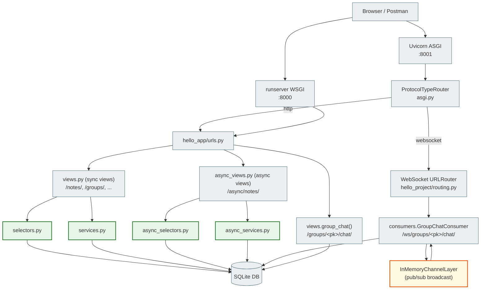
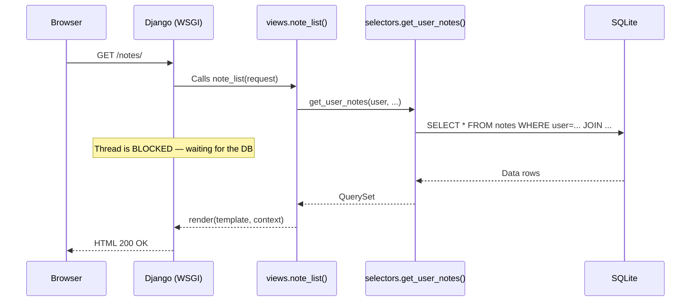
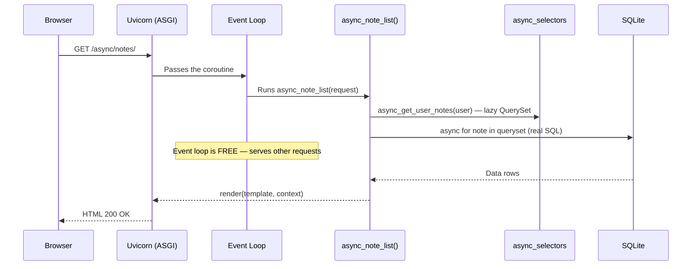
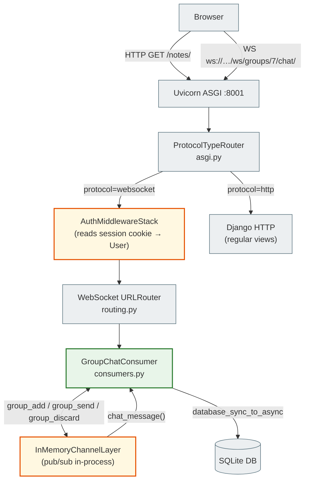
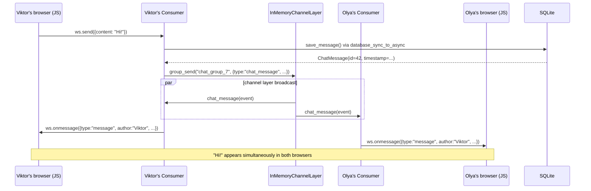

# Crispy Notes Project: Sync vs Async Django

> A learning project for the Python/Django course.
> It demonstrates **synchronous** and **asynchronous** Django side by side on the same code.

---

## 00. What this project is about

This is an already finished Django app for notes (Notes, Notebooks, Tags, TodoList, ShoppingList).
We **don't rewrite it from scratch** — we add async capabilities **alongside** the sync code.

**Two async demonstrations in one project:**

```
# Part 1: Async views (same result — different architecture)
http://127.0.0.1:8000/notes/          ← Sync view (classic Django)
http://127.0.0.1:8001/async/notes/    ← Async view (same result, async ORM)

# Part 2: Real-time chat (here async is the only correct approach)
http://127.0.0.1:8001/groups/<pk>/chat/   ← Group WebSocket chat
```

Async views and the async ORM show **how** to write async code.
The group chat shows **why** async is needed — sync simply doesn't fit here.

---

## 01. What the student will learn

After completing this project you will understand:

**Async views and the ORM:**
- [ ] Why `async def view` doesn't become useful just because you wrote `async`
- [ ] What a lazy QuerySet is and where the SQL actually runs
- [ ] How `async for` replaces `for` when iterating over a QuerySet
- [ ] When and why `sync_to_async` is needed for `transaction.atomic()`
- [ ] How to run Django under ASGI with Uvicorn
- [ ] How to write tests for async views with `AsyncClient`
- [ ] That `aupdate()` + `F()` is an atomic SQL UPDATE without loading the object

**Real-time chat (Django Channels + WebSocket):**
- [ ] Why HTTP doesn't fit real-time and where async becomes a necessity
- [ ] What WebSocket is and how it differs from HTTP
- [ ] What a Consumer is and how it differs from a View
- [ ] How the channel layer delivers messages to all participants (pub/sub)
- [ ] How `ProtocolTypeRouter` combines HTTP and WebSocket in one ASGI process
- [ ] How `AuthMiddlewareStack` authenticates WebSocket connections
- [ ] What `database_sync_to_async` is and why it's needed in a Consumer

---

## 02. Project architecture



### File table

| File | Role | Changed? |
|------|------|---------------|
| `models.py` | 9 models: Note, Notebook, Tag, ..., **ChatMessage** | ✅ Added ChatMessage |
| `views.py` | 50+ sync views + **group_chat** | ✅ Added group_chat |
| `selectors.py` | Sync ORM SELECT queries | ❌ Unchanged |
| `services.py` | Sync business logic | ❌ Unchanged |
| `forms.py` | Django Forms | ❌ Unchanged |
| **`async_selectors.py`** | **Async ORM SELECT queries** | **✅ New** |
| **`async_services.py`** | **Async business logic** | **✅ New** |
| **`async_views.py`** | **Async def views** | **✅ New** |
| **`consumers.py`** | **WebSocket Consumer (Django Channels)** | **✅ New** |
| **`tests/test_async_views.py`** | **Async tests** | **✅ New** |
| `urls.py` | URL routing | ✅ Added async URLs + chat |
| `requirements.txt` | Dependencies | ✅ Added uvicorn, httpx, channels |
| `settings.py` | Django configuration | ✅ CHANNEL_LAYERS, channels in INSTALLED_APPS |
| `asgi.py` | ASGI entry point | ✅ ProtocolTypeRouter |
| **`hello_project/routing.py`** | **WebSocket URL patterns** | **✅ New** |
| **`static/hello_app/js/group_chat.js`** | **Vanilla JS WebSocket client** | **✅ New** |

!!! note "The learning state of this module"
    `async_selectors.py`, `async_services.py`, `async_views.py` and `test_async_views.py`
    are created **only within this learning step** to demonstrate Django async views.

    In the final version of **Notes Chat App** these modules are **absent**: all the async logic
    is implemented directly in `consumers.py` (Django Channels) without separate async_*.py files.

---

## 03. The sync version: classic Django

The sync code in this project is standard Django without any changes.

### How a sync request works



### Sync URLs

| URL | Method | View | What it does |
|-----|-------|------|-----------|
| `/notes/` | GET | `note_list` | List of notes |
| `/notes/<pk>/` | GET | `note_detail` | Note details |
| `/notes/new/` | GET/POST | `note_create` | Create form |
| `/notes/<pk>/edit/` | GET/POST | `note_edit` | Edit form |
| `/notes/<pk>/delete/` | GET/POST | `note_delete` | Deletion |

---

## 04. The async version: what we added and why

We added new files **without changing** the sync code.
A student can open `views.py` and `async_views.py` side by side and see the difference.

### How an async request works



### Async URLs

| URL | Method | Async View | Sync counterpart |
|-----|-------|-----------|-------------|
| `/async/notes/` | GET | `async_note_list` | `note_list` |
| `/async/notes/<pk>/` | GET | `async_note_detail` | `note_detail` |
| `/async/notes/create/` | GET/POST | `async_note_create` | `note_create` |
| `/async/notes/<pk>/delete/` | GET/POST | `async_note_delete` | `note_delete` |
| `/async/notes/<pk>/pin/` | POST | `async_note_toggle_pin` | _(no separate URL)_ |

---

## 05. When async is justified and when it isn't

Async is not "better". Async is "for a different kind of task".

### ❌ Async is not needed (sync is enough)

| Feature | Why sync is enough |
|------------|-------------------|
| Note CRUD | Simple DB queries, one request = one response |
| TodoList, ShoppingList | No bottleneck, short requests |
| Forms, authorization | CPU operations without I/O waiting |
| Admin panel | Rare complex queries, concurrency isn't needed |

### ✅ Async is justified

| Feature | Why async is needed |
|------------|---------------------|
| **Group chat (this project!)** | WebSocket = thousands of open connections at the same time |
| Parallel API requests | `asyncio.gather()` → several requests at once |
| Streaming responses | Server-Sent Events, large files |
| High-concurrency API | 10,000+ req/s without blocking threads |

Rewriting the whole project in async without a real bottleneck means
overengineering + more complex code + the same results.

**We convert only Notes** so the student can compare the architecture.
**The group chat** is a separate use case where async is the only correct choice (→ section 18).

---

## 06. Running sync Django with runserver

### Step 1: Go to the directory

```bash
cd module_5/lesson_Django_Async/notes_chat_app
```

### Step 2: Create a virtualenv

```bash
# Create a virtualenv
python -m venv .venv

# Activate (Linux / macOS)
source .venv/bin/activate

# Activate (Windows)
.venv\Scripts\activate
```

### Step 3: Install dependencies

```bash
pip install -r requirements.txt
# Installs: Django 5.2, crispy-forms, uvicorn, httpx, and others
```

### Step 4: Migrations

```bash
python manage.py migrate
# Creates SQLite db.sqlite3 with all tables
```

### Step 5: Superuser (optional)

```bash
python manage.py createsuperuser
# Username: admin
# Password: (enter your own)
# → http://127.0.0.1:8000/admin/
```

### Step 6: Start the sync server

```bash
python manage.py runserver
# ↑ Django starts on the built-in WSGI server
# Port: 8000 (by default)
```

Open your browser: **http://127.0.0.1:8000/**

Sign up or log in. See the sync list of notes: **http://127.0.0.1:8000/notes/**

---

## 07. Running async Django with Uvicorn (ASGI)

Uvicorn is an ASGI server. Unlike the built-in runserver, it uses
the asyncio event loop and serves async views natively.

### Step 1: Install dependencies (including wsproto)

```bash
pip install -r requirements.txt
```

> **Why it matters:** `requirements.txt` contains `wsproto` — a WebSocket protocol library
> for uvicorn. Without it uvicorn logs `"No supported WebSocket library detected"` and returns
> HTTP 404 for all WS requests. Async views work, but **the chat won't**.

### Step 2: Start the ASGI server

```bash
uvicorn notes_project.asgi:application --reload --port 8001
```

Command breakdown:

| Part | What it means |
|---------|-----------|
| `uvicorn` | ASGI server (the async counterpart of gunicorn) |
| `notes_project.asgi` | Python module: `notes_project/asgi.py` |
| `:application` | Object in the module (`application = ProtocolTypeRouter(...)`) |
| `--reload` | Auto-restart on file changes (dev only!) |
| `--port 8001` | Port 8001 (8000 is taken by runserver) |

### Expected warning (NOT an error)

```
WARNING:  ASGI 'lifespan' protocol appears unsupported.
```

Uvicorn tries the lifespan protocol (startup/shutdown hooks) → Django doesn't implement it →
uvicorn logs a WARNING and keeps running. This is normal. The chat and async views work
fully. Ignore this message.

Open your browser: **http://127.0.0.1:8001/**

Now you can compare:
- **http://127.0.0.1:8000/notes/** — sync view (WSGI)
- **http://127.0.0.1:8001/async/notes/** — async view (ASGI)
- **http://127.0.0.1:8001/groups/** — group chat (WebSocket)

> **Important:** Both servers connect to the SAME `db.sqlite3`.
> The data is the same. The execution architecture is different.

---

## 08. URL comparison table

| Sync URL | Async URL | What we compare |
|----------|-----------|---------------|
| `GET /notes/` | `GET /async/notes/` | Note list, lazy ORM vs async for |
| `GET /notes/<pk>/` | `GET /async/notes/<pk>/` | Note details, `.get()` vs `.aget()` |
| `GET/POST /notes/new/` | `GET/POST /async/notes/create/` | Form + `create_note` vs `sync_to_async` |
| `GET/POST /notes/<pk>/delete/` | `GET/POST /async/notes/<pk>/delete/` | `.delete()` vs `.adelete()` |
| _(no separate URL)_ | `POST /async/notes/<pk>/pin/` | `.update(F(...))` vs `.aupdate(F(...))` |

---

## 09. How async_selectors.py works

Open the file: `hello_app/async_selectors.py`

Compare it with the original: `hello_app/selectors.py`

### Key idea: lazy vs evaluation

```python
# selectors.py (sync) — original
def get_user_notes(user, ...):
    qs = Note.objects.filter(Q(user=user) | ...)
    qs = qs.select_related('notebook', 'group')
    qs = qs.prefetch_related('tags')
    return qs.order_by('-is_pinned', ...)
    # ↑ SQL HAS NOT RUN YET — returns a lazy QuerySet
    # SQL runs in views.py when: for note in notes: ...
```

```python
# async_selectors.py — async version
def async_get_user_notes(user, ...):
    qs = Note.objects.filter(Q(user=user) | ...)
    qs = qs.select_related('notebook', 'group')
    qs = qs.prefetch_related('tags')
    return qs.order_by('-is_pinned', ...)
    # ↑ THE SAME LOGIC — also a lazy QuerySet
    # SQL runs in async_views.py when: async for note in notes_qs: ...
```

| Django ORM method | Type | Does SQL run? |
|-----------------|-----|-----------------|
| `.filter(...)` | Lazy | ❌ No |
| `.select_related(...)` | Lazy | ❌ No |
| `.prefetch_related(...)` | Lazy | ❌ No |
| `.annotate(...)` | Lazy | ❌ No |
| `.order_by(...)` | Lazy | ❌ No |
| `.get()` | Eval | ✅ Yes (sync — blocks) |
| `.aget()` | Eval | ✅ Yes (async — doesn't block) |
| `.count()` | Eval | ✅ Yes (sync) |
| `.acount()` | Eval | ✅ Yes (async) |
| `for obj in qs` | Eval | ✅ Yes (sync — blocks) |
| `async for obj in qs` | Eval | ✅ Yes (async — doesn't block) |

### async def only where there is real SQL

```python
# async_get_user_notes — a plain def (lazy QuerySet, SQL doesn't run)
def async_get_user_notes(user, ...):
    return Note.objects.filter(...).select_related(...).order_by(...)

# async_get_note_detail — async def (real SQL via .aget())
async def async_get_note_detail(user, note_id):
    return await Note.objects.filter(...).select_related(...).aget(id=note_id)
    #      ↑ await: SQL runs asynchronously, the event loop is free while we wait
```

---

## 10. How async_services.py works

Open the file: `hello_app/async_services.py`

Compare it with the original: `hello_app/services.py`

### Two approaches: sync_to_async vs native async

```python
# services.py (sync) — original
def create_note(*, user, title, ...):
    with transaction.atomic():         # ← transaction
        note = Note.objects.create(...)
        note.tags.set(valid_tags)
    return note
```

```python
# async_services.py — async via sync_to_async
# You can't simply make it async def because of transaction.atomic()
async_create_note = sync_to_async(create_note, thread_sensitive=True)
# ↑ Wraps the sync create_note so it can be safely called from an async view
# sync_to_async runs create_note in a dedicated OS thread
# the event loop is free while the thread runs the transaction
```

Compare the three approaches in async_services.py:

| Operation | Approach | Why |
|----------|--------|------|
| `async_create_note` | `sync_to_async(create_note)` | `transaction.atomic()` isn't supported natively in async |
| `async_delete_note` | `await note.adelete()` | Simple DELETE, native async ORM method |
| `async_toggle_pin_note` | `await qs.aupdate(is_pinned=~F(...))` | Atomic UPDATE, native async, without loading the object |

### sync_to_async: what it looks like in memory

```
Async View (event loop thread)
    │
    │  await async_create_note(...)       ← the view is suspended
    │
    ├─→ sync_to_async: hands off to a worker thread
    │
    │  the event loop serves OTHER requests ←
    │
    │  Worker Thread: runs create_note() + transaction.atomic()
    │
    │  Worker Thread: returns note ───────┐
    │                                     │
    │  the event loop resumes the view ───┘
    │
    └─→ note = <Note object>  ← the view continues
```

---

## 11. How async_views.py works

Open the file: `hello_app/async_views.py`

Compare it with the original: `hello_app/views.py`

### Key syntax differences

```python
# views.py (sync) — original
@login_required
def note_list(request):
    notes = selectors.get_user_notes(request.user)        # lazy QuerySet
    # On the line below the template evaluates the QuerySet via a for loop (sync)
    return render(request, 'hello_app/note_list.html', {'notes': notes})
```

```python
# async_views.py — async version
async def async_note_list(request):
    if not request.user.is_authenticated:         # explicit auth check
        return redirect('login')

    notes_qs = async_selectors.async_get_user_notes(request.user)  # lazy (sync def)

    notes = [note async for note in notes_qs]     # async for → SQL runs here
    #        ↑ the await happens inside async for
    #          the event loop is free while the DB responds

    return render(request, 'hello_app/note_list.html', {'notes': notes})
    #     ↑ render() is sync, but safe in async def (Django 5.x)
```

### Where the `await`s are and why

| Line | await | Why |
|-------|-------|--------|
| `note = await async_selectors.async_get_note_detail(...)` | ✅ | Inside aget() — real SQL |
| `notes = [note async for note in notes_qs]` | ✅ (implicit) | Iterating a QuerySet = SQL |
| `note = await async_services.async_create_note(...)` | ✅ | sync_to_async — runs in a thread |
| `await async_services.async_delete_note(note)` | ✅ | adelete() — real SQL |
| `await async_services.async_toggle_pin_note(note)` | ✅ | aupdate() — real SQL |
| `form = NoteForm(request.POST, user=request.user)` | ❌ | The form is lazy, no heavy I/O |
| `form.is_valid()` | ❌ | CPU validation, no I/O |
| `return render(...)` | ❌ | Django 5.x renders a sync template safely |
| `return redirect(...)` | ❌ | Just an HttpResponse with 302, no I/O |

---

## 12. Tests: sync vs async

### Running tests

```bash
# Only the original sync tests (129 tests)
python manage.py test hello_app.tests.test_views -v 2

# Only the new async tests
python manage.py test hello_app.tests.test_async_views -v 2

# All tests together (sync + async)
python manage.py test hello_app -v 1

# A specific async class
python manage.py test hello_app.tests.test_async_views.AsyncNoteListViewTest -v 2

# Stop at the first failure
python manage.py test hello_app --failfast -v 2
```

### Key differences in async tests

Open side by side:
- `hello_app/tests/test_views.py` — sync tests (NoteListViewTest)
- `hello_app/tests/test_async_views.py` — async tests (AsyncNoteListViewTest)

```python
# test_views.py — sync test
class NoteListViewTest(TestCase):

    def setUp(self):
        # Sync ORM — always OK in setUp
        self.alice = User.objects.create_user('alice', password='pass123')

    def test_redirects_to_login(self):
        # Sync HTTP request
        response = self.client.get(reverse('hello_app:note_list'))
        self.assertEqual(response.status_code, 302)

    def test_auth_user_gets_200(self):
        self.client.force_login(self.alice)   # sync login
        response = self.client.get(reverse('hello_app:note_list'))
        self.assertEqual(response.status_code, 200)
```

```python
# test_async_views.py — async test
class AsyncNoteListViewTest(TestCase):  # TestCase (not AsyncTestCase)

    def setUp(self):
        # setUp is sync, ORM without await — OK
        self.alice = User.objects.create_user('alice_async', password='pass123')

    async def test_redirects_to_login(self):
        client = AsyncClient()                  # AsyncClient instead of self.client
        response = await client.get(            # await client.get()
            reverse('hello_app:async_note_list')
        )
        self.assertEqual(response.status_code, 302)

    async def test_auth_user_gets_200(self):
        client = AsyncClient()
        await client.force_login(self.alice)    # await force_login
        response = await client.get(
            reverse('hello_app:async_note_list')
        )
        self.assertEqual(response.status_code, 200)
```

| Concept | Sync test | Async test |
|-----------|-----------|------------|
| Base class | `TestCase` | `TestCase` (the same!) |
| setUp | `def setUp(self)` | `def setUp(self)` (sync!) |
| test_ methods | `def test_*(self)` | `async def test_*(self)` |
| HTTP client | `self.client` | `AsyncClient()` |
| GET request | `self.client.get(url)` | `await client.get(url)` |
| Login | `self.client.force_login(user)` | `await client.force_login(user)` |
| ORM in a test | `Note.objects.create(...)` | `await sync_to_async(Note.objects.create)(...)` |

> **Why TestCase and not AsyncTestCase?**
> `AsyncTestCase` is a subclass of `SimpleTestCase` and doesn't support transactions.
> `TestCase` wraps every test in a transaction (rollback after the test).
> Django 4.1+ supports `async def test_*` in a regular `TestCase`.
> That's why we use `TestCase` with `async def test_*` methods.

---

## 13. Postman / browser: how to test

### 13.1. Testing in the browser

**Step 1:** Start both servers at the same time

```bash
# Terminal 1 (sync)
python manage.py runserver

# Terminal 2 (async)
uvicorn notes_project.asgi:application --reload --port 8001
```

**Step 2:** Sign up or log in at http://127.0.0.1:8000/

**Step 3:** Open both URLs in different tabs

```
Tab 1: http://127.0.0.1:8000/notes/           ← sync
Tab 2: http://127.0.0.1:8001/async/notes/     ← async
```

**Step 4:** Create a note via sync (/notes/new/) and check that it is visible in async (/async/notes/).

> Both servers connect to one db.sqlite3 — the data is shared.

### 13.2. Testing in Postman

> **What is a CSRF token?**
> CSRF (Cross-Site Request Forgery) is protection against cross-site request forgery.
> Django checks a special token in every POST request.
> The browser receives the token automatically via a cookie. In Postman you have to do it manually.

---

**Step 1:** Get the CSRF token with a GET request in Postman

Django sets the `csrftoken` cookie on the first GET request to any page.

```
GET http://127.0.0.1:8000/
```

In the response, Postman will show a **Cookies** tab:
- Find the cookie named `csrftoken`
- Copy its value (a long string of letters and digits)

Or through the browser (if it's already open):
- F12 → Application → Cookies → http://127.0.0.1:8000
- Copy the `csrftoken` value

> Django automatically enables the cookie manager in Postman (Settings → Cookies).
> After the first GET request, the `csrftoken` cookie will appear in the Postman Cookie Jar.

---

**Step 2:** Log in via Postman

```
POST http://127.0.0.1:8000/accounts/login/
Content-Type: application/x-www-form-urlencoded
Body (x-www-form-urlencoded):
  username      alice
  password      pass123
  csrfmiddlewaretoken   <csrftoken value from step 1>
```

After a successful login:
- Postman will save the `sessionid` cookie automatically (via the Cookie Jar)
- Response status: 302 Redirect (to the home page)

---

**Step 3:** GET the list of async notes

```
GET http://127.0.0.1:8001/async/notes/
```

Postman will automatically send the `sessionid` and `csrftoken` cookies (from the Cookie Jar).
You'll see an HTML page with the list of notes.

---

**Step 4:** POST to create a note via the async view

```
POST http://127.0.0.1:8001/async/notes/create/
Content-Type: application/x-www-form-urlencoded
Headers:
  X-CSRFToken    <csrftoken value>
Body (x-www-form-urlencoded):
  title         Test note via Postman
  content       Note content
  priority      1
Body:
  title=Test note via Postman
  content=Content
  priority=1
```

---

## 14. Benchmark: what you can and can't measure

### What you should NOT expect

```bash
# ❌ One request proves nothing
curl http://127.0.0.1:8000/notes/        # Sync: 45ms
curl http://127.0.0.1:8001/async/notes/  # Async: 48ms
# "Async is slower!" — a FALSE conclusion
```

Async has overhead from the event loop. For a single request, sync may be faster.

### What really shows the difference

The difference is visible under **concurrent load** (50+ simultaneous requests):

```bash
# 1000 requests, 50 concurrent (requires apache-httpd or apache2-utils)
ab -n 1000 -c 50 http://127.0.0.1:8000/notes/         # sync
ab -n 1000 -c 50 http://127.0.0.1:8001/async/notes/   # async
```

> **Note:** SQLite is not an ideal DB for an async performance benchmark.
> SQLite has a global write lock. For a real async benchmark
> use PostgreSQL with a connection pool.

### Locust for a learning benchmark

```bash
pip install locust
```

Create `locustfile.py` next to `manage.py`:

```python
from locust import HttpUser, task, between

class SyncUser(HttpUser):
    host = "http://127.0.0.1:8000"
    wait_time = between(0.1, 0.5)

    @task
    def view_notes(self):
        self.client.get("/notes/")


class AsyncUser(HttpUser):
    host = "http://127.0.0.1:8001"
    wait_time = between(0.1, 0.5)

    @task
    def view_async_notes(self):
        self.client.get("/async/notes/")
```

```bash
locust -f locustfile.py
# Open http://localhost:8089 and start the test
```

---

## 15. Common student mistakes

### ❌ Mistake 1: Sync ORM in an async view

```python
async def bad_note_detail(request, pk):
    note = Note.objects.get(pk=pk)  # ← SynchronousOnlyOperation!
    return render(request, 'note_detail.html', {'note': note})
```

**Mistake:** `.get()` is sync SQL. In an async context Django raises an exception.

```python
# ✅ Correct
async def good_note_detail(request, pk):
    note = await Note.objects.aget(pk=pk)  # async counterpart of .get()
    return render(request, 'note_detail.html', {'note': note})
```

---

### ❌ Mistake 2: requests.get() in an async view

```python
import requests

async def bad_view(request):
    # requests.get() is sync! It blocks the whole event loop while waiting for the response
    data = requests.get("https://api.example.com/data").json()
    return JsonResponse(data)
```

**Mistake:** The whole server "freezes" for all other users during the HTTP request.

```python
# ✅ Correct: httpx.AsyncClient
import httpx

async def good_view(request):
    async with httpx.AsyncClient() as client:
        # await: the view is suspended, the event loop serves others
        response = await client.get("https://api.example.com/data")
    return JsonResponse(response.json())
```

---

### ❌ Mistake 3: time.sleep() in an async view

```python
import time

async def bad_delay_view(request):
    time.sleep(2)  # Blocks the whole event loop for 2 seconds!
    return HttpResponse("done")
```

```python
# ✅ Correct: asyncio.sleep()
import asyncio

async def good_delay_view(request):
    await asyncio.sleep(2)  # Hands control back to the event loop
    return HttpResponse("done")
```

---

### ❌ Mistake 4: Rewriting the whole project in async "because it's trendy"

```python
# ❌ Async isn't needed here — unnecessary overhead
async def simple_crud_view(request):
    note = await Note.objects.aget(pk=1)
    return render(request, 'note.html', {'note': note})

# ✅ Simpler and sufficient for regular CRUD
def simple_crud_view(request):
    note = get_object_or_404(Note, pk=1)
    return render(request, 'note.html', {'note': note})
```

---

## 16. Practical exercises for students

### Exercise 1: Compare the code

Open `views.py:note_list()` and `async_views.py:async_note_list()` side by side.
Find all the lines that changed. Write them down in a table:

| Sync line | Async line | Why it changed |
|-----------|-------------|-------------|
| `def note_list(request):` | `async def async_note_list(request):` | async def |
| `@login_required` | `if not request.user.is_authenticated:` | inline auth |
| `for note in notes_qs` | `[note async for note in notes_qs]` | async iteration |
| ... | ... | ... |

### Exercise 2: Add async_get_pinned_notes

`selectors.py` has `get_pinned_notes(user, limit=5)`.
Add its async counterpart `async_get_pinned_notes(user, limit=5)` to `async_selectors.py`.

Question: should this function be `def` or `async def`? Why?

### Exercise 3: Compare the results in the browser

1. Start both servers
2. Create a note via `/notes/new/`
3. Check that it is visible via `/async/notes/`
4. Delete the note via `/async/notes/<pk>/delete/`
5. Check that it disappeared via `/notes/`

### Exercise 4: Write an async test

In `test_async_views.py` add a test that checks:
- POST to `/async/notes/create/` without `title` → 200 (form with errors)
- POST to `/async/notes/create/` with `title` → 302 (redirect)

### Exercise 5: Understand sync_to_async

In `async_services.py` find:

```python
async_create_note = sync_to_async(create_note, thread_sensitive=True)
```

Answer the questions:
1. Why can't `create_note` be made native async (without sync_to_async)?
2. What does `thread_sensitive=True` mean?
3. What happens to the event loop while sync_to_async is running?

---

## 17. Summary + documentation

### What we did

| Step | File | Result |
|------|------|-----------|
| 1 | `requirements.txt` | Added uvicorn, httpx |
| 2 | `settings.py` | Comments about ASGI, CONN_MAX_AGE=0 |
| 3 | `asgi.py` | Teaching comments about the uvicorn command |
| 4 | `async_selectors.py` | Lazy QuerySets + aget() |
| 5 | `async_services.py` | sync_to_async + adelete + aupdate + F() |
| 6 | `async_views.py` | 5 async def views with detailed comments |
| 7 | `urls.py` | `/async/notes/` URL prefix |
| 8 | `tests/test_async_views.py` | AsyncClient tests, sync vs async comparison |

### Official documentation

| Topic | Link |
|------|-----------|
| Django async views | https://docs.djangoproject.com/en/5.2/topics/async/ |
| Django async ORM | https://docs.djangoproject.com/en/5.2/ref/models/querysets/#async-queries |
| sync_to_async | https://docs.djangoproject.com/en/5.2/topics/async/#asgiref-sync |
| Django async testing | https://docs.djangoproject.com/en/5.2/topics/testing/tools/#asynchronous-tests |
| Uvicorn | https://uvicorn.dev/|
| httpx | https://www.python-httpx.org/ |
| asgiref | https://github.com/django/asgiref |
| asyncio (Python docs) | https://docs.python.org/3/library/asyncio.html |

### Final thought

> **Async Django is a tool, not a coding style.**
>
> Sync Django fits most projects: CRUD, admin, a blog, an API.
> Async Django is justified when there is a **real I/O bottleneck**:
> parallel external API requests, WebSockets, streaming, high concurrency.
>
> This learning project shows: one and the same result,
> two different architectures. Choose according to the task.

---

## 18. Real-time group chat: why async is the only correct choice here

### 18.1. The problem: why HTTP doesn't fit a chat

HTTP is a "request → response → closed" protocol.
Each browser request opens a new TCP connection, the server responds and closes it.

```
HTTP flow (classic):
  Browser ── GET /groups/7/chat/ ──► Django view → HttpResponse → [connection closed]
  Browser ── GET /groups/7/chat/ ──► Django view → HttpResponse → [connection closed]
  ...
```

**The problem for a chat:** the server can't send a message to the browser FIRST.
If Olya writes "Hi", Viktor's browser learns about it only on the next
request. When should the next request be made? We don't know.

Two "hacky" HTTP-based workarounds — and why they're bad:

| Approach | How it works | Problem |
|--------|-----------|----------|
| **Polling** | The browser requests `/new-messages/` every 2 seconds | 1000 users = 500 requests/sec. A message arrives with a delay of up to 2 sec |
| **Long polling** | The browser sends a request, the server "holds" it open until a new message appears | 1000 users = 1000 blocked threads on the server |

**Long polling + sync Django = a concurrency disaster:**

```
Sync Django: one thread = one active request
1000 users in the chat → 1000 threads blocked (waiting for new messages)
Django thread pool exhausted → the rest of the site doesn't respond
```

---

### 18.2. The solution: WebSocket

WebSocket is a **persistent bidirectional TCP connection** between the browser and the server.
It's established via an HTTP Upgrade handshake (once), after which HTTP is no longer needed.

```
WebSocket flow:
  Browser ══════════ PERSISTENT TCP CONNECTION ═════════ Server
  ↑ Either side can send data at any moment
  ↑ One connection lives the whole time the tab is open

  Olya:   ws.send({content: "Hi!"})       ──────────────► consumer.receive()
  Server: consumer.send({author: "Olya"}) ──────────────► ws.onmessage (in Viktor's browser)
  Server: consumer.send({author: "Olya"}) ──────────────► ws.onmessage (in Masha's browser)
```

The browser WebSocket API is built in, no libraries needed:

```javascript
// Open a connection
const ws = new WebSocket('ws://127.0.0.1:8001/ws/groups/7/chat/')
//                        ↑ ws:// for HTTP, wss:// for HTTPS

ws.onopen    = () => { /* connection established */ }
ws.onmessage = (e) => { const data = JSON.parse(e.data) }  // the server sent something
ws.onclose   = (e) => { /* close code: 1000=normal, 1006=abnormal */ }

ws.send(JSON.stringify({ content: "Hi!" }))  // send to the server
```

---

### 18.3. Why WebSocket and sync Django don't mix

A sync view in Django: processed the request → returned a response → **the thread is free**.
A WebSocket connection: opened → **stays open for hours**.

```
Sync Django + WebSocket:
  1000 users in the chat → 1000 threads blocked until the tabs are closed
  Thread pool exhausted → the rest of the site doesn't respond

  Solve it with more threads? 1000 OS threads ≈ 8 GB RAM just for stacks
  This doesn't scale.
```

**Async + WebSocket is the right architecture:**

```
Async Django Channels:
  1000 users in the chat → 1000 Consumer objects in memory
  Each Consumer is a coroutine that "sleeps" while there are no messages
  The event loop serves active connections (where there are messages)
  The CPU is busy only when there is something to process

  1000 open connections ≈ RAM for 1000 Python objects (a few MB)
```

This is the key difference between sync and async for long-lived connections:

| | Sync | Async |
|--|------|-------|
| Model | One thread = one connection | One event loop = thousands of coroutines |
| 1000 users | 1000 OS threads (~8 GB RAM for stacks) | 1000 coroutines (a few MB) |
| CPU while there are no messages | The thread is blocked (waiting) | The event loop serves others |
| Scalability | Limited by the thread pool | Limited only by RAM and the channel layer |

---

### 18.4. Architecture: how Django Channels fits into Django

Django Channels is a package that adds WebSocket support to Django via ASGI.



Key components:

| Component | Role | Counterpart in HTTP Django |
|-----------|------|---------------------|
| `ProtocolTypeRouter` | Tells HTTP and WebSocket apart and routes them | `ROOT_URLCONF` |
| `AuthMiddlewareStack` | Reads the session cookie, loads `User` into `scope` | `@login_required` |
| `WebSocket URLRouter` | Routes the WebSocket URL to a Consumer | `urls.py` |
| `Consumer` | Handles the WebSocket connection the whole time | `view` |
| `InMemoryChannelLayer` | Pub/sub: delivers messages to all Consumers of one group | _(no counterpart)_ |

---

### 18.5. Consumer: lifecycle and methods

Open the file: `hello_app/consumers.py`

A Consumer is a class that inherits from `AsyncWebsocketConsumer`.
Unlike a view (one request → one response), a Consumer **lives for the whole** connection.

```
Consumer lifecycle:
  1. connect()      ← the browser opened the connection (once)
  2. receive()      ← the browser sent a message (N times)
     receive()      ← ...
     receive()      ← ...
  3. chat_message() ← the channel layer delivered a broadcast from another consumer (N times)
     chat_message() ← ...
  4. disconnect()   ← the browser closed the connection (once)
```

#### connect(): what happens when the connection opens

```python
async def connect(self):
    # 1. Read the user — AuthMiddlewareStack has already loaded it into scope
    self.user = self.scope['user']

    # 2. Reject anonymous users (await close() → WS close frame to the browser)
    if not self.user.is_authenticated:
        await self.close(); return

    # 3. Read group_pk from the URL (the counterpart of kwargs in a view)
    self.group_pk = int(self.scope['url_route']['kwargs']['group_pk'])

    # 4. Check group membership (database_sync_to_async → ORM in a thread)
    if not await self.check_membership(self.group_pk, self.user):
        await self.close(); return

    # 5. Subscribe to the "broadcasting group" in the channel layer
    self.room_group_name = f"chat_group_{self.group_pk}"
    await self.channel_layer.group_add(self.room_group_name, self.channel_name)
    #                                                         ↑ unique ID of this consumer

    # 6. Accept the connection (without accept() → the browser gets a 403)
    await self.accept()

    # 7. Send the last 50 messages from the DB (history)
    for msg in await self.load_history(self.group_pk):
        await self.send(text_data=json.dumps({'type': 'history', ...}))
```

#### receive(): a new message from the browser

```python
async def receive(self, text_data):
    data = json.loads(text_data)         # JS: socket.send(JSON.stringify({content: "Hi"}))
    content = data.get('content', '').strip()

    # Save to the DB
    msg = await self.save_message(self.group_pk, self.user, content)

    # Broadcast to ALL group subscribers via the channel layer
    await self.channel_layer.group_send(
        self.room_group_name,
        {
            'type': 'chat_message',   # → Django Channels will call the chat_message() method
            'author': self.user.username,
            'content': content,
            'timestamp': msg.timestamp.isoformat(),
        }
    )
```

#### chat_message(): we received a broadcast from the channel layer

```python
async def chat_message(self, event):
    # event['type'] = 'chat_message' → this method
    # Task: forward the JSON to OUR browser
    await self.send(text_data=json.dumps({
        'type': 'message',
        'author': event['author'],
        'content': event['content'],
        'timestamp': event['timestamp'],
    }))
```

**An important detail:** `type: 'chat_message'` in `group_send()` → Django Channels
automatically looks for the `chat_message()` method in the Consumer. A dot in the type → an underscore
(e.g. `'type': 'chat.message'` → the `chat_message()` method).

---

### 18.6. How the channel layer delivers messages to all participants

`InMemoryChannelLayer` implements the pub/sub (publish/subscribe) pattern.

```
Channel layer state when 3 users have opened the chat of group 7:

  Viktor's channel_name: "specific.abc123"
  Olya's channel_name:   "specific.def456"
  Masha's channel_name:  "specific.ghi789"

  group "chat_group_7" → subscribers: ["specific.abc123", "specific.def456", "specific.ghi789"]

Olya sends "Hi":
  Olya's consumer: group_send("chat_group_7", {type: "chat_message", content: "Hi"})
                    │
                    ├── the channel layer finds all subscribers of chat_group_7
                    │
                    ├── delivers the event to Viktor's consumer → chat_message() → send("Hi")
                    ├── delivers the event to Olya's consumer   → chat_message() → send("Hi")
                    └── delivers the event to Masha's consumer  → chat_message() → send("Hi")

Result: "Hi" appears simultaneously in all three browsers.
```

`InMemoryChannelLayer` is in-process, for a single server. For production
with several servers, `channels-redis` (a channel layer over Redis) is used,
but for a learning project InMemory is enough.

---

### 18.7. database_sync_to_async: why the ORM needs a wrapper in a Consumer

The Django ORM is synchronous. It cannot run directly in the asyncio event loop.

```python
# ❌ WRONG — SynchronousOnlyOperation exception
async def connect(self):
    group = Group.objects.get(pk=self.group_pk)   # sync ORM in an async context!
```

```python
# ✅ CORRECT — database_sync_to_async
@database_sync_to_async
def check_membership(self, group_pk, user):
    # This function is a regular sync def
    # database_sync_to_async runs it in the Django thread pool (worker thread)
    # the event loop is free while the thread runs the SQL
    return Group.objects.get(pk=group_pk).user_set.filter(pk=user.pk).exists()

async def connect(self):
    is_member = await self.check_membership(self.group_pk, self.user)
    #           ↑ await: the view is suspended, the event loop serves others
```

**A critical detail in `load_history`:** we return a `list`, not a `QuerySet`:

```python
@database_sync_to_async
def load_history(self, group_pk):
    qs = ChatMessage.objects.filter(group_id=group_pk).order_by('-timestamp')[:50]
    return list(qs.values('id', 'author__username', 'content', 'timestamp'))
    #      ↑ list() runs the SQL HERE, in the worker thread
    #      A QuerySet is lazy and bound to the thread where it was created
    #      If you return a QuerySet and iterate it in an async context → error
```

| Wrapper | When to use | In this project |
|---------|---------------------|-----------------|
| `database_sync_to_async` | Django ORM (optimized for Django DB connections) | `check_membership`, `load_history`, `save_message` |
| `sync_to_async` | Any sync code without the DB | _(in async_services.py for `create_note`)_ |

---

### 18.8. Vanilla JS WebSocket client

Open the file: `hello_app/static/hello_app/js/group_chat.js`

The JS client manages the connection state and the display of messages.

```
Connection state (status bar in the UI):
  connecting → connected → (on failure) disconnected → (auto-reconnect) connecting → ...

  1000 = normal closure  → do NOT reconnect
  1001 = page is closing → do NOT reconnect
  1006 = failure (internet, server crashed) → reconnect after 3 seconds
```

Two types of messages from the server:

| `type` | When | From what | What is displayed |
|--------|------|----------|-------------------|
| `history` | Right after connect() | `load_history()` in the consumer | The last 50 messages from the DB |
| `message` | Real-time | `chat_message()` in the consumer | A new message from anyone |

**XSS protection is mandatory for a chat:**

```javascript
// ❌ DANGEROUS: user content directly in innerHTML
div.innerHTML = data.content  // an attacker sends <script>...</script> → XSS

// ✅ CORRECT: escapeHtml() before any user content
wrapper.innerHTML = `<div class="chat-content">${escapeHtml(data.content)}</div>`
// escapeHtml replaces: & → &amp;  < → &lt;  > → &gt;  " → &quot;  ' → &#039;
```

Without `escapeHtml()` an attacker can send the message:
```html

```
and obtain the cookies of all chat participants (Session Hijacking).

---

### 18.9. The full flow: from pressing Enter to the message appearing for everyone



This whole path happens **without a single HTTP request**. Only WebSocket frames.

---

### 18.10. Running and testing the chat

**Step 1:** Start the ASGI server (the chat requires ASGI, not runserver):

```bash
uvicorn notes_project.asgi:application --reload --port 8001
```

**Step 2:** Open http://127.0.0.1:8001/ and log in.

**Step 3:** Go to any group (http://127.0.0.1:8001/groups/) and click «Відкрити чат».

**Step 4:** Open the same URL in a second tab (or another browser) as a different user.

**Step 5:** Send a message — it will appear in both tabs **instantly** without reloading.

> **To see the difference:** try to imagine the same chat via polling (GET every 2 sec).
> Open the Network tab in DevTools: with WebSocket there's one row (the WS connection).
> With polling there's a new row every 2 seconds, even when nobody is writing anything.

---

### 18.11. Summary: why the chat is the perfect demonstration of async

The async views in this project (sections 04–12) show **how** to write async code.
Technically, the same result can be achieved with sync.

The group chat shows **why** async exists — here sync is **architecturally impossible**:

| Chat requirement | Sync Django | Async Django Channels |
|------------|-------------|----------------------|
| The server sends data without a request from the browser | ❌ Impossible | ✅ `consumer.send()` |
| The connection stays open for hours | ❌ Blocks a thread | ✅ The coroutine "sleeps" |
| 1000 users at the same time | ❌ Needs 1000 threads | ✅ 1000 lightweight coroutines |
| Broadcasting one message to everyone | ❌ No mechanism | ✅ `channel_layer.group_send()` |

It's not "async is better" — it's "for long-lived connections sync **doesn't fit architecturally**".
That's why the group chat is the best demonstration: not a stylistic preference, but a **necessity**.

---

## 19. Docker Compose: isolated run (recommended)

### 19.1. Why Docker for this project

Without Docker, Python adds all packages from `.venv` to `sys.path`. If one workspace
has several Django projects with the same package names (`notes_project`, `notes_app`),
Python may load **the wrong project**. Docker solves this once and for all:
the container has only `/app` in `sys.path`, no third-party packages.

```
Without Docker:                     With Docker:
sys.path = [                        sys.path = [
  lesson_Django_authentication/..., ← /app ← only notes_chat_app
  lesson_Django_Async/...,          ]
  ...                               WORKDIR /app → ENV PYTHONPATH=/app
]
```

### 19.2. Docker Compose structure

```yaml
# docker-compose.yml
services:
  web:       ← Django + Uvicorn (port 8001)
  selenium:  ← Selenium Grid + Chrome (port 4444, for E2E tests)
```

| Service | Image | Role |
|--------|-------|------|
| `web` | Dockerfile (python:3.12-slim) | Django ASGI server |
| `selenium` | `selenium/standalone-chrome` | Headless Chrome for E2E tests |

### 19.3. Running

```powershell
# Go to the project folder (PowerShell / CMD)
cd C:\Users\victo\PycharmProjects\PY-Course-Victor-Nikoriak-23_02\module_5\lesson_Django_Async\notes_chat_app

# Build + start (first time ~3-5 min)
docker compose up --build

# Or in the background
docker compose up --build -d
```

On the first start, `entrypoint.sh` automatically runs:
1. `python manage.py migrate` — applies all migrations
2. `python manage.py collectstatic --noinput` — collects static files
3. Starts `uvicorn` on port `8001`

### 19.4. Useful commands

```powershell
# View logs
docker compose logs -f web

# Open a shell inside the container
docker compose exec web bash

# Run any Django command
docker compose exec web python manage.py shell
docker compose exec web python manage.py createsuperuser
docker compose exec web python manage.py migrate

# Stop
docker compose down

# Stop and remove volumes (reset the DB)
docker compose down -v
```

### 19.5. Tests in Docker

```powershell
# All tests (146 unit/integration + 13 Selenium E2E via Remote Chrome)
docker compose exec web python manage.py test --verbosity=2

# Only unit tests (without Selenium)
docker compose exec web python manage.py test notes_app.tests.test_views notes_app.tests.test_async_views notes_app.tests.test_consumers -v 2

# Only Selenium (requires the selenium service to be running)
docker compose exec web python manage.py test notes_app.tests.test_selenium -v 2

# Only WebSocket consumer tests
docker compose exec web python manage.py test notes_app.tests.test_consumers -v 2
```

**How the Selenium E2E tests work in Docker:**

```
web container              selenium container
───────────────            ──────────────────
LiveServerTestCase         selenium/standalone-chrome
  binds 0.0.0.0:PORT  ←── Chrome opens http://web:PORT/...
  (all interfaces)         (Docker internal network)

env: WEB_HOST=web          ← _DockerLiveServerMixin substitutes it into live_server_url
env: SELENIUM_REMOTE_URL=http://selenium:4444/wd/hub  ← Remote WebDriver
```

`_DockerLiveServerMixin` in `test_selenium.py` automatically:
- Binds the test server to `0.0.0.0` (reachable from the selenium container)
- Replaces `0.0.0.0` with `web` in `live_server_url` if `WEB_HOST` is set

### 19.6. New Docker files

| File | Role |
|------|------|
| `Dockerfile` | Image: python:3.12-slim + package installation |
| `docker-compose.yml` | Services: web + selenium |
| `entrypoint.sh` | migrate → collectstatic → uvicorn on startup |
| `.dockerignore` | Excludes .venv, __pycache__, staticfiles, db.sqlite3 |

```dockerfile
# Dockerfile — key lines
FROM python:3.12-slim
WORKDIR /app
ENV PYTHONPATH=/app DJANGO_SETTINGS_MODULE=notes_project.settings
RUN pip install -r requirements.txt
CMD ["./entrypoint.sh"]
```

```sh
# entrypoint.sh — runs on every docker compose up
python manage.py migrate --noinput
python manage.py collectstatic --noinput
exec python -m uvicorn notes_project.asgi:application --host 0.0.0.0 --port 8001 --reload
```

### 19.7. URLs available after docker compose up

| URL | What it is |
|-----|-------|
| http://localhost:8001/ | Django (dashboard) |
| http://localhost:8001/groups/ | List of groups |
| http://localhost:8001/groups/`<pk>`/chat/ | Group chat |
| http://localhost:8001/async/notes/ | Async views |
| http://localhost:4444 | Selenium Grid UI (for debugging) |
